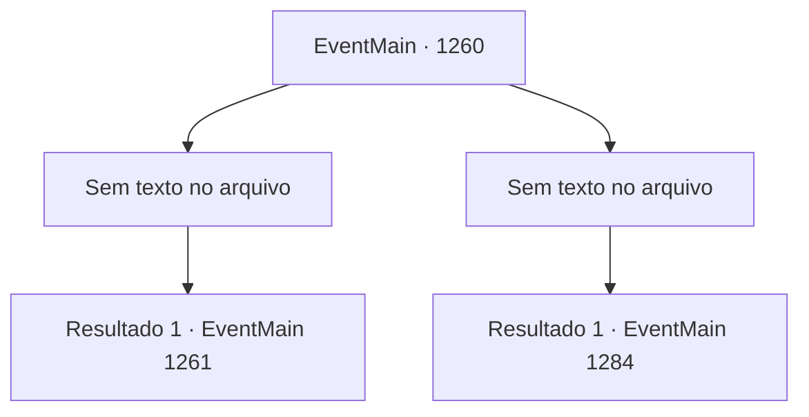

# Eventos principais · 1260

[Índice da tabela](index.md) · [Índice geral](../index.md)

ID: `pt:EventMain:1260` · Fonte: `EventMain4` · Versão: 1.2.47.

Mapeamento estático dos arquivos; a disponibilidade e a execução dependem do estado da run.

## Texto do evento

*Sem texto no arquivo.*

## Dados de entrada

```json
{
  "id": 1260,
  "grade": 1,
  "normalGoal": "",
  "required": ""
}
```

## Mapa das escolhas



## Escolhas e resultados

### Escolha 1

*Sem texto no arquivo; o papel dessa opção depende da interface do jogo.*

Requisitos e outros campos da escolha:

```json
{
  "required": ""
}
```

#### Resultado 1.1

Você e Kalman derrotam o cavaleiro que guarda a porta e seguem para a torre do castelo. Os soldados restantes devem ter ido para as muralhas externas, para conter os mortos-vivos. Você abre a porta e entra, chegando a um salão enorme. É tão luxuoso quanto na última vez em que o viu. Um lustre gigante pende do teto, e o piso de mármore reflete uma luz tênue. Mas nem uma única pessoa está visível agora. A torre parece assustadoramente silenciosa — talvez os civis também tenham se escondido. Logo, a caminho das escadas, Kalman sussurra para você. 

 "O escritório fica no terceiro andar."


Continuação registrada: [Evento 1261](1261.md) na mesma tabela.

```json
{
  "required": "",
  "chance": "1",
  "nextEvent": 1261,
  "type": 2,
  "reward": ""
}
```

### Escolha 2

*Sem texto no arquivo; o papel dessa opção depende da interface do jogo.*

Requisitos e outros campos da escolha:

```json
{
  "required": ""
}
```

#### Resultado 2.1

Você está cercado por cavaleiros. Incapaz de resistir à saraivada de ataques, você é derrubado de joelhos. Kalman te abandona, desaparecendo na escuridão. 

 Você finalmente recupera a consciência e abre os olhos. Percebe que suas mãos e pernas estão algemadas. Cada vez que você exala, baforadas brancas saem da sua boca. Lentamente, você olha ao redor. É uma prisão subterrânea escura e úmida. Pequenas poças de água se formam entre as pedras. 

 "Eu nunca esperava que nos encontraríamos assim novamente."

 Uma voz familiar vem do outro lado das grades de ferro. Você ergue o olhar e vê Katrin ali. A castelã do Castelo Greymoor te encara friamente. 

 "E eu aqui, pensando que fiz o suficiente para ganhar sua confiança."

 A voz dela ecoa pela prisão. 

 "Fomos amigos de infância, lembra? Eu queria que nossas Casas fossem aliadas. Mas é assim que você me retribui pela minha bondade?"

 Segue-se um breve silêncio. Katrin olha para você e continua. 

 "Por quê... justo assim?"


Continuação registrada: [Evento 1284](1284.md) na mesma tabela.

```json
{
  "required": "",
  "chance": "1",
  "nextEvent": 1284,
  "type": 2,
  "reward": ""
}
```

## Referências que chegam a este evento

- [Evento 1259 · escolha 1 · resultado 1](1259.md#escolha-1)
- [Evento 1259 · escolha 2 · resultado 2](1259.md#escolha-2)
- [Evento 1259 · escolha 3 · resultado 2](1259.md#escolha-3)
