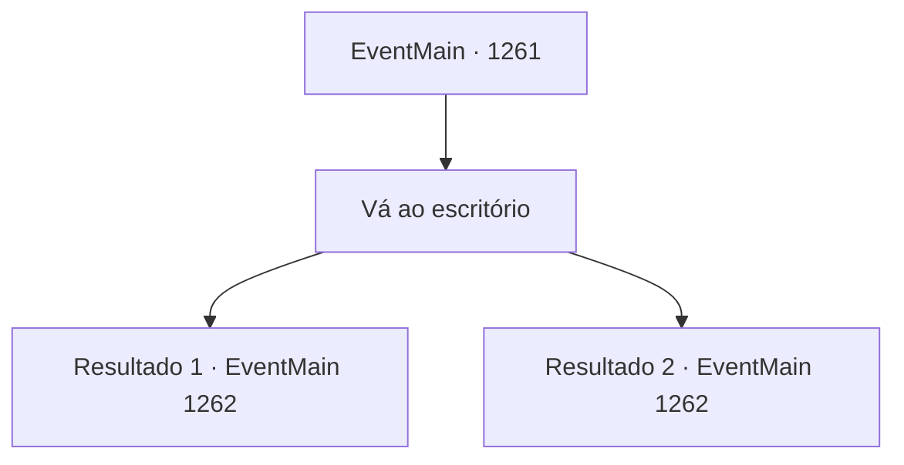

# Eventos principais · 1261

[Índice da tabela](index.md) · [Índice geral](../index.md)

ID: `pt:EventMain:1261` · Fonte: `EventMain4` · Versão: 1.2.47.

Mapeamento estático dos arquivos; a disponibilidade e a execução dependem do estado da run.

## Texto do evento

*Sem texto no arquivo.*

## Dados de entrada

```json
{
  "id": 1261,
  "grade": 1,
  "normalGoal": "",
  "required": ""
}
```

## Mapa das escolhas



## Escolhas e resultados

### Escolha 1

Vá ao escritório

Requisitos e outros campos da escolha:

```json
{
  "required": ""
}
```

#### Resultado 1.1

Você e Kalman caminham até o escritório. Lá dentro, vocês encontram Katrin e um cavaleiro de meia-idade discutindo planos. Katrin reconhece a presença e ergue o olhar. Lentamente, ela se levanta da cadeira. Ela olha para você, e então para Kalman. 

 "...Não esperava por você, vindo lá do Solar Briovich. E você trouxe o necromante também."

 Ela sorri amargamente e acrescenta. 

 "Heh. Então você escolheu agarrar a mão imunda dele afinal."

 Kalman responde imediatamente. 

 "Você ousa me chamar de imundo? Não fui eu que rastejou pelo esgoto pra chegar até aqui."

 Então, o cavaleiro ao lado de Katrin avança um passo. Você conhece seu nome. Sir Wojciech. Um cavaleiro leal a Katrin, que serviu à Casa Greymoor desde o governo do seu pai. 

 'DING! DING! DING!' 

 O som dos sinos ecoa lá fora. Você ouve passos pesados vindo do corredor. Kalman suspira e se vira. 

 "Tsc. Eu lido com os fracos."

 Wojciech lhe lança um olhar fulminante, rebaixando a postura. Em seguida, ele investe com sua espada, fechando a distância num piscar de olhos.

Continuação registrada: [Evento 1262](1262.md) na mesma tabela.

```json
{
  "required": "5_944_1",
  "chance": "1",
  "nextEvent": 1262,
  "type": 2,
  "reward": "6_0_205",
  "place": 10
}
```

#### Resultado 1.2

Você e Kalman caminham até o escritório. Lá dentro, vocês encontram Katrin e um cavaleiro de meia-idade discutindo planos. Katrin reconhece a presença e olha para cima. Lentamente, ela se levanta da cadeira. Ela olha para você, e então para Kalman. 

 "...Eu não esperava por vocês, vindo lá do Solar Briovich. E vocês trouxeram o necromante também."

 Ela sorri amargamente e acrescenta. 

 "Heh. Então no fim tudo se resume à batalha das Casas, hein?"

 Então, o cavaleiro que está ao lado de Katrin dá um passo à frente. Você sabe o nome dele. Sir Wojciech. Um cavaleiro leal a Katrin, que serve à Casa Greymoor desde o governo do seu pai. 

 'DING! DING! DING!' 

 O som dos sinos ecoa do lado de fora. Você ouve passos pesados vindo do corredor. Kalman suspira e se vira. 

 "Tsc. Eu me encarrego dos fracos."

 Wojciech lança um olhar severo para você, abaixando a postura. Então, ele investe com sua espada, fechando a distância num piscar de olhos.

Continuação registrada: [Evento 1262](1262.md) na mesma tabela.

```json
{
  "required": "18_944_1",
  "chance": "1",
  "nextEvent": 1262,
  "type": 2,
  "reward": "6_0_205",
  "place": 10
}
```

## Referências que chegam a este evento

- [Evento 1259 · escolha 2 · resultado 1](1259.md#escolha-2)
- [Evento 1259 · escolha 3 · resultado 1](1259.md#escolha-3)
- [Evento 1259 · escolha 3 · resultado 3](1259.md#escolha-3)
- [Evento 1260 · escolha 1 · resultado 1](1260.md#escolha-1)
