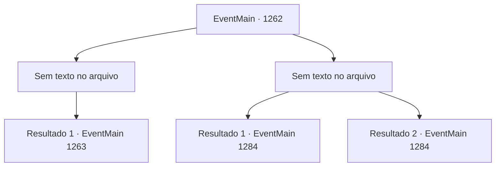

# Eventos principais · 1262

[Índice da tabela](index.md) · [Índice geral](../index.md)

ID: `pt:EventMain:1262` · Fonte: `EventMain4` · Versão: 1.2.47.

Mapeamento estático dos arquivos; a disponibilidade e a execução dependem do estado da run.

## Texto do evento

*Sem texto no arquivo.*

## Dados de entrada

```json
{
  "id": 1262,
  "grade": 1,
  "normalGoal": "",
  "required": ""
}
```

## Mapa das escolhas



## Escolhas e resultados

### Escolha 1

*Sem texto no arquivo; o papel dessa opção depende da interface do jogo.*

Requisitos e outros campos da escolha:

```json
{
  "required": ""
}
```

#### Resultado 1.1

Sir Wojciech balança sua espada, ensanguentado, gritando furiosamente. Em vez de desviar, você apará seus ataques e o derruba com um ataque. Você agarra seu braço e o derruba com seu peso. Wojciech cai no chão e perde a consciência. Você recupera o fôlego e se levanta. Kalman está limpando o sangue das mãos, eliminando os soldados sobreviventes. 

 "...Você está fora de si? Aliar-se a um necromante e atacar um nobre do reino? O que você está cometendo é alta traição."

 Você se vira para encarar Katrin. Ela está mordendo os lábios, lançando um olhar feroz para você. Kalman olha em seus olhos e diz algo que você não entende à primeira. 

 "Pahaha... Parece que você aprendeu a agir e falar como uma dama nobre, Ulrich Greymoor. Então, como está o corpo da sua filha?"

 Ele varre o cabelo bagunçado para trás e continua. 

 "Quem você acha que eu sou, hm? Já esqueceu que fui eu quem transferiu sua alma por você? Pare com essas teatralidades sem sentido. Eu não suporto isso."


Continuação registrada: [Evento 1263](1263.md) na mesma tabela.

```json
{
  "required": "",
  "chance": "1",
  "nextEvent": 1263,
  "type": 2,
  "reward": ""
}
```

### Escolha 2

*Sem texto no arquivo; o papel dessa opção depende da interface do jogo.*

Requisitos e outros campos da escolha:

```json
{
  "required": ""
}
```

#### Resultado 2.1

A arma de Sir Wojciech brilha. Com um impacto poderoso, sua arma é arremessada de suas mãos. Antes que você consiga se equilibrar, Sir Wojciech acerta seu queixo com o pomo da espada. Seu joelho falha, e sua visão se apaga. 

 "Tch. Pedaço inútil de carne."

 Kalman desaparece, abandonando você. 

 Você finalmente recobra a consciência e abre os olhos. Você nota que suas mãos e pernas estão algemadas. Cada vez que você exala, baforadas brancas saem da sua boca. Devagar, você olha ao redor. É uma prisão subterrânea escura e úmida. Pequenas poças de água se formam entre as pedras. 

 "Nunca esperei que nos encontraríamos assim de novo."

 Uma voz familiar vem do outro lado das grades de aço. Você ergue o olhar e encontra Katrin ali parada. A castelã do Castelo Greymoor olha para você friamente. 

 "E eu aqui, pensando que tinha feito o suficiente para merecer sua confiança."

 A voz dela ecoa pela prisão. 

 "Fomos amigas de infância, lembra? Queria que nossas Casas fossem aliadas. Mas é assim que você me retribui pela minha bondade?"

 Segue-se um breve silêncio. Katrin olha para você e continua. 

 "Só... por quê?"


Continuação registrada: [Evento 1284](1284.md) na mesma tabela.

```json
{
  "required": "5_944_1",
  "chance": "1",
  "nextEvent": 1284,
  "type": 2,
  "reward": "5_944_9"
}
```

#### Resultado 2.2

A arma de Sir Wojciech brilha. Com um impacto poderoso, sua arma é arremessada de suas mãos. Antes que você consiga se equilibrar, Sir Wojciech acerta seu queixo com o pomo da espada. Seu joelho falha, e sua visão se apaga. 

 "Tch. Pedaço inútil de carne."

 Kalman desaparece, abandonando você. 

 Você finalmente recobra a consciência e abre os olhos. Você nota que suas mãos e pernas estão algemadas. Cada vez que você exala, baforadas brancas saem da sua boca. Devagar, você olha ao redor. É uma prisão subterrânea escura e úmida. Pequenas poças de água se formam entre as pedras. 

 "Nunca esperei que nos encontraríamos assim de novo."

 Uma voz familiar vem do outro lado das grades de aço. Você ergue o olhar e encontra Katrin ali parada. A castelã do Castelo Greymoor olha para você friamente. 

 "E eu aqui, pensando que tinha feito o suficiente para merecer sua confiança."

 A voz dela ecoa pela prisão. 

 "Fomos amigas de infância, lembra? Queria que nossas Casas fossem aliadas. Mas é assim que você me retribui pela minha bondade?"

 Segue-se um breve silêncio. Katrin olha para você e continua. 

 "Só... por quê?"


Continuação registrada: [Evento 1284](1284.md) na mesma tabela.

```json
{
  "required": "18_944_1",
  "chance": "1",
  "nextEvent": 1284,
  "type": 2,
  "reward": ""
}
```

## Referências que chegam a este evento

- [Evento 1261 · escolha 1 · resultado 1](1261.md#escolha-1)
- [Evento 1261 · escolha 1 · resultado 2](1261.md#escolha-1)
