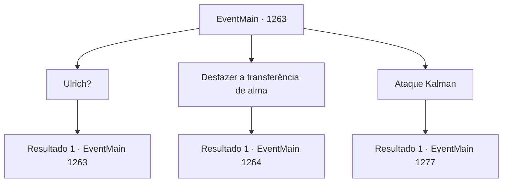

# Eventos principais · 1263

[Índice da tabela](index.md) · [Índice geral](../index.md)

ID: `pt:EventMain:1263` · Fonte: `EventMain4` · Versão: 1.2.47.

Mapeamento estático dos arquivos; a disponibilidade e a execução dependem do estado da run.

## Texto do evento

*Sem texto no arquivo.*

## Dados de entrada

```json
{
  "id": 1263,
  "grade": 1,
  "normalGoal": "",
  "required": ""
}
```

## Mapa das escolhas



## Escolhas e resultados

### Escolha 1

Ulrich?

Requisitos e outros campos da escolha:

```json
{
  "required": "5_946_0"
}
```

#### Resultado 1.1


 "Você me ouviu corretamente. Ulrich! Conde Ulrich Greymoor!"

 Você rememora. Ulrich Greymoor, o pai de Katrin Greymoor e o antigo Conde Greymoor. Pelo que você sabe, ele morreu alguns anos atrás. Kalman fita Katrin e fala. 

 "Ah, todo mundo achou que ele estava morto. Mas isso não é verdade. Na verdade, ele ainda vive. <color=red>Dentro do corpo de sua filha, Katrin Greymoor.</color>"

 Uma aura sombria começa a emanar de Kalman. 

 "Existe um feitiço secreto, guardado, na escola de necromancia. Chama-se Transferência de Alma - um feitiço que transfere a alma de alguém para outra pessoa, assumindo seus corpos."

 Kalman aponta para Katrin com o dedo. 

 "Ulrich me pediu para realizá-lo por ele. É assim que ele ainda está vivo."

 Kalman então aponta para o próprio pescoço e continua. 

 "Não é de se admirar que ele tenha tentado me matar antes."

 Katrin grita, furiosa. 

 "Vocês não estão falando sério em ouvir esse necromante insano, estão? Ele te manipulou para fazer isso?!"

 Katrin suspira. 

 "*suspiro*... Eu já te acusei perante a corte real, por cooperar com um necromante. Uma equipe de investigação será despachada a qualquer momento."

 Ela continua, mantendo a arrogância. 

 "No entanto, ainda não é tarde demais para você. Venha - junte-se a mim, e vamos derrotar Kalman de uma vez por todas. Você fizer isso, e eu não terei mais questionamentos. Além disso - prometo uma ajuda financeira substancial, para a reconstrução da Fazenda Briovich."

 Kalman cai na risada e responde. 

 "Ah, palavras, palavras, palavras. Irrelevante! Você verá o que quero dizer quando desfizer a Transferência de Alma."


Continuação registrada: [Evento 1263](1263.md) na mesma tabela.

```json
{
  "required": "",
  "chance": "1",
  "nextEvent": 1263,
  "type": 2,
  "reward": "5_946_1"
}
```

### Escolha 2

Desfazer a transferência de alma

Requisitos e outros campos da escolha:

```json
{
  "required": "5_946_1"
}
```

#### Resultado 2.1

Você acena, dizendo a Kalman para prosseguir. Kalman acena concordando. 

 "Bom. Agora, vamos ver..."

 Kalman revira seu saco de pano preto. Katrin puxa uma adaga prateada. 

 "F- FIQUE LONGE DE MIM!"

 Mas a resistência dela não dura muito. Kalman bate nela com o saco. 

 "Argh...!"

 Katrin cai no chão. Então, o saco se solta, e uma cabeça humana ressequida rola para fora dele. O fedor da morte enche a sala. Os olhos de Katrin se arregalam de choque. Kalman sorri, certo de que levou a melhor. 

 "Sim... Você reconhece. Quem você realmente é."

 Kalman acorrenta Katrin. Então, de seu saco, ele tira um pó de ossos e faz um círculo com ele ao redor dela. O círculo mágico se completa. Katrin se vira para olhar para você. Os olhos dela já estão injetados de sangue. 

 "T- isso é loucura! Por favor, por favor, me escute!"


Continuação registrada: [Evento 1264](1264.md) na mesma tabela.

```json
{
  "required": "",
  "chance": "1",
  "nextEvent": 1264,
  "type": 2,
  "reward": ""
}
```

### Escolha 3

Ataque Kalman

Requisitos e outros campos da escolha:

```json
{
  "required": "5_946_1"
}
```

#### Resultado 3.1

Você se afasta de Kalman e se põe ao lado de Katrin. Em seguida, você se vira para olhar para Kalman. As sobrancelhas dele se contraem. 

 "Ora, ora... Você é um idiota ainda maior do que eu pensava. Cansei de brincar com você."

 Uma aura sinistra se espalha do corpo dele. 

 "Se é a morte que você deseja, então assim seja!"


Continuação registrada: [Evento 1277](1277.md) na mesma tabela.

```json
{
  "required": "",
  "chance": "1",
  "nextEvent": 1277,
  "type": 2,
  "reward": "6_0_196",
  "place": 10
}
```

## Referências que chegam a este evento

- [Evento 1262 · escolha 1 · resultado 1](1262.md#escolha-1)
- [Evento 1263 · escolha 1 · resultado 1](1263.md#escolha-1)
