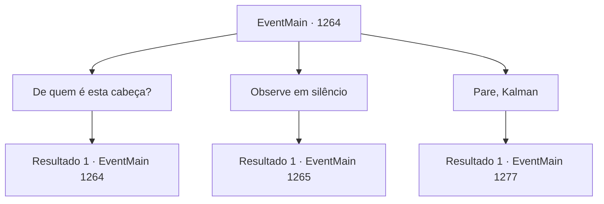

# Eventos principais · 1264

[Índice da tabela](index.md) · [Índice geral](../index.md)

ID: `pt:EventMain:1264` · Fonte: `EventMain4` · Versão: 1.2.47.

Mapeamento estático dos arquivos; a disponibilidade e a execução dependem do estado da run.

## Texto do evento

*Sem texto no arquivo.*

## Dados de entrada

```json
{
  "id": 1264,
  "grade": 1,
  "normalGoal": "",
  "required": ""
}
```

## Mapa das escolhas



## Escolhas e resultados

### Escolha 1

De quem é esta cabeça?

Requisitos e outros campos da escolha:

```json
{
  "required": "5_947_0"
}
```

#### Resultado 1.1

Kalman responde com indiferença. 

 "É do Ulrich, claro."

 Ele espalha mais pó de osso, completando um círculo mágico. Em seguida, ele tira uma garrafa de vidro e começa a desenhar um símbolo com sangue. 

 "Estou mandando-o de volta para o corpo ao qual pertence. Chama-se carma."

 Ele solta uma risadinha.

Continuação registrada: [Evento 1264](1264.md) na mesma tabela.

```json
{
  "required": "",
  "chance": "1",
  "nextEvent": 1264,
  "type": 2,
  "reward": "5_947_1"
}
```

### Escolha 2

Observe em silêncio

Requisitos e outros campos da escolha:

```json
{
  "required": "5_947_1"
}
```

#### Resultado 2.1

Você dá um passo para trás e observa o ritual de Kalman acontecer. Com os preparativos completos, Kalman começa uma invocação. O círculo mágico começa a emitir uma fumaça sinistra. O símbolo de sangue vermelho carmesim começa a brilhar. A voz de Katrin se mistura com a de um homem idoso. 

 "Não! NÃOOOOOO---!!"

 O corpo de Katrin treme e estremece. Fumaça branca sai de seus ouvidos e nariz. |drawing_katrineSoulDivide| Kalman a pega e empurra para dentro da cabeça murcha no chão. A fumaça branca é sugada pela boca, nariz e cavidades oculares da cabeça decapitada. Então, o círculo mágico perde o brilho. O corpo de Katrin perde a tensão. 

 "*ofegante*... *ofegante*..."

 Kalman enxuga o suor da testa, exausto. Ele se vira para você e fala. 

 "...Mate-a. Deixá-la viva só vai causar problemas depois."

 Então, você nota o corpo de Katrin convulsionando.

Continuação registrada: [Evento 1265](1265.md) na mesma tabela.

```json
{
  "required": "",
  "chance": "1",
  "nextEvent": 1265,
  "type": 2,
  "reward": ""
}
```

### Escolha 3

Pare, Kalman

Requisitos e outros campos da escolha:

```json
{
  "required": "5_947_1"
}
```

#### Resultado 3.1

Você distrai Kalman do ritual, atacando-o. Kalman desvia por pouco do seu ataque e grita com você furiosamente. 

 "V- VOCÊ IMBECIL...!"

 Uma aura sinistra se espalha de seu corpo. 

 "Se é a morte que você deseja, então assim seja!"


Continuação registrada: [Evento 1277](1277.md) na mesma tabela.

```json
{
  "required": "",
  "chance": "1",
  "nextEvent": 1277,
  "type": 2,
  "reward": "6_0_196",
  "place": 10
}
```

## Referências que chegam a este evento

- [Evento 1263 · escolha 2 · resultado 1](1263.md#escolha-2)
- [Evento 1264 · escolha 1 · resultado 1](1264.md#escolha-1)
