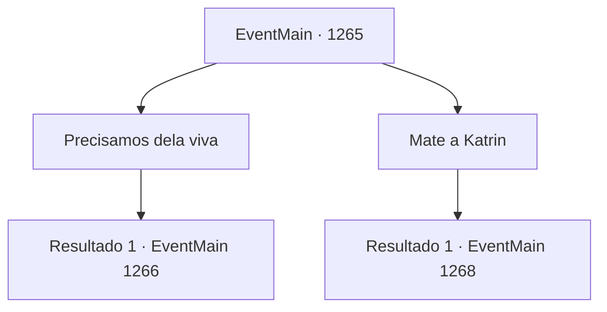

# Eventos principais · 1265

[Índice da tabela](index.md) · [Índice geral](../index.md)

ID: `pt:EventMain:1265` · Fonte: `EventMain4` · Versão: 1.2.47.

Mapeamento estático dos arquivos; a disponibilidade e a execução dependem do estado da run.

## Texto do evento

*Sem texto no arquivo.*

## Dados de entrada

```json
{
  "id": 1265,
  "grade": 1,
  "normalGoal": "",
  "required": ""
}
```

## Mapa das escolhas



## Escolhas e resultados

### Escolha 1

Precisamos dela viva

Requisitos e outros campos da escolha:

```json
{
  "required": ""
}
```

#### Resultado 1.1

Você impede Kalman, dizendo que matar Katrin não é a coisa certa a fazer. Suas sobrancelhas tremem. 

 "Ora, ora... Você é um idiota ainda maior do que eu pensava. Cansei de brincar com você."

 Uma aura sinistra se espalha de seu corpo. 

 "Se é a morte que você deseja, então que assim seja!"


Continuação registrada: [Evento 1266](1266.md) na mesma tabela.

```json
{
  "required": "",
  "chance": "1",
  "nextEvent": 1266,
  "type": 2,
  "reward": "6_0_196",
  "place": 10
}
```

### Escolha 2

Mate a Katrin

Requisitos e outros campos da escolha:

```json
{
  "required": ""
}
```

#### Resultado 2.1

Você pega a adaga de Katrin do chão. Então, você a crava no pescoço dela. Os olhos dela se abrem com dor. 

 "Gck...! Urgh....!"

 Com um curto gemido de dor, o sangue de Katrin encharca o tapete. O corpo dela treme por mais alguns segundos e fica imóvel. Kalman sorri, satisfeito. 

 "Bom trabalho. Precisamos voltar agora. Meus mortos-vivos não conseguirão segurá-los para sempre."

 Você e Kalman saem da fortaleza. O castelo ainda está em caos — a horda de mortos-vivos continua atacando os portões da frente, com toda a atenção dos soldados voltada para eles. Você e Kalman se esgueiram pela escuridão, mantendo-se na sombra da Fortaleza Greymoor. Ninguém percebe vocês, nem mesmo quando chegam à porta dos fundos.

Continuação registrada: [Evento 1268](1268.md) na mesma tabela.

```json
{
  "required": "",
  "chance": "1",
  "nextEvent": 1268,
  "type": 2,
  "reward": "0_3_-5"
}
```

## Referências que chegam a este evento

- [Evento 1264 · escolha 2 · resultado 1](1264.md#escolha-2)
