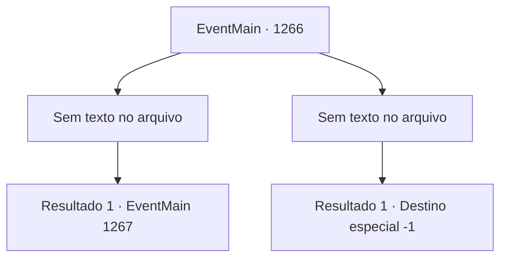

# Eventos principais · 1266

[Índice da tabela](index.md) · [Índice geral](../index.md)

ID: `pt:EventMain:1266` · Fonte: `EventMain4` · Versão: 1.2.47.

Mapeamento estático dos arquivos; a disponibilidade e a execução dependem do estado da run.

## Texto do evento

*Sem texto no arquivo.*

## Dados de entrada

```json
{
  "id": 1266,
  "grade": 1,
  "normalGoal": "",
  "required": ""
}
```

## Mapa das escolhas



## Escolhas e resultados

### Escolha 1

*Sem texto no arquivo; o papel dessa opção depende da interface do jogo.*

Requisitos e outros campos da escolha:

```json
{
  "required": ""
}
```

#### Resultado 1.1

Kalman se ajoelha no chão. Sangue escorre de sua boca. Ele reúne forças e dispara um espeto ósseo em direção a Katrin. Você corre até ela para bloqueá-lo, e Kalman pula pela janela. Você olha para fora, e Kalman já desapareceu na escuridão. Você volta para Katrin e a liberta das correntes. Uma gota de lágrima escorre pelos seus olhos. Por alguns minutos, ela não faz nada além de tremer, incapaz de falar. Você espera pacientemente ao lado dela, esperando que ela se acalme. 

 Alguns instantes se passam. Ela enxuga as lágrimas dos olhos e finalmente fala, embora com voz trêmula. 

 "Obrigada... por salvar minha vida..."

 Ela mal consegue vocalizar. 

 "E... minhas desculpas. O que meu pai fez... as atrocidades que cometeu com meu corpo... eu tive que assistir a tudo. E ainda assim eu não pude fazer nada, como se estivesse presa em um pesadelo sem fim."

 Ela se ajoelha no chão. 

 "Sua propriedade foi atacada, seu povo ferido... tudo por minha causa. Eu... honestamente não sei como retribuir."

 Sua voz continua a tremer. 

 "Minhas mais sinceras desculpas. Como matriarca da Casa Greymoor, prometo oficialmente compensar os danos causados à Fazenda Briovich."

 Ela se curva.

Continuação registrada: [Evento 1267](1267.md) na mesma tabela.

```json
{
  "required": "",
  "chance": "1",
  "nextEvent": 1267,
  "type": 2,
  "reward": ""
}
```

### Escolha 2

*Sem texto no arquivo; o papel dessa opção depende da interface do jogo.*

Requisitos e outros campos da escolha:

```json
{
  "required": ""
}
```

#### Resultado 2.1


 "Imbecil tolo. Você poderia ter sido útil por mais tempo..."

 Você tenta se levantar. Mas Kalman não hesita. Ele perfura seu pescoço com uma estaca de osso. Sua visão fica turva. Você distingue o sorriso de Kalman. O grito doloroso de Katrin é a última coisa que você ouve.

Continuação registrada: [Destino especial `-1`](../destinos-especiais.md).

```json
{
  "required": "",
  "chance": "1",
  "nextEvent": -1,
  "type": 2,
  "reward": "15_7_7|15_7_29|25_8_1"
}
```

## Referências que chegam a este evento

- [Evento 1265 · escolha 1 · resultado 1](1265.md#escolha-1)
