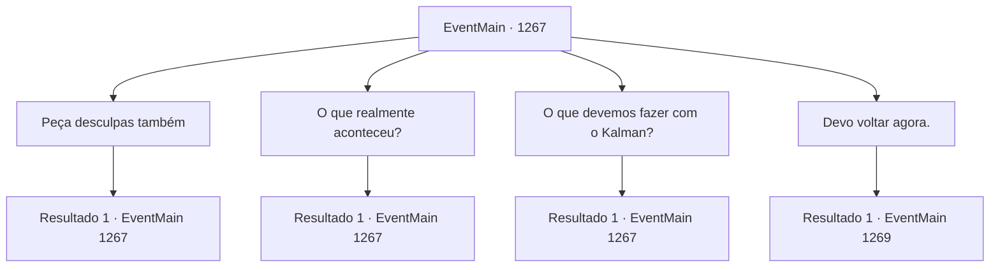

# Eventos principais · 1267

[Índice da tabela](index.md) · [Índice geral](../index.md)

ID: `pt:EventMain:1267` · Fonte: `EventMain4` · Versão: 1.2.47.

Mapeamento estático dos arquivos; a disponibilidade e a execução dependem do estado da run.

## Texto do evento

*Sem texto no arquivo.*

## Dados de entrada

```json
{
  "id": 1267,
  "grade": 1,
  "normalGoal": "",
  "required": ""
}
```

## Mapa das escolhas



## Escolhas e resultados

### Escolha 1

Peça desculpas também

Requisitos e outros campos da escolha:

```json
{
  "required": "5_948_0"
}
```

#### Resultado 1.1

Você se desculpa por ter se aliado a Kalman e atacado os soldados de Greymoor. Você admite que, em última instância, foi sua decisão cooperar com Kalman e lançar um ataque total ao Castelo Greymoor. Você promete compensar os soldados feridos e os familiares dos mortos. Katrin olha nos seus olhos por um momento. Então, ela pondera algo e balança a cabeça. 

 "Mas... se não fosse por essa decisão, eu ainda estaria presa sob o controle do meu pai. Então... vamos resolver algo juntos."


Continuação registrada: [Evento 1267](1267.md) na mesma tabela.

```json
{
  "required": "",
  "chance": "1",
  "nextEvent": 1267,
  "type": 2,
  "reward": "5_948_1"
}
```

### Escolha 2

O que realmente aconteceu?

Requisitos e outros campos da escolha:

```json
{
  "required": "5_949_0|5_948_1"
}
```

#### Resultado 2.1

Sua pergunta parece ter abalado Katrin. Ela fecha as mãos em punho, depois relaxa. 

 "Uma noite... meu pai me chamou para o quarto dele, para tomar chá. Bebi algo e tudo ficou turvo. Quando abri os olhos, estava dentro de um quarto escuro."

 Ela pega os ombros e os esfrega. 

 "Vi duas pessoas à minha frente. Meu pai e... um homem velho que eu nunca tinha visto antes. Ele tinha uma queimadura no rosto. Só descobri mais tarde... mas aquele homem era Kalman."

 Ela fecha os olhos. 

 "Kalman lançou uma espécie de feitiço... e algo branco saiu do corpo do meu pai. Depois, penetrou em mim. Eu... não consegui resistir. Tudo que pude fazer foi assistir enquanto aquilo entrava pela minha boca e nariz."

 Os cílios dela tremem. 

 "Quando abri os olhos de novo... eu... estava presa no meu próprio corpo. Eu ouvi tudo o que eu dizia. Vi minhas mãos se moverem... mas nenhum desses movimentos foi por minha vontade."

 Katrin encara os próprios dedos, como se conferisse novamente se recuperou o controle do corpo.

Continuação registrada: [Evento 1267](1267.md) na mesma tabela.

```json
{
  "required": "",
  "chance": "1",
  "nextEvent": 1267,
  "type": 2,
  "reward": "5_949_1"
}
```

### Escolha 3

O que devemos fazer com o Kalman?

Requisitos e outros campos da escolha:

```json
{
  "required": "5_950_0|5_948_1"
}
```

#### Resultado 3.1

Você pergunta a ela como lidar com Kalman. O olhar de Katrin segue você. 

 "Espero que ele volte. Pelo que presenciei, ele é um homem de ambição. Foi assim que tratou meu pai, assim tratou sua pesquisa. Enquanto ele viver, nossas propriedades nunca ficarão livres de vestígios de necromancia."

 Ela fecha as mãos em punhos. 

 "Estou pensando em contratar mais aventureiros e solicitar oficialmente ajuda do reino. Se clérigos e paladinos habilidosos da cidade capital puderem nos ajudar, tenho certeza de que poderemos resolver o problema dos mortos-vivos de uma vez por todas."

 Ela se vira para você. 

 "Vamos capturá-lo vivo e garantir que ele seja devidamente punido, de acordo com a lei do reino."


Continuação registrada: [Evento 1267](1267.md) na mesma tabela.

```json
{
  "required": "",
  "chance": "1",
  "nextEvent": 1267,
  "type": 2,
  "reward": "5_950_1"
}
```

### Escolha 4

Devo voltar agora.

Requisitos e outros campos da escolha:

```json
{
  "required": "5_948_1|5_949_1|5_950_1"
}
```

#### Resultado 4.1

Você termina de conversar com Katrin e decide voltar à propriedade Briovich. O barulho da batalha terminou. Logo, um cavaleiro de Greymoor entra no escritório. 

 "Meu senhor! A senhora está bem?!"

 Ele se ajoelha diante de Katrin. 

 "Os mortos-vivos recuaram! ...O quê!?"

 O olhar do cavaleiro salta de Katrin para você. Seu rosto fica nervoso, e ele alcança sua arma. Katrin o tranquiliza gentilmente. 

 "Não precisa se preocupar. Estou bem. Esta pessoa salvou minha vida."

 Katrin esfrega os olhos com as mangas e se levanta. Então, ela continua. 

 "Reúna alguns homens e, por favor, recupere os restos do Sir Wojciech. E prepare uma carroça, por favor. Vamos garantir um retorno seguro à propriedade Briovich — desloque alguns soldados como escolta também."

 O cavaleiro parece visivelmente confuso, mas inclina-se mesmo assim para seguir as ordens. 

 "Sim, minha senhora! Será feito."

 Ele apressa-se para fora do escritório. Você ouve o cavaleiro descendo as escadas correndo. Katrin observa sua saída e sorri amargamente. 

 "Meu pai governava com medo. O medo é o método mais eficaz de reinar, ele dizia. Mas não eu. Eu não quero isso."

 Ela fixa o olhar nas escadas agora vazias por um momento. Então, ela se volta para olhar para você. 

 "Venha, vou escoltá-lo até o quintal. A diligência ficará pronta em breve."


Continuação registrada: [Evento 1269](1269.md) na mesma tabela.

```json
{
  "required": "",
  "chance": "1",
  "nextEvent": 1269,
  "type": 2,
  "reward": ""
}
```

## Referências que chegam a este evento

- [Evento 1266 · escolha 1 · resultado 1](1266.md#escolha-1)
- [Evento 1267 · escolha 1 · resultado 1](1267.md#escolha-1)
- [Evento 1267 · escolha 2 · resultado 1](1267.md#escolha-2)
- [Evento 1267 · escolha 3 · resultado 1](1267.md#escolha-3)
