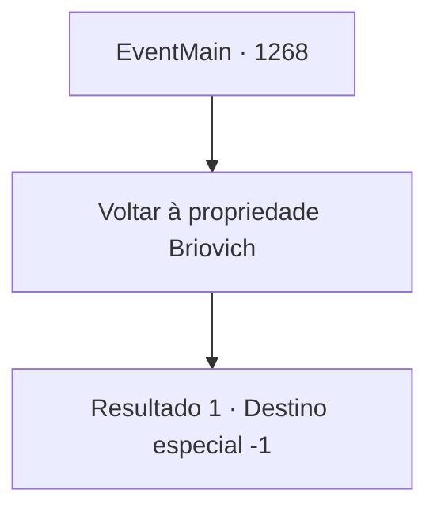

# Eventos principais · 1268

[Índice da tabela](index.md) · [Índice geral](../index.md)

ID: `pt:EventMain:1268` · Fonte: `EventMain4` · Versão: 1.2.47.

Mapeamento estático dos arquivos; a disponibilidade e a execução dependem do estado da run.

## Texto do evento

*Sem texto no arquivo.*

## Dados de entrada

```json
{
  "id": 1268,
  "grade": 1,
  "normalGoal": "",
  "required": ""
}
```

## Mapa das escolhas



## Escolhas e resultados

### Escolha 1

Voltar à propriedade Briovich

Requisitos e outros campos da escolha:

```json
{
  "required": ""
}
```

#### Resultado 1.1

A viagem de volta à propriedade Briovich levou mais tempo do que você esperava. É uma noite estrelada. Um vento frio sopra pelas planícies. 

 "Ei."

 Kalman chama você. 

 "Você e eu... Não há volta agora."

 Ele toca a cabeça decepada de Ulrich em seu colo com as coxas. 

 "Os inimigos da nossa grande Casa se foram. Todos eles SE FORAM!"

 Ele olha para você e assume uma expressão séria. 

 "Estou convencido de que posso confiar a você, com segurança, o cargo de Chefe da Casa."

 Ele respira e continua. 

 "Com uma condição. Rugarden Woods — desejo residir lá. É uma ruína abandonada, sim, mas também o lugar perfeito para pesquisar necromancia."

 Kalman se vira para frente e continua. 

 "Ficarei lá e continuarei minhas pesquisas. Deixarei os negócios da propriedade inteiramente a seu cargo."

 Ele está te oferecendo um acordo, concordando com um tratado de paz mútuo em troca de ocultação e proteção. Você ajusta a condição dele, exigindo que civis inocentes não sejam prejudicados. 

 "Certo. Aceito. Claro, a menos que algum curioso extra decida fuçar..."

 Kalman estende a mão. Você a aceita.

Continuação registrada: [Destino especial `-1`](../destinos-especiais.md).

```json
{
  "required": "",
  "chance": "1",
  "nextEvent": -1,
  "type": 2,
  "reward": "15_7_23|15_7_7"
}
```

## Referências que chegam a este evento

- [Evento 1265 · escolha 2 · resultado 1](1265.md#escolha-2)
