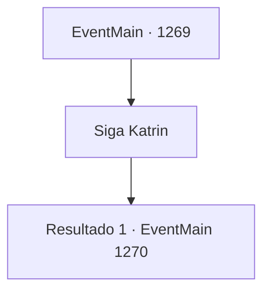

# Eventos principais · 1269

[Índice da tabela](index.md) · [Índice geral](../index.md)

ID: `pt:EventMain:1269` · Fonte: `EventMain4` · Versão: 1.2.47.

Mapeamento estático dos arquivos; a disponibilidade e a execução dependem do estado da run.

## Texto do evento

*Sem texto no arquivo.*

## Dados de entrada

```json
{
  "id": 1269,
  "grade": 1,
  "normalGoal": "",
  "required": ""
}
```

## Mapa das escolhas



## Escolhas e resultados

### Escolha 1

Siga Katrin

Requisitos e outros campos da escolha:

```json
{
  "required": ""
}
```

#### Resultado 1.1

Você segue Katrin até o pátio. Logo, diligências e escoltas são preparadas. Depois de vê-lo subir na diligência, Katrin fala. 

 "Bem, então. Vou visitá-lo assim que as coisas se acertarem. Afinal, precisamos discutir compensações e a questão do Kalman."

 A diligência começa a se mover com um pequeno rangido. Você passa pelo castelo interno, pela estrada principal e pelos portões externos do castelo. Passa-se cerca de uma hora. Você aproveita a brisa da noite, olhando pela janela da diligência. Então, você percebe o cheiro de sangue no ar. Um grito agudo segue. 

 "ARGGH!! É UM MONSTRO!!"

 Rapidamente, você olha para fora. Uma horda de mortos-vivos investe contra sua diligência, emergindo da escuridão. O chão se abre, enquanto um necrotitan aparece. Ele lança seu enorme corpo contra a diligência em que você está.

Continuação registrada: [Evento 1270](1270.md) na mesma tabela.

```json
{
  "required": "",
  "chance": "1",
  "nextEvent": 1270,
  "type": 2,
  "reward": ""
}
```

## Referências que chegam a este evento

- [Evento 1267 · escolha 4 · resultado 1](1267.md#escolha-4)
