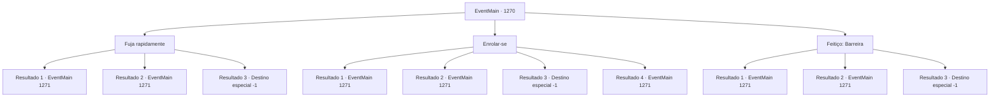

# Eventos principais · 1270

[Índice da tabela](index.md) · [Índice geral](../index.md)

ID: `pt:EventMain:1270` · Fonte: `EventMain4` · Versão: 1.2.47.

Mapeamento estático dos arquivos; a disponibilidade e a execução dependem do estado da run.

## Texto do evento

*Sem texto no arquivo.*

## Dados de entrada

```json
{
  "id": 1270,
  "grade": 1,
  "normalGoal": "",
  "required": ""
}
```

## Mapa das escolhas



## Escolhas e resultados

### Escolha 1

Fuja rapidamente

Requisitos e outros campos da escolha:

```json
{
  "required": ""
}
```

#### Resultado 1.1

Sua diligência tomba. Imediatamente, você chuta a porta e salta para fora. Você rola pelo chão. Quando você se levanta novamente, a diligência está se despedaçando, enquanto o punho gigante do necrótitan desaba sobre ela. Estilhaços de madeira são arremessados pelo ar. Os cavalos são arrancados do chão. Você não ousa olhar ao redor, enquanto gritos e guinchos preenchem o ar. A horda de mortos-vivos de Kalman está atacando os soldados de Greymoor. Esqueletos brandem suas espadas, e necrófagos mordem seus pescoços. Kalman aparece das sombras. 

 "Serei simples e claro. Devolva. Meu. Título."

 Ele levanta o braço, e o necrótitan se vira para encará-lo. Seus pés gigantes golpeiam o chão, lançando-se contra você.

Continuação registrada: [Evento 1271](1271.md) na mesma tabela.

```json
{
  "required": "",
  "chance": "1|0_6_1",
  "nextEvent": 1271,
  "type": 0,
  "reward": "6_3_184",
  "place": 13
}
```

#### Resultado 1.2

Sua diligência tomba. Você não consegue escapar. O punho gigante do necrotitan cai sobre ela, esmagando você junto com a diligência. Você rola pelo chão, atingido pelo impacto. Você sente terra e grama na boca. Você rasteja para fora dos destroços e se levanta novamente, apenas para encontrar o necrotitan em pé diante de você. Você não ousa olhar ao redor, enquanto gritos e urros enchem o ar. A horda de mortos-vivos de Kalman está atacando os soldados de Greymoor. Esqueletos brandem suas espadas, e ghouls mordem seus pescoços. Kalman surge das sombras. 

 "Vou ser direto e claro. Devolva. Meu. Título."

 Ele ergue o braço, e o necrotitan se vira para encará-lo. Seus pés gigantes chutam o chão, lançando-se contra você.

Continuação registrada: [Evento 1271](1271.md) na mesma tabela.

```json
{
  "required": "1_0_2",
  "chance": "20",
  "nextEvent": 1271,
  "type": 1,
  "reward": "0_0_-1|6_3_184",
  "place": 13
}
```

#### Resultado 1.3

O punho gigante do necrotitã cai sobre você, esmagando-o junto com a diligência. Sua visão fica vermelha, e seus membros não obedecem. Kalman se aproxima, agacha-se ao seu lado e fala. 

 "Oh, não fique tão triste agora. Vou fazer bom uso da sua carne."

 Então, a aura negra vinda de seu corpo o envolve. Uma dor lancinante se espalha pelo seu corpo, enquanto você dá seu último suspiro.

Continuação registrada: [Destino especial `-1`](../destinos-especiais.md).

```json
{
  "required": "2_0_2",
  "chance": "20",
  "nextEvent": -1,
  "type": 1,
  "reward": "0_0_-1|15_7_22|15_7_24|25_8_1"
}
```

### Escolha 2

Enrolar-se

Requisitos e outros campos da escolha:

```json
{
  "required": ""
}
```

#### Resultado 2.1

Sua diligência tomba. O punho gigante do necrotitan cai sobre ela, esmagando você junto com a diligência. Estilhaços de madeira são lançados no ar. Os cavalos são arremessados para fora do chão. Mas você sai caminhando sem um único ferimento. Você não ousa olhar ao redor, enquanto gritos e urros enchem o ar. A horda de mortos-vivos de Kalman está atacando os soldados de Greymoor. Esqueletos brandem suas espadas, e ghouls mordem seus pescoços. Kalman aparece das sombras. 

 "Vou manter isto simples e claro. Devolva. Meu. Título."

 Ele ergue o braço, e o necrotitan se vira para encarar você. Seus pés gigantes chutam o chão, lançando-se em sua direção.

Continuação registrada: [Evento 1271](1271.md) na mesma tabela.

```json
{
  "required": "21_9_1",
  "chance": "1|0_13_1",
  "nextEvent": 1271,
  "type": 0,
  "reward": "6_3_184",
  "place": 13
}
```

#### Resultado 2.2

O punho gigante do necrotitan desaba sobre ele, esmagando você junto com a diligência. Você rola pelo chão, preso no impacto. Você sente terra e grama na boca. Você rasteja para fora dos destroços e se levanta, apenas para encontrar o necrotitan parado diante de você. Você não ousa olhar ao redor, pois gritos e alaridos enchem o ar. A horda de mortos-vivos de Kalman está atacando os soldados de Greymoor. Esqueletos balançam suas espadas, e necrófagos mordem seus pescoços. Kalman aparece das sombras. 

 "Vou ser simples e direto. Devolva. O. Meu. Título."

 Ele levanta o braço, e o necrotitan se vira para encará-lo. Seus pés gigantes chutam contra o chão, lançando-o em sua direção.

Continuação registrada: [Evento 1271](1271.md) na mesma tabela.

```json
{
  "required": "1_0_2|21_9_1",
  "chance": "20",
  "nextEvent": 1271,
  "type": 1,
  "reward": "0_0_-1|6_3_184",
  "place": 13
}
```

#### Resultado 2.3

O punho gigante do necrotitã cai sobre você, esmagando-o junto com a diligência. Sua visão fica vermelha, e seus membros não obedecem. Kalman se aproxima, agacha-se ao seu lado e fala. 

 "Oh, não fique tão triste agora. Vou fazer bom uso da sua carne."

 Então, a aura negra vinda de seu corpo o envolve. Uma dor lancinante se espalha pelo seu corpo, enquanto você dá seu último suspiro.

Continuação registrada: [Destino especial `-1`](../destinos-especiais.md).

```json
{
  "required": "2_0_2|21_9_1",
  "chance": "20",
  "nextEvent": -1,
  "type": 1,
  "reward": "0_0_-1|15_7_22|15_7_24|25_8_1"
}
```

#### Resultado 2.4

O punho gigante do necrotitan desaba sobre ele, esmagando você junto com a diligência. Você rola pelo chão, preso no impacto. Você sente terra e grama na boca. Você rasteja para fora dos destroços e se levanta, apenas para encontrar o necrotitan parado diante de você. Você não ousa olhar ao redor, pois gritos e alaridos enchem o ar. A horda de mortos-vivos de Kalman está atacando os soldados de Greymoor. Esqueletos balançam suas espadas, e necrófagos mordem seus pescoços. Kalman aparece das sombras. 

 "Vou ser simples e direto. Devolva. O. Meu. Título."

 Ele levanta o braço, e o necrotitan se vira para encará-lo. Seus pés gigantes chutam contra o chão, lançando-o em sua direção.

Continuação registrada: [Evento 1271](1271.md) na mesma tabela.

```json
{
  "required": "20_9_1",
  "chance": "1",
  "nextEvent": 1271,
  "type": 2,
  "reward": "6_3_184",
  "place": 13
}
```

### Escolha 3

Feitiço: Barreira

Requisitos e outros campos da escolha:

```json
{
  "required": "1_1_2|20_0_2"
}
```

#### Resultado 3.1

Sua diligência inclina. Você rapidamente conjura um feitiço, formando uma barreira ao seu redor. O punho gigante do necrotitã desaba sobre ela, esmagando você junto com a diligência. Lascações de madeira voam pelo ar. Os cavalos são arrancados do chão. Mas você sai sem um único ferimento. Você não ousa olhar ao redor, pois gritos e urros enchem o ar. A horda de mortos-vivos de Kalman está atacando os soldados de Greymoor. Esqueletos brandem suas espadas, e necrófagos mordem seus pescoços. Kalman aparece das sombras. 

 "Vou ser simples e claro. Me. Devolva. Meu. Título."

 Ele ergue o braço, e o necrotitã se vira para encará-lo. Seus pés gigantes chutam o chão, lançando-se em sua direção.

Continuação registrada: [Evento 1271](1271.md) na mesma tabela.

```json
{
  "required": "",
  "chance": "1|0_14_1",
  "nextEvent": 1271,
  "type": 0,
  "reward": "6_3_184|0_1_-1",
  "place": 13
}
```

#### Resultado 3.2

Sua diligência inclina. Você rapidamente conjura um feitiço, tentando formar uma barreira ao seu redor, mas não é rápido o bastante. O punho gigante do necrotitan desaba sobre ela, esmagando você junto com a diligência. Estilhaços de madeira são arremessados pelo ar. Os cavalos são levantados do chão. Mas você sai sem um único ferimento. Você não ousa olhar ao redor, enquanto gritos e lamentos enchem o ar. A horda de mortos-vivos de Kalman está atacando os soldados de Greymoor. Esqueletos balançam suas espadas, e carniçais mordem seus pescoços. Kalman surge das sombras. 

 "Vou ser direto e claro. Me. Devolva. Meu. Título."

 Ele ergue o braço, e o necrotitan se vira para encará-lo. Seus pés gigantes chutam o chão, lançando-o em sua direção.

Continuação registrada: [Evento 1271](1271.md) na mesma tabela.

```json
{
  "required": "1_0_2",
  "chance": "20",
  "nextEvent": 1271,
  "type": 1,
  "reward": "0_0_-1|6_3_184",
  "place": 13
}
```

#### Resultado 3.3

O punho gigante do necrotitã cai sobre você, esmagando-o junto com a diligência. Sua visão fica vermelha, e seus membros não obedecem. Kalman se aproxima, agacha-se ao seu lado e fala. 

 "Oh, não fique tão triste agora. Vou fazer bom uso da sua carne."

 Então, a aura negra vinda de seu corpo o envolve. Uma dor lancinante se espalha pelo seu corpo, enquanto você dá seu último suspiro.

Continuação registrada: [Destino especial `-1`](../destinos-especiais.md).

```json
{
  "required": "2_0_2",
  "chance": "1",
  "nextEvent": -1,
  "type": 2,
  "reward": "0_0_-1|15_7_22|15_7_24|25_8_1"
}
```

## Referências que chegam a este evento

- [Evento 1269 · escolha 1 · resultado 1](1269.md#escolha-1)
