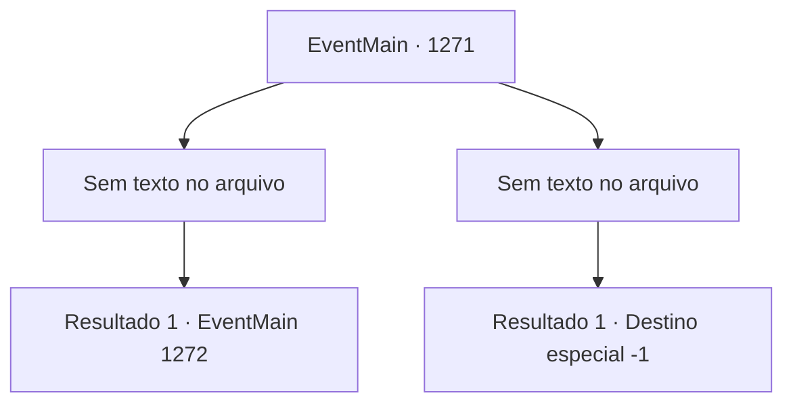

# Eventos principais · 1271

[Índice da tabela](index.md) · [Índice geral](../index.md)

ID: `pt:EventMain:1271` · Fonte: `EventMain4` · Versão: 1.2.47.

Mapeamento estático dos arquivos; a disponibilidade e a execução dependem do estado da run.

## Texto do evento

*Sem texto no arquivo.*

## Dados de entrada

```json
{
  "id": 1271,
  "grade": 1,
  "normalGoal": "",
  "required": ""
}
```

## Mapa das escolhas



## Escolhas e resultados

### Escolha 1

*Sem texto no arquivo; o papel dessa opção depende da interface do jogo.*

Requisitos e outros campos da escolha:

```json
{
  "required": ""
}
```

#### Resultado 1.1

Você destrói o corpo do necrotitã. A enorme pilha de ossos desaba ruidosamente. Enquanto a poeira assenta, você vê Kalman em pé além dos escombros. Os soldados de Greymoor ainda estão ocupados lutando contra os mortos-vivos. Você está completamente sozinho. Kalman fala, massageando o pescoço. 

 "Que tenaz você é..."

 Ele ri. 

 "Lute mais, então! ENTRETENHA-ME!"

 Enquanto Kalman ergue o punho, uma aura sinistra emana de seu corpo. A enorme pilha de fragmentos de osso começa a flutuar. Centenas, milhares de fragmentos de osso vibram no ar. Então, eles são lançados simultaneamente contra você.

Continuação registrada: [Evento 1272](1272.md) na mesma tabela.

```json
{
  "required": "",
  "chance": "1",
  "nextEvent": 1272,
  "type": 2,
  "reward": "6_0_196",
  "place": 13
}
```

### Escolha 2

*Sem texto no arquivo; o papel dessa opção depende da interface do jogo.*

Requisitos e outros campos da escolha:

```json
{
  "required": ""
}
```

#### Resultado 2.1

Você é nocauteado pelo punho gigante do necroritã. Você é lançado ao chão. Sem hesitar, ele te esmaga com seu pé gigante. Uma dor imensa se espalha enquanto todos os ossos do seu corpo se quebram. Você não consegue respirar. Sua visão fica vermelha. 

 "Oh, não fique tão triste agora. Vou fazer bom uso da sua carne."

 A luz se apaga, e a voz de Kalman desaparece.

Continuação registrada: [Destino especial `-1`](../destinos-especiais.md).

```json
{
  "required": "",
  "chance": "1",
  "nextEvent": -1,
  "type": 2,
  "reward": "0_0_-1|0_1_-1|15_7_22|15_7_24|25_8_1"
}
```

## Referências que chegam a este evento

- [Evento 1270 · escolha 1 · resultado 1](1270.md#escolha-1)
- [Evento 1270 · escolha 1 · resultado 2](1270.md#escolha-1)
- [Evento 1270 · escolha 2 · resultado 1](1270.md#escolha-2)
- [Evento 1270 · escolha 2 · resultado 2](1270.md#escolha-2)
- [Evento 1270 · escolha 2 · resultado 4](1270.md#escolha-2)
- [Evento 1270 · escolha 3 · resultado 1](1270.md#escolha-3)
- [Evento 1270 · escolha 3 · resultado 2](1270.md#escolha-3)
