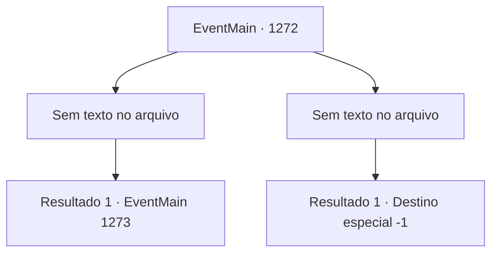

# Eventos principais · 1272

[Índice da tabela](index.md) · [Índice geral](../index.md)

ID: `pt:EventMain:1272` · Fonte: `EventMain4` · Versão: 1.2.47.

Mapeamento estático dos arquivos; a disponibilidade e a execução dependem do estado da run.

## Texto do evento

*Sem texto no arquivo.*

## Dados de entrada

```json
{
  "id": 1272,
  "grade": 1,
  "normalGoal": "",
  "required": ""
}
```

## Mapa das escolhas



## Escolhas e resultados

### Escolha 1

*Sem texto no arquivo; o papel dessa opção depende da interface do jogo.*

Requisitos e outros campos da escolha:

```json
{
  "required": ""
}
```

#### Resultado 1.1


 "I- Eu...!"

 Kalman se ajoelha no chão, tentando tirar palavras da boca. Sangue pinga sobre suas queimaduras. 

 "Eu... sou o único e verdadeiro Conde Briovich...! Não eu... Deveria ter sido EU...!"

 Lentamente, você se aproxima de Kalman. Ele olha para você com os olhos injetados de sangue. Seus braços trêmulos se estendem na sua direção, mas logo caem. 

 "*tosse*...!"

 Ele vomita sangue no chão e desmaia. Seu corpo não se move mais. A área fica em silêncio. Logo, você ouve o som de algo desmoronando ao seu redor. Toda a horda de mortos-vivos para. Esqueletos perdem suas estruturas e caem. Carniçais param de se mover e tombam no chão. Os soldados de Greymoor ofegam, finalmente largando suas armas. 

 "E- Estamos vivos...!"

 O céu a leste vai clareando. O sol nasce além do horizonte. Raios de sol se estendem pelas planícies, iluminando você. Exausto, você continua a pé em direção ao Solar Briovich.

Continuação registrada: [Evento 1273](1273.md) na mesma tabela.

```json
{
  "required": "",
  "chance": "1",
  "nextEvent": 1273,
  "type": 2,
  "reward": ""
}
```

### Escolha 2

*Sem texto no arquivo; o papel dessa opção depende da interface do jogo.*

Requisitos e outros campos da escolha:

```json
{
  "required": ""
}
```

#### Resultado 2.1

Você é forçado a se ajoelhar diante de Kalman. Ele se aproxima de você com um sorriso malicioso. 

 "Ah, não fique tão triste agora. Vou dar bom uso à sua carne."

 Ele segura uma estaca afiada de osso nas mãos. Ele aperta mais a mão em torno dela e a crava em seu pescoço. Sangue carmesim jorra do seu pescoço. Sua visão fica vermelha e logo tudo escurece. A risada de Kalman vai se apagando.

Continuação registrada: [Destino especial `-1`](../destinos-especiais.md).

```json
{
  "required": "",
  "chance": "1",
  "nextEvent": -1,
  "type": 2,
  "reward": "0_0_-1|0_1_-1|15_7_22|15_7_24|25_8_1"
}
```

## Referências que chegam a este evento

- [Evento 1271 · escolha 1 · resultado 1](1271.md#escolha-1)
