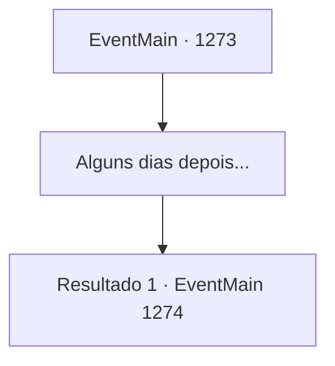

# Eventos principais · 1273

[Índice da tabela](index.md) · [Índice geral](../index.md)

ID: `pt:EventMain:1273` · Fonte: `EventMain4` · Versão: 1.2.47.

Mapeamento estático dos arquivos; a disponibilidade e a execução dependem do estado da run.

## Texto do evento

*Sem texto no arquivo.*

## Dados de entrada

```json
{
  "id": 1273,
  "grade": 1,
  "normalGoal": "",
  "required": ""
}
```

## Mapa das escolhas



## Escolhas e resultados

### Escolha 1

Alguns dias depois...

Requisitos e outros campos da escolha:

```json
{
  "required": ""
}
```

#### Resultado 1.1

É fim de tarde, e você está revendo documentos em seu escritório. Pilhas de papéis estão empilhadas em sua mesa - nomeação de novos vassalos, relatórios sobre a colheita de grãos, tratamento médico e compensação para os soldados, reparos nas muralhas do castelo e mais. Enquanto você molha sua pena na tinta, ouve duas batidas na porta. 

 "Condessa Greymoor está aqui, meu senhor."

 É Rennart. Você abre a porta para receber Katrin. 

 "Faz tempo, não é?"

 Ela veste uma roupa casual, mas bem arrumada. O cabelo dela está preso em uma única trança, caindo sobre o ombro. Rennart traz um bule e duas xícaras. Ele serve chá nas duas xícaras e as coloca frente a frente, depois fica atrás de você. Você e Katrin se sentam, um em frente ao outro. O sol do final da tarde lança sua luz através das janelas, projetando uma pequena sombra sobre a escrivaninha. 

 "Como você tem estado?"

 Katrin segura a xícara com as mãos. Ela sente o calor se espalhando pela pele.

Continuação registrada: [Evento 1274](1274.md) na mesma tabela.

```json
{
  "required": "",
  "chance": "1",
  "nextEvent": 1274,
  "type": 2,
  "reward": ""
}
```

## Referências que chegam a este evento

- [Evento 1272 · escolha 1 · resultado 1](1272.md#escolha-1)
