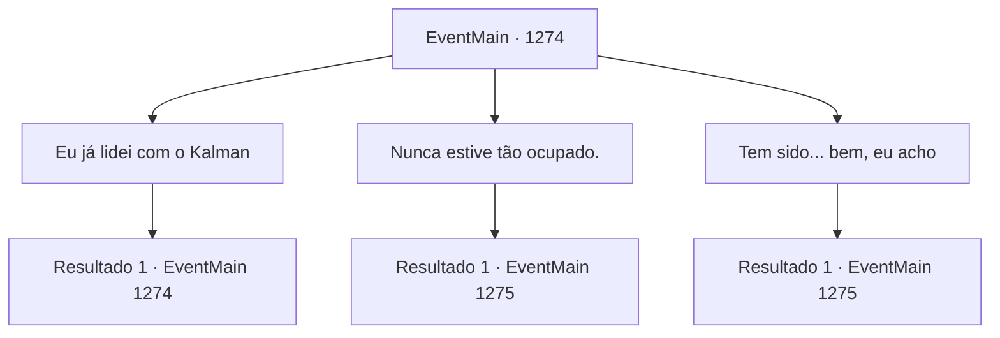

# Eventos principais · 1274

[Índice da tabela](index.md) · [Índice geral](../index.md)

ID: `pt:EventMain:1274` · Fonte: `EventMain4` · Versão: 1.2.47.

Mapeamento estático dos arquivos; a disponibilidade e a execução dependem do estado da run.

## Texto do evento

*Sem texto no arquivo.*

## Dados de entrada

```json
{
  "id": 1274,
  "grade": 1,
  "normalGoal": "",
  "required": ""
}
```

## Mapa das escolhas



## Escolhas e resultados

### Escolha 1

Eu já lidei com o Kalman

Requisitos e outros campos da escolha:

```json
{
  "required": "5_951_0"
}
```

#### Resultado 1.1

Você diz a ela que foi emboscado por Kalman, mas conseguiu derrotá-lo. Seus dedos finos batem repetidamente na xícara. 

 "Ouvi sim, pelos soldados que o acompanharam. Eu teria enviado reforços imediatamente, se soubesse que uma emboscada ocorreria. Sinto muito por não ter sido de muita ajuda."

 Katrin ergue a xícara e toma um gole. 

 "Só fui dormir depois que soube da sua volta em segurança. Você não faz ideia de como fiquei feliz ao ouvir isso."


Continuação registrada: [Evento 1274](1274.md) na mesma tabela.

```json
{
  "required": "",
  "chance": "1",
  "nextEvent": 1274,
  "type": 2,
  "reward": "5_951_1"
}
```

### Escolha 2

Nunca estive tão ocupado.

Requisitos e outros campos da escolha:

```json
{
  "required": ""
}
```

#### Resultado 2.1

Você adiciona um pouco de humor e responde em tom de brincadeira. Katrin se ilumina, sorrindo. 

 "Bem, eu também!"

 Seu olhar demora sobre você, depois volta para a xícara. 

 "A primeira coisa que fiz foi me apresentar diante do meu povo. Expliquei o que aconteceu na propriedade e contei a eles meus planos para o futuro."

 Ela continua a encarar a xícara. 

 "Também tive uma reunião pessoal com cada um dos meus vassalos. Eles ficaram espantados com a súbita mudança das coisas... Claro, eu não pude contar TUDO, mas felizmente foram todos muito compreensivos."

 Katrin faz uma pausa. Sua sombra cai sobre a superfície da xícara de chá. 

 "Ainda há muito mais a fazer. Mas... juro que vou pôr as coisas em ordem, uma por uma."

 Ela olha para você. 

 "Tudo isso graças a você, {1}."

 Katrin coloca a xícara. 

 "Então, venho a você hoje com uma proposta."

 Ela ajusta a postura e continua. 

 "Desejo formalizar um pacto oficial de cooperação entre nossas duas propriedades. Como sinal de pedido de desculpas, a Casa Greymoor cobrirá todas as despesas necessárias para a construção de novas rotas comerciais."


Continuação registrada: [Evento 1275](1275.md) na mesma tabela.

```json
{
  "required": "",
  "chance": "1",
  "nextEvent": 1275,
  "type": 2,
  "reward": ""
}
```

### Escolha 3

Tem sido... bem, eu acho

Requisitos e outros campos da escolha:

```json
{
  "required": ""
}
```

#### Resultado 3.1

Você responde com calma, dizendo a ela que você está bem. Katrin acena e responde. 

 "Entendo. Eu... nunca estive tão ocupada, honestamente!"

 O olhar dela paira em você, depois volta para sua xícara. 

 "A primeira coisa que fiz foi me apresentar perante o meu povo. Expliquei o que aconteceu na propriedade e contei a eles meus planos para o futuro."

 Ela continua a olhar para a xícara. 

 "Tive também uma reunião particular com cada um dos meus vassalos. Eles ficaram pasmos com a súbita mudança das coisas... Claro, eu não poderia contar TUDO a eles, mas felizmente foram todos muito compreensivos."

 Katrin faz uma pausa por um momento. A sombra dela cai sobre a superfície da xícara de chá. 

 "Há muito mais a fazer. Mas... juro que vou consertar as coisas, uma por uma."

 Ela olha para você. 

 "É tudo graças a você, {1}."

 Katrin põe a xícara sobre a mesa. 

 "Então, venho a você hoje com uma proposta."

 Ela ajusta a postura e continua. 

 "Desejo formar um pacto oficial de cooperação entre nossos dois domínios. Como sinal de pedido de desculpas, a Casa Greymoor cobrirá todas as despesas necessárias na construção de novas rotas comerciais."


Continuação registrada: [Evento 1275](1275.md) na mesma tabela.

```json
{
  "required": "",
  "chance": "1",
  "nextEvent": 1275,
  "type": 2,
  "reward": ""
}
```

## Referências que chegam a este evento

- [Evento 1273 · escolha 1 · resultado 1](1273.md#escolha-1)
- [Evento 1274 · escolha 1 · resultado 1](1274.md#escolha-1)
