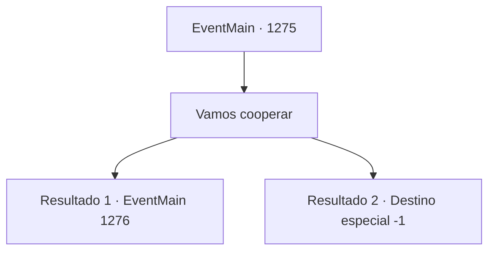

# Eventos principais · 1275

[Índice da tabela](index.md) · [Índice geral](../index.md)

ID: `pt:EventMain:1275` · Fonte: `EventMain4` · Versão: 1.2.47.

Mapeamento estático dos arquivos; a disponibilidade e a execução dependem do estado da run.

## Texto do evento

*Sem texto no arquivo.*

## Dados de entrada

```json
{
  "id": 1275,
  "grade": 1,
  "normalGoal": "",
  "required": ""
}
```

## Mapa das escolhas



## Escolhas e resultados

### Escolha 1

Vamos cooperar

Requisitos e outros campos da escolha:

```json
{
  "required": ""
}
```

#### Resultado 1.1

Você aceita a proposta de Katrin. Um ar de alívio ilumina seu rosto. 

 "Obrigada. Isso é... ótimo de ouvir."

 Ela segura a xícara de chá com as mãos. 

 "Deixarei nossos mordomos cuidarem dos detalhes. As medições começarão no mês que vem... e poderemos trabalhar juntos nos reparos das estradas também."

 Katrin toma outro gole da xícara. 

 "Nunca vou esquecer isso. Você não apenas salvou minha vida, {1}, mas você... me devolveu a vida. Meu corpo. Quem eu realmente sou."

 Ela tenta dizer algo, hesita e finalmente abre a boca novamente. 

 "E... mais uma coisa."

 Ela começa a roçar os dedos na xícara. 

 "...A Casa Greymoor não tem herdeiro adequado no momento. O futuro da minha Casa está em risco. Outras Casas continuarão a nos importunar, sem contar outros perigos como monstros. Estou bem ciente das dificuldades financeiras da Casa Briovich também! Você sempre esteve tão ocupado defendendo-nos dos perigos externos..."

 Katrin endireita as costas e ajusta a postura mais uma vez. 

 "Eu gostaria de... pedir sua mão em casamento, {1}."

 Segue um breve silêncio. Os olhos de Rennart se arregalam. Ela olha nos seus olhos e continua. 

 "Com ambas as propriedades unidas sob uma única Casa, nossos vassalos se tornarão mais leais, e poderemos defender-nos das ameaças juntos. Falo também em nome do meu povo ao dizer que é a melhor forma de garantir um futuro seguro."

 Katrin está corada, suas bochechas e orelhas tingidas de vermelho. 

 "...Casamento diplomático, é claro."

 Katrin baixa o olhar. A ponta dos seus dedos na xícara está tremendo.

Continuação registrada: [Evento 1276](1276.md) na mesma tabela.

```json
{
  "required": "11_0_0",
  "chance": "1",
  "nextEvent": 1276,
  "type": 2,
  "reward": ""
}
```

#### Resultado 1.2

Você aceita a proposta de Katrin. Um ar de alívio ilumina seu rosto. 

 "Obrigada. Isso é... ótimo de ouvir."

 Ela segura sua xícara de chá com as mãos. 

 "Deixarei nossos mordomos cuidarem dos detalhes. As medições começarão no próximo mês... e poderemos trabalhar juntos nas reparações das estradas também."

 Katrin toma outro gole de sua xícara. 

 "Nunca vou esquecer isso. Você não apenas salvou minha vida, {1}, mas... você me devolveu a vida. Meu corpo. Quem eu realmente sou."

 Seus olhos se enchem de lágrimas. Mas ela sorri de volta imediatamente. 

 "Lembre-se de que permanecerei ao seu lado para sempre, {1}, não importa o que aconteça. Seja assunto da propriedade ou algo pessoal, passarei com prazer se você precisar da minha ajuda."

 Com isso, Katrin se levanta de sua cadeira. 

 "Acho que prolonguei demais minha estadia. Devo ir agora."

 Ela lembra de fazer uma reverência antes de se despedir. 

 "Espero vê-lo novamente."

 Ela parte com uma despedida graciosa. Em seguida, pega sua diligência de volta para Greymoor Estate.

Continuação registrada: [Destino especial `-1`](../destinos-especiais.md).

```json
{
  "required": "11_0_1",
  "chance": "1",
  "nextEvent": -1,
  "type": 2,
  "reward": "15_7_5|15_7_27"
}
```

## Referências que chegam a este evento

- [Evento 1274 · escolha 2 · resultado 1](1274.md#escolha-2)
- [Evento 1274 · escolha 3 · resultado 1](1274.md#escolha-3)
