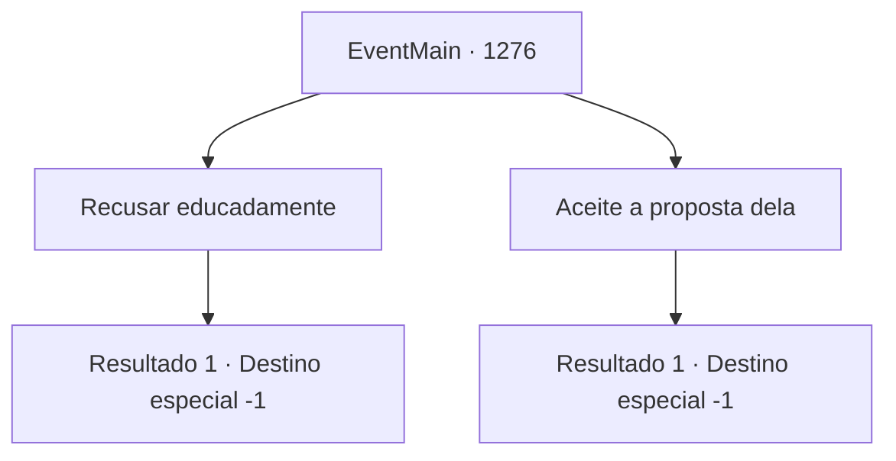

# Eventos principais · 1276

[Índice da tabela](index.md) · [Índice geral](../index.md)

ID: `pt:EventMain:1276` · Fonte: `EventMain4` · Versão: 1.2.47.

Mapeamento estático dos arquivos; a disponibilidade e a execução dependem do estado da run.

## Texto do evento

*Sem texto no arquivo.*

## Dados de entrada

```json
{
  "id": 1276,
  "grade": 1,
  "normalGoal": "",
  "required": ""
}
```

## Mapa das escolhas



## Escolhas e resultados

### Escolha 1

Recusar educadamente

Requisitos e outros campos da escolha:

```json
{
  "required": ""
}
```

#### Resultado 1.1

Você recusa educadamente a proposta de casamento dela. Katrin assente lentamente. 

 "...Ah, entendo."

 A voz dela está calma como sempre. Mas ela hesita um pouco antes de pousar a xícara de chá. Os olhos dela se enchem de lágrimas, mas ela sorri de volta imediatamente. 

 "De qualquer forma, lembre-se de que permanecerei ao seu lado para sempre, {1}, aconteça o que acontecer. Seja por assuntos da propriedade ou por um assunto pessoal, eu passo com prazer se você precisar da minha ajuda."

 Com isso, Katrin se levanta do assento. 

 "Acho que fiquei tempo demais. Devo ir agora."

 Ela se lembra de se curvar antes de se despedir. 

 "Espero vê-lo novamente."

 Ela parte com uma despedida graciosa. Você a observa caminhar pelo corredor e atravessar o portão da frente. A porta da carruagem dela se abre, e ela pula para dentro. O som dos cascos dos cavalos ecoa pelo pátio. Então, ela pega sua carruagem de volta para a Propriedade Greymoor.

Continuação registrada: [Destino especial `-1`](../destinos-especiais.md).

```json
{
  "required": "",
  "chance": "1",
  "nextEvent": -1,
  "type": 2,
  "reward": "15_7_5|15_7_27"
}
```

### Escolha 2

Aceite a proposta dela

Requisitos e outros campos da escolha:

```json
{
  "required": "24_1_1"
}
```

#### Resultado 2.1

Você aceita a proposta de casamento dela. Os olhos dela se arregalam. Ela tenta dizer algo, mas as palavras não saem da boca. 

 " S- sério...?! "

 A voz dela treme. Você acena para tranquilizá-la, e Katrin cobre a boca com uma das mãos. Ela tenta esconder o largo sorriso no rosto, mas acaba falhando. 

 " ...Obrigada! "

 Ela limpa a garganta e recupera a compostura. 

 " Ahem. Acho que você fez uma escolha sábia para o futuro de nossas duas casas. Como Condessa, e como Chefe da Casa de Greymoor, eu lhe agradeço. "

 Ela se inclina. Então, Rennart, que está limpando o bule e as xícaras, fala. 

 " Bem... Os mordomos das duas Casas podem resolver os detalhes. Tudo o que você precisa fazer agora, meu senhor, é decidir o dia do seu casamento. Recomendo que discuta com seus vassalos. "

 Katrin acena com a cabeça rapidamente. 

 " Sim. Isso será ótimo. "

 Com isso, ela se levanta do assento. 

 " Acho que... da próxima vez que nos vermos, posso vir com uma atitude um pouco mais casual. "

 Ela lembra de se curvar antes de se despedir. 

 " Espero vê-lo novamente. "

 Ela parte com uma despedida graciosa. Você a observa caminhar pelo corredor e sair pelo portão da frente. A porta da carruagem dela se abre, e ela pula para dentro. O som dos cascos dos cavalos ecoa pelo pátio. Em seguida, ela leva sua carruagem de volta à Estância Greymoor.

Continuação registrada: [Destino especial `-1`](../destinos-especiais.md).

```json
{
  "required": "",
  "chance": "1",
  "nextEvent": -1,
  "type": 2,
  "reward": "15_7_5|15_7_21"
}
```

## Referências que chegam a este evento

- [Evento 1275 · escolha 1 · resultado 1](1275.md#escolha-1)
