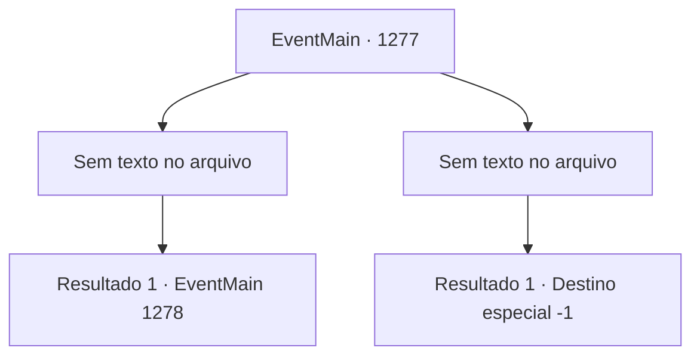

# Eventos principais · 1277

[Índice da tabela](index.md) · [Índice geral](../index.md)

ID: `pt:EventMain:1277` · Fonte: `EventMain4` · Versão: 1.2.47.

Mapeamento estático dos arquivos; a disponibilidade e a execução dependem do estado da run.

## Texto do evento

*Sem texto no arquivo.*

## Dados de entrada

```json
{
  "id": 1277,
  "grade": 1,
  "normalGoal": "",
  "required": ""
}
```

## Mapa das escolhas



## Escolhas e resultados

### Escolha 1

*Sem texto no arquivo; o papel dessa opção depende da interface do jogo.*

Requisitos e outros campos da escolha:

```json
{
  "required": ""
}
```

#### Resultado 1.1


 "I- Eu...!"

 Kalman ajoelha no chão, tentando arrancar palavras da boca. Sangue escorre sobre suas queimaduras. 

 "Eu... sou o único e verdadeiro Conde Briovich...! Não eu... Deveria ter sido EU...!"

 Devagar, você se aproxima de Kalman. Ele lhe encara com olhos injetados de sangue. Seus braços trêmulos estendem-se em sua direção, mas logo caem. 

 "*tosse*...!"

 Ele vomita sangue no chão e desmaia. Seu corpo não se move mais. Em pouco tempo, soldados de Greymoor correm para dentro, armados. 

 "Minha Senhora! A senhora está bem?!"

 Um cavaleiro se ajoelha diante de Katrin. 

 "Os mortos-vivos foram destruídos de repente. Nenhum deles parece se mover mais."

 Katrin ajeita suas roupas novamente, endireitando a postura. 

 "Estou bem. O necromante apareceu, mas essa pessoa aqui salvou minha vida. Não precisam se preocupar."

 Um par de soldados troca olhares entre si. Parecem ter percebido que algo está errado. Mas ninguém diz nada. Com calma, Katrin continua. 

 "Limpe o corpo dele. Preparem um quarto para nossa preciosa convidada aqui."

 O cavaleiro parece confuso por um segundo, mas logo se curva e obedece ao comando. 

 "Entendido, minha Senhora."

 Os soldados se dispersam. O corpo de Kalman é carregado para fora por um grupo de soldados. 

 "Receio que a manutenção dos terrenos do castelo seja prioridade. Podemos retomar nossa conversa amanhã."

 Ela ergue o braço e aponta para o interior do torreão. 

 "Vou mostrar-lhe seu quarto. Por aqui."

 Você a acompanha até o torreão. Atrás, você ouve o cadáver de Kalman sendo encaixado em algo.

Continuação registrada: [Evento 1278](1278.md) na mesma tabela.

```json
{
  "required": "",
  "chance": "1",
  "nextEvent": 1278,
  "type": 2,
  "reward": ""
}
```

### Escolha 2

*Sem texto no arquivo; o papel dessa opção depende da interface do jogo.*

Requisitos e outros campos da escolha:

```json
{
  "required": ""
}
```

#### Resultado 2.1


 "Imbecil tolo. Você poderia ter sido útil por mais tempo..."

 Você tenta se levantar. Mas Kalman não hesita. Ele perfura seu pescoço com uma estaca de osso. Sua visão fica turva. Você distingue o sorriso de Kalman. O grito doloroso de Katrin é a última coisa que você ouve.

Continuação registrada: [Destino especial `-1`](../destinos-especiais.md).

```json
{
  "required": "",
  "chance": "1",
  "nextEvent": -1,
  "type": 2,
  "reward": "0_0_-1|0_1_-1|15_7_7|15_7_29|25_8_1"
}
```

## Referências que chegam a este evento

- [Evento 1263 · escolha 3 · resultado 1](1263.md#escolha-3)
- [Evento 1264 · escolha 3 · resultado 1](1264.md#escolha-3)
