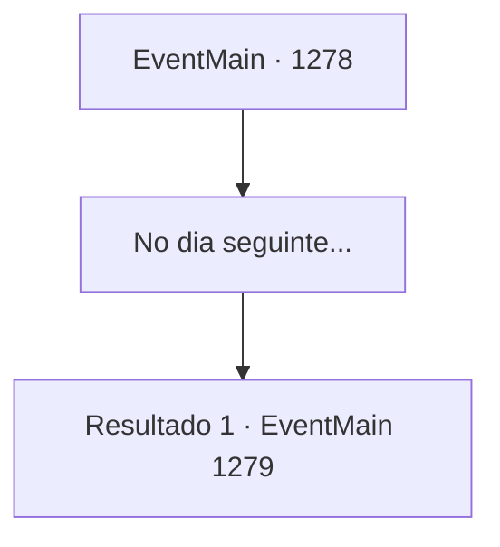

# Eventos principais · 1278

[Índice da tabela](index.md) · [Índice geral](../index.md)

ID: `pt:EventMain:1278` · Fonte: `EventMain4` · Versão: 1.2.47.

Mapeamento estático dos arquivos; a disponibilidade e a execução dependem do estado da run.

## Texto do evento

*Sem texto no arquivo.*

## Dados de entrada

```json
{
  "id": 1278,
  "grade": 1,
  "normalGoal": "",
  "required": ""
}
```

## Mapa das escolhas



## Escolhas e resultados

### Escolha 1

No dia seguinte...

Requisitos e outros campos da escolha:

```json
{
  "required": ""
}
```

#### Resultado 1.1

No dia seguinte, você acorda no quarto de hóspedes. Uma criada bate cuidadosamente à sua porta. 

 "Seu café da manhã está pronto. Vou levá-lo ao salão de jantar."

 Você ajeita as mangas e sai. Você atravessa o corredor e chega ao salão de jantar. Uma variedade de pratos de todo o reino ocupa a longa mesa de jantar. Cervo assado, truta temperada, pão e queijo recém-assados e uma seleção de frutas são colocados em pratos de prata. Katrin senta-se em uma das extremidades da mesa. 

 "Você chegou. Venha, sente-se."

 Você se senta, de frente para Katrin. Uma criada se aproxima e enche seu copo com vinho. Um líquido vermelho carmim gira dentro. Katrin ergue seu copo. 

 "Antes de prosseguirmos, vamos beber."

 Um sorriso se espalha pelo rosto dela. 

 "À amizade eterna entre Greymoor e Briovich."


Continuação registrada: [Evento 1279](1279.md) na mesma tabela.

```json
{
  "required": "",
  "chance": "1",
  "nextEvent": 1279,
  "type": 2,
  "reward": ""
}
```

## Referências que chegam a este evento

- [Evento 1277 · escolha 1 · resultado 1](1277.md#escolha-1)
