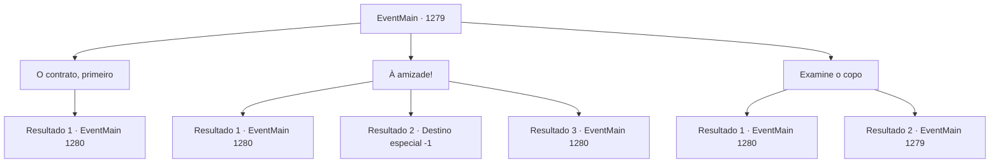

# Eventos principais · 1279

[Índice da tabela](index.md) · [Índice geral](../index.md)

ID: `pt:EventMain:1279` · Fonte: `EventMain4` · Versão: 1.2.47.

Mapeamento estático dos arquivos; a disponibilidade e a execução dependem do estado da run.

## Texto do evento

*Sem texto no arquivo.*

## Dados de entrada

```json
{
  "id": 1279,
  "grade": 1,
  "normalGoal": "",
  "required": ""
}
```

## Mapa das escolhas



## Escolhas e resultados

### Escolha 1

O contrato, primeiro

Requisitos e outros campos da escolha:

```json
{
  "required": ""
}
```

#### Resultado 1.1

Você ignora o copo. Você insiste que um contrato seja feito primeiro. Katrin para, segurando o copo no ar. O sorriso dela se enfraquece. Mas num instante, ela baixa o copo e acena com a cabeça. 

 "...Eu entendo."

 Ela chama seu servo com um gesto. 

 "Traga o rascunho do nosso contrato."

 O servo se curva e sai do salão de jantar. Katrin olha para você. Um leve sorriso volta a se espalhar pelo rosto dela. Em pouco tempo, o servo retorna com um pergaminho. É um pedaço grosso de pergaminho. Mas no momento em que seus dedos tocam o contrato, ele explode em uma explosão de várias cores com um barulho alto. Cores intensas se espalham por todo o salão, pintando sua visão de branco num instante. É Jato de Cores — um feitiço ilusório de baixo nível. Mas seu impacto é mais que potente. Instintivamente, você dá um passo para trás. Mas sua visão já está prejudicada. Você ouve passos por todo o salão de jantar. O som de aço se chocando enche a sala. Então, você ouve Katrin falar. 

 "Mate."

 Além das cores, soldados armados se atiram sobre você simultaneamente.

Continuação registrada: [Evento 1280](1280.md) na mesma tabela.

```json
{
  "required": "",
  "chance": "1",
  "nextEvent": 1280,
  "type": 0,
  "reward": "6_3_197",
  "place": 10
}
```

### Escolha 2

À amizade!

Requisitos e outros campos da escolha:

```json
{
  "required": ""
}
```

#### Resultado 2.1

Você ergue seu copo. 

 "Por uma amizade eterna entre Greymoor e Briovich."

 Seu copo toca o de Katrin. Um tilintar claro ecoa pelo salão de jantar. Você dá um gole no vinho e engole. Katrin está olhando para você. Você percebe um sorriso no rosto dela, mas os olhos dela avaliam sua expressão. Você a ignora e aproveita a comida à sua frente. Katrin observa você devorar tigelas de sopa e punhados de pão, então levanta a mão. Então, passos começam a ecoar por todo o salão de jantar. O som de aço se chocando enche a sala. Cavaleiros de Greymoor surgem além das paredes e dos quartos adjacentes, cercando você num instante. Então, você ouve Katrin falar. 

 "Mata."

 Os cavaleiros investem contra você simultaneamente.

Continuação registrada: [Evento 1280](1280.md) na mesma tabela.

```json
{
  "required": "21_15_3",
  "chance": "1|0_13_1",
  "nextEvent": 1280,
  "type": 0,
  "reward": "6_0_197",
  "place": 10
}
```

#### Resultado 2.2

Você levanta sua taça. 

 "A uma amizade eterna entre Greymoor e Briovich."

 Sua taça bate na de Katrin. Um tilintar claro ecoa pelo salão de jantar. Você toma um gole do seu vinho e engole. Você põe a taça no lugar e estende a mão para outros pratos. Mas então, quando está prestes a pegar um pão, sente algo se torcer no estômago. Começou como uma pontada leve. Mas em segundos, evolui para uma dor intensa. Você apoia o corpo no apoio de braço. Sua respiração começa a ficar pesada. O suor começa a encharcar sua testa. Sua visão embaça. Várias camadas do salão se sobrepõem à sua visão. Você sente vômito na garganta. Cobre a boca e tenta conter, mas sangue espesso e vermelho vaza entre seus dedos. Infelizmente, você cai da cadeira no chão. Katrin observa você perder a consciência e se levanta. 

 "Adeus, Briovich."

 A voz dela se apaga. Logo, tudo fica escuro.

Continuação registrada: [Destino especial `-1`](../destinos-especiais.md).

```json
{
  "required": "21_15_3",
  "chance": "30",
  "nextEvent": -1,
  "type": 1,
  "reward": "0_0_-1|0_1_-1|15_7_0|25_8_1"
}
```

#### Resultado 2.3

Você ergue seu copo. 

 "Por uma amizade eterna entre Greymoor e Briovich."

 Seu copo toca o de Katrin. Um tilintar claro ecoa pelo salão de jantar. Você dá um gole no vinho e engole. Katrin está olhando para você. Você percebe um sorriso no rosto dela, mas os olhos dela avaliam sua expressão. Você a ignora e aproveita a comida à sua frente. Katrin observa você devorar tigelas de sopa e punhados de pão, então levanta a mão. Então, passos começam a ecoar por todo o salão de jantar. O som de aço se chocando enche a sala. Cavaleiros de Greymoor surgem além das paredes e dos quartos adjacentes, cercando você num instante. Então, você ouve Katrin falar. 

 "Mata."

 Os cavaleiros investem contra você simultaneamente.

Continuação registrada: [Evento 1280](1280.md) na mesma tabela.

```json
{
  "required": "20_15_3",
  "chance": "1",
  "nextEvent": 1280,
  "type": 2,
  "reward": "6_0_197",
  "place": 10
}
```

### Escolha 3

Examine o copo

Requisitos e outros campos da escolha:

```json
{
  "required": "5_952_0"
}
```

#### Resultado 3.1

Você levanta o copo e examina seu conteúdo. Mesmo levando em conta que a luz do sol entra pelas janelas, você percebe que o líquido no seu copo parece um pouco turvo demais. Você cheira — e nota um leve cheiro amargo de ervas trituradas por baixo do vinho. Instintivamente, você percebe que seu vinho está envenenado. Katrin ainda sorri. Você vira o copo na direção dela, respingando o vinho no rosto dela. 

 "...!"

 Katrin franze a testa imediatamente. O líquido vermelho ensopa o rosto e o vestido dela. Gotas de vinho escorrem do cabelo dela. Katrin te encara por um instante antes de erguer a mão. Então, passos começam a ecoar por todo o salão de jantar. O som do aço se chocando enche a sala. Cavaleiros de Greymoor surgem além das paredes e das salas adjacentes, cercando você num instante. Então, você ouve Katrin falar. 

 "Matem."

 Os cavaleiros investem contra você simultaneamente.

Continuação registrada: [Evento 1280](1280.md) na mesma tabela.

```json
{
  "required": "",
  "chance": "1|0_14_1",
  "nextEvent": 1280,
  "type": 0,
  "reward": "5_952_1|6_0_197",
  "place": 10
}
```

#### Resultado 3.2

O vinho tinto gira no seu copo. Você põe o copo sob a luz e até o cheira. Você não percebe nada suspeito. É apenas vinho tinto comum, tanto na cor quanto no cheiro. Katrin sorri e sacode o copo. 

 "Venha. A uma amizade eterna entre Greymoor e Briovich."


Continuação registrada: [Evento 1279](1279.md) na mesma tabela.

```json
{
  "required": "",
  "chance": "24",
  "nextEvent": 1279,
  "type": 1,
  "reward": "5_952_9"
}
```

## Referências que chegam a este evento

- [Evento 1278 · escolha 1 · resultado 1](1278.md#escolha-1)
- [Evento 1279 · escolha 3 · resultado 2](1279.md#escolha-3)
