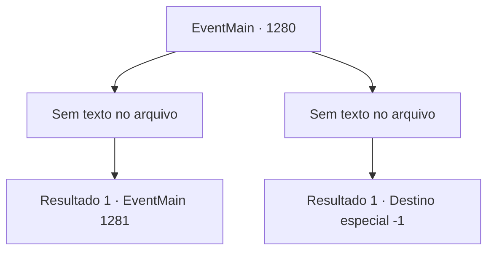

# Eventos principais · 1280

[Índice da tabela](index.md) · [Índice geral](../index.md)

ID: `pt:EventMain:1280` · Fonte: `EventMain4` · Versão: 1.2.47.

Mapeamento estático dos arquivos; a disponibilidade e a execução dependem do estado da run.

## Texto do evento

*Sem texto no arquivo.*

## Dados de entrada

```json
{
  "id": 1280,
  "grade": 1,
  "normalGoal": "",
  "required": ""
}
```

## Mapa das escolhas



## Escolhas e resultados

### Escolha 1

*Sem texto no arquivo; o papel dessa opção depende da interface do jogo.*

Requisitos e outros campos da escolha:

```json
{
  "required": ""
}
```

#### Resultado 1.1

Você consegue derrotar todos os cavaleiros de Greymoor. Montes de cadáveres com armadura estão espalhados pelo salão de jantar. A mesa está encharcada de vinho e sangue. As manchas ficam mais escuras e espessas. Katrin empalidece e se levanta cambaleando. Seu vestido fica preso em um pé da mesa, o que a desequilibra. Ela puxa o vestido às pressas e foge para a porta dos fundos. 

 "SOLDADOS! EU PRECISO DE SOLDADOS!"

 Seus gritos ecoam pelos corredores e por todo o prédio. 

 "ALGUÉM... QUALQUER UM!! SALVE-ME!!"

 Soldados armados invadem o salão de jantar, empunhando espadas, lanças e bestas. Katrin se esconde atrás dos soldados, apontando para você com uma das mãos. 

 "É ELE! MATEM! AGORA!!"

 Os soldados iniciam o ataque, obedecendo ao comando de Katrin.

Continuação registrada: [Evento 1281](1281.md) na mesma tabela.

```json
{
  "required": "",
  "chance": "1",
  "nextEvent": 1281,
  "type": 2,
  "reward": "6_0_204",
  "place": 10
}
```

### Escolha 2

*Sem texto no arquivo; o papel dessa opção depende da interface do jogo.*

Requisitos e outros campos da escolha:

```json
{
  "required": ""
}
```

#### Resultado 2.1

A saraivada de ataques dos cavaleiros atinge seu corpo. Eles miram seu pescoço, abdômen e suas coxas ao mesmo tempo. Você tenta desviar, mas simplesmente não consegue evitar todos. Ai, sua coxa é cortada, e o sangue jorra da ferida. Os cavaleiros não lhe dão tempo para se recuperar. Você é levado aos joelhos. Um dos cavaleiros balança sua espada, e seu mundo começa a girar. Seu corpo sem cabeça cai para frente no chão.

Continuação registrada: [Destino especial `-1`](../destinos-especiais.md).

```json
{
  "required": "",
  "chance": "1",
  "nextEvent": -1,
  "type": 2,
  "reward": "0_0_-1|0_1_-1|15_7_0|25_8_1"
}
```

## Referências que chegam a este evento

- [Evento 1279 · escolha 1 · resultado 1](1279.md#escolha-1)
- [Evento 1279 · escolha 2 · resultado 1](1279.md#escolha-2)
- [Evento 1279 · escolha 2 · resultado 3](1279.md#escolha-2)
- [Evento 1279 · escolha 3 · resultado 1](1279.md#escolha-3)
