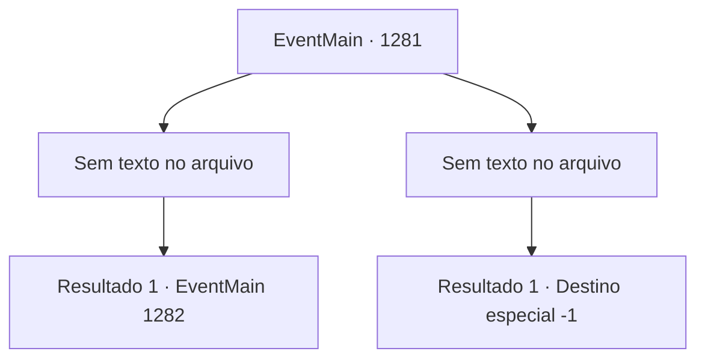

# Eventos principais · 1281

[Índice da tabela](index.md) · [Índice geral](../index.md)

ID: `pt:EventMain:1281` · Fonte: `EventMain4` · Versão: 1.2.47.

Mapeamento estático dos arquivos; a disponibilidade e a execução dependem do estado da run.

## Texto do evento

*Sem texto no arquivo.*

## Dados de entrada

```json
{
  "id": 1281,
  "grade": 1,
  "normalGoal": "",
  "required": ""
}
```

## Mapa das escolhas



## Escolhas e resultados

### Escolha 1

*Sem texto no arquivo; o papel dessa opção depende da interface do jogo.*

Requisitos e outros campos da escolha:

```json
{
  "required": ""
}
```

#### Resultado 1.1

Cada soldado cai diante de você. Você pega uma espada ensanguentada do chão e a enfia no peito do último soldado sobrevivente. 

 "GAAAAARGH!! Agh...!"

 Ondas de sangue jorram do soldado. Sua mão balança desesperadamente no ar, mas logo fica fraca. Lentamente, você gira a espada no corpo dele antes de puxá-la. O sangue pinga da lâmina. Você se vira para encarar Katrin, cujo rosto ficou pálido. Você caminha em direção a ela, lentamente. Passo após passo, você se aproxima de Katrin. A cada passo que você dá, ela também dá, afastando-se de você. Ela pega um candelabro da mesa de jantar. 

 "F- FIQUE LONGE! NÃO ouse chegar perto de mim!!"

 Ela balança o candelabro em sua direção, mas você simplesmente o afasta de sua mão. O candelabro voa de suas mãos e rola pelo chão. Katrin cambaleia para trás e tropeça, caindo sentada no chão. Você ouve algo rasgar, enquanto Katrin pisa no próprio vestido e o rasga. Sua tez fica ainda mais pálida. Você percebe que seus lábios perderam a cor. 

 "E- Eu sinto muito. Eu sinto muito mesmo. É tudo culpa minha."

 Ela se ajoelha diante de você. 

 "Por favor, não me mate... Misericórdia!"


Continuação registrada: [Evento 1282](1282.md) na mesma tabela.

```json
{
  "required": "",
  "chance": "0",
  "nextEvent": 1282,
  "type": 0,
  "reward": ""
}
```

### Escolha 2

*Sem texto no arquivo; o papel dessa opção depende da interface do jogo.*

Requisitos e outros campos da escolha:

```json
{
  "required": ""
}
```

#### Resultado 2.1

Você é bombardeado por virotes de bestas, cortado por espadas e atravessado por lanças. Você faz sua defesa, mas, infelizmente, é forçado a se ajoelhar diante dos soldados. A voz fria de Katrin segue. 

 "...Já basta. Hora de terminar com isto."

 Você olha para cima, ofegante. A chuva de virotes disparados contra você é a última coisa que vê antes de perder a consciência.

Continuação registrada: [Destino especial `-1`](../destinos-especiais.md).

```json
{
  "required": "",
  "chance": "1",
  "nextEvent": -1,
  "type": 2,
  "reward": "0_0_-1|0_1_-1|15_7_0|25_8_1"
}
```

## Referências que chegam a este evento

- [Evento 1280 · escolha 1 · resultado 1](1280.md#escolha-1)
