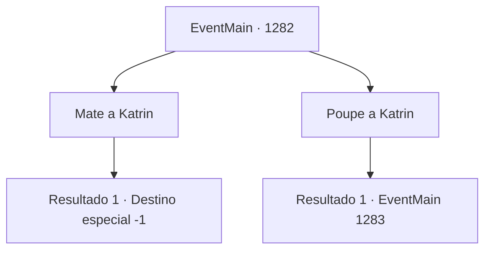

# Eventos principais · 1282

[Índice da tabela](index.md) · [Índice geral](../index.md)

ID: `pt:EventMain:1282` · Fonte: `EventMain4` · Versão: 1.2.47.

Mapeamento estático dos arquivos; a disponibilidade e a execução dependem do estado da run.

## Texto do evento

*Sem texto no arquivo.*

## Dados de entrada

```json
{
  "id": 1282,
  "grade": 1,
  "normalGoal": "",
  "required": ""
}
```

## Mapa das escolhas



## Escolhas e resultados

### Escolha 1

Mate a Katrin

Requisitos e outros campos da escolha:

```json
{
  "required": ""
}
```

#### Resultado 1.1

Você decapita Katrin com a espada que estava segurando. Os olhos dela se arregalam enquanto o sangue escorre pela pele imaculada. 

 "Ack...! *gargarejo*"

 As mãos dela instintivamente procuram onde o pescoço costumava estar, mas só jorros de sangue são encontrados ali. O corpo decapitado de Katrin cai no chão. Então, passos apressados se aproximam de fora. São os servos — devem ter percebido a comoção no salão de jantar. 

 "Meu Senhor, você está... ARGGHHHHH!!"

 Uma criada entra pela porta e fica congelada. Ela ofega com a visão inacreditável e grita. 

 "EEEEEEEEK! S- SANGUE! ESTÁ POR TODA PARTE...!!"

 Outro servo puxa o ombro da criada para olhar o salão de jantar. Ele também empalidece. Cambaleando, ele corre pelo corredor. Gritos e passos se espalham pelo prédio.

Continuação registrada: [Destino especial `-1`](../destinos-especiais.md).

```json
{
  "required": "",
  "chance": "1",
  "nextEvent": -1,
  "type": 2,
  "reward": "15_7_7|15_7_28"
}
```

### Escolha 2

Poupe a Katrin

Requisitos e outros campos da escolha:

```json
{
  "required": ""
}
```

#### Resultado 2.1

Você olha para baixo, para Katrin, e lhe comunica as condições do contrato. A Condessa Greymoor deve admitir sua responsabilidade por ter fechado um acordo com os orcs da tribo Zaraid e por instigar um ataque à propriedade Briovich. A Casa Greymoor também será responsabilizada financeiramente por compensar a Casa Briovich por todos os danos causados. Katrin abaixa os ombros, incapaz de levantar o olhar. Você ouve sua respiração contida através de seus cabelos bagunçados. 

 "..S- Sim, entendido."

 A voz dela falha. Você vira o olhar e chama um servo. 

 "Traga-me uma pena e algo para escrever."

 O servo olha para dentro do salão de jantar e se assusta. Mesas viradas, pratos espalhados e o chão encharcado de sangue. E, ao centro, a própria Condessa ajoelhada diante de você. O rosto do servo empalidece. Katrin, com a voz ainda trêmula, grita para o servo. 

 "...Você ouviu bem. Traga-os aqui."

 O servo sai apressadamente do salão de jantar. Alguns segundos depois, ele retorna com uma pena, um frasco de tinta e um pedaço de pergaminho. Ele os coloca sobre a mesa e vai embora. Você coloca o pergaminho à sua frente. Com a pena, você escreve o contrato, linha por linha. Os termos do contrato envolvem a confissão de Katrin Greymoor de ter pago os orcs da tribo Zaraid para atacarem a propriedade Briovich, a promessa de compensação financeira por todos os danos causados à propriedade Briovich e, por fim, um juramento de pacificação — a Casa Greymoor não deve, sob nenhuma circunstância, engajar-se em quaisquer atos hostis contra a Casa Briovich no futuro. Você empurra o contrato para Katrin. Ela pega a pena com mãos trêmulas. Ela assina seu nome na parte inferior do pergaminho. Você derrama um pouco de cera de vela sobre o documento, selando-o com sigilos de ambas as Casas.

Continuação registrada: [Evento 1283](1283.md) na mesma tabela.

```json
{
  "required": "",
  "chance": "1",
  "nextEvent": 1283,
  "type": 2,
  "reward": ""
}
```

## Referências que chegam a este evento

- [Evento 1281 · escolha 1 · resultado 1](1281.md#escolha-1)
