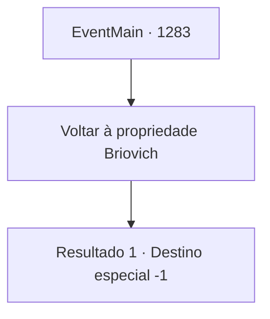

# Eventos principais · 1283

[Índice da tabela](index.md) · [Índice geral](../index.md)

ID: `pt:EventMain:1283` · Fonte: `EventMain4` · Versão: 1.2.47.

Mapeamento estático dos arquivos; a disponibilidade e a execução dependem do estado da run.

## Texto do evento

*Sem texto no arquivo.*

## Dados de entrada

```json
{
  "id": 1283,
  "grade": 1,
  "normalGoal": "",
  "required": ""
}
```

## Mapa das escolhas



## Escolhas e resultados

### Escolha 1

Voltar à propriedade Briovich

Requisitos e outros campos da escolha:

```json
{
  "required": ""
}
```

#### Resultado 1.1

Você lhe diz que voltará à propriedade Briovich com o contrato. Katrin ordena ao seu servo com gestos. 

 "Acompanhe o retorno à propriedade Briovich."

 O servo se curva em sinal de reconhecimento. 

 "Sim, minha senhora. E- era por aqui."

 Você segue o servo para fora da fortaleza. Alguns soldados ainda permanecem nos terrenos do castelo, mas nenhum deles ousa impedi-lo de sair. Você segue até a cocheira e aluga um cavalo. Você deixa o Castelo Greymoor e cavalga em direção à propriedade Briovich. 

 A jornada de volta parece muito mais longa do que você lembra. Você segue a estrada, atravessando as planícies e passando por um rio. Quando chega ao Castelo Briovich, o sol já está se pondo. 

 "Minha senhora! A senhora voltou!"

 Grita o guarda do portão. As correntes tilintam, e o portão da frente se abre. Rennart corre para fora para recebê-la. 

 "A senhora voltou inteira, minha senhora."

 Você tira o contrato e o entrega a ele. Rennart o pega com ambas as mãos e o examina cuidadosamente. 

 "Isto é... muito impressionante, minha senhora."

 Ele se afasta e a conduz até a torre de Briovich. Você o segue até seu escritório.

Continuação registrada: [Destino especial `-1`](../destinos-especiais.md).

```json
{
  "required": "",
  "chance": "1",
  "nextEvent": -1,
  "type": 2,
  "reward": "15_7_25"
}
```

## Referências que chegam a este evento

- [Evento 1282 · escolha 2 · resultado 1](1282.md#escolha-2)
