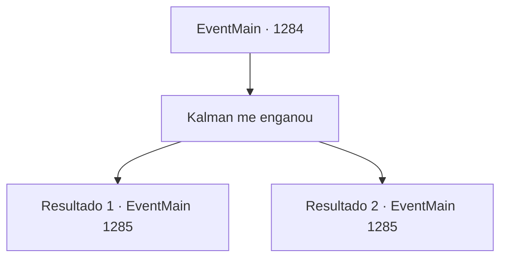

# Eventos principais · 1284

[Índice da tabela](index.md) · [Índice geral](../index.md)

ID: `pt:EventMain:1284` · Fonte: `EventMain4` · Versão: 1.2.47.

Mapeamento estático dos arquivos; a disponibilidade e a execução dependem do estado da run.

## Texto do evento

*Sem texto no arquivo.*

## Dados de entrada

```json
{
  "id": 1284,
  "grade": 1,
  "normalGoal": "",
  "required": ""
}
```

## Mapa das escolhas



## Escolhas e resultados

### Escolha 1

Kalman me enganou

Requisitos e outros campos da escolha:

```json
{
  "required": ""
}
```

#### Resultado 1.1

Você conta a Katrin tudo o que aconteceu até agora, explicando que Kalman se aproximou de você primeiro, dizendo que a Casa Greymoor é a mente por trás de tudo. Você acrescenta que foi enganado por suas palavras e uniu forças. Katrin olha para você em silêncio. A luz da tocha cintila levemente em sua bochecha. 

 "Então... você, o grande chefe da Casa de Briovich, foi... enganado?"

 Você acena com a cabeça, continuando a convencê-la. Você acrescenta que, quando percebeu que havia sido enganado, a horda de mortos-vivos de Kalman já havia se tornado uma ameaça grande demais para enfrentá-lo. Segue-se um longo silêncio. Katrin finalmente abre a boca. 

 "...Tudo bem. Certo."

 A voz calma e reservada dela ecoa pela sala. 

 "Mas eu não tenho como assegurar que você está dizendo a verdade. Por enquanto, pelo menos, não posso libertá-lo."

 Katrin passa algumas ordens para um soldado ao lado dela. Você não consegue entender bem o que ela está dizendo. Ela então se vira novamente. Os passos ficam mais distantes enquanto ela e o soldado se afastam. Então, o som de uma pesada porta se fechando ecoa pela prisão.

Continuação registrada: [Evento 1285](1285.md) na mesma tabela.

```json
{
  "required": "",
  "chance": "1|0_12_1",
  "nextEvent": 1285,
  "type": 0,
  "reward": "5_953_1"
}
```

#### Resultado 1.2

Você conta a Katrin tudo o que aconteceu até agora, explicando que Kalman se aproximou de você primeiro, dizendo que a Casa Greymoor é a mente por trás de tudo. Você acrescenta que foi enganado por suas palavras e se aliou a ele. Katrin olha para você em silêncio. A luz da tocha tremula levemente em sua face. 

 "Então... você, o grande Chefe da Casa de Briovich, foi... enganado?"

 Você acena com a cabeça, continuando a tentar convencê-la. Você acrescenta que, quando percebeu que havia sido enganado, a horda de mortos-vivos de Kalman já tinha se tornado uma ameaça grande demais para enfrentá-lo. Mas Katrin não acredita em nada disso. 

 "Você está mentindo para mim. Agora sei que é perda de tempo tentar falar com você."

 Katrin passa algumas ordens a um soldado que está ao lado dela. Você não consegue decifrar exatamente o que ela está dizendo. Ela então se vira novamente. Os passos vão ficando mais distantes enquanto ela e o soldado se afastam. Em seguida, o som de uma pesada porta se fechando ecoa pela prisão.

Continuação registrada: [Evento 1285](1285.md) na mesma tabela.

```json
{
  "required": "",
  "chance": "25",
  "nextEvent": 1285,
  "type": 1,
  "reward": "5_953_2"
}
```

## Referências que chegam a este evento

- [Evento 1260 · escolha 2 · resultado 1](1260.md#escolha-2)
- [Evento 1262 · escolha 2 · resultado 1](1262.md#escolha-2)
- [Evento 1262 · escolha 2 · resultado 2](1262.md#escolha-2)
