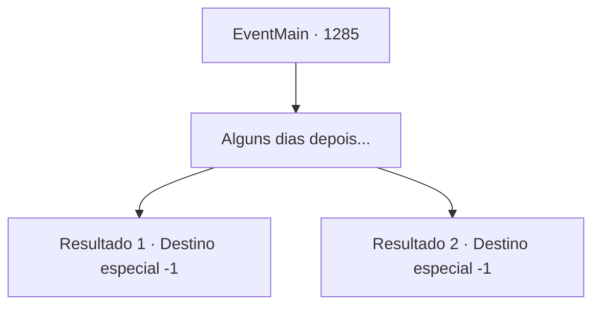

# Eventos principais · 1285

[Índice da tabela](index.md) · [Índice geral](../index.md)

ID: `pt:EventMain:1285` · Fonte: `EventMain4` · Versão: 1.2.47.

Mapeamento estático dos arquivos; a disponibilidade e a execução dependem do estado da run.

## Texto do evento

*Sem texto no arquivo.*

## Dados de entrada

```json
{
  "id": 1285,
  "grade": 1,
  "normalGoal": "",
  "required": ""
}
```

## Mapa das escolhas



## Escolhas e resultados

### Escolha 1

Alguns dias depois...

Requisitos e outros campos da escolha:

```json
{
  "required": ""
}
```

#### Resultado 1.1

Na segunda manhã, você é transferido da cela da prisão para um quarto de hóspedes. Passam-se mais alguns dias. Uma criada entra no seu quarto, com um prato cheio de comida. Katrin a segue para dentro. 

 "O Castelo Briovich soube do seu infortúnio e deseja seu retorno em segurança. Ou pelo menos é o que ouvi."

 Katrin coloca um pedaço de papel e uma pena diante de você. 

 "Aqui. Assine."

 Escrito no pedaço de papel estão os termos de um contrato — que a Casa Briovich deve compensar financeiramente a Casa Greymoor pelos danos causados. Você assina o documento e carimba o brasão da sua Casa. 

 "Não vou insistir mais neste assunto."

 Katrin chama seus homens com um gesto e ordena que o escoltem para fora do Castelo Greymoor. Uma carruagem está esperando por você. 

 "...Entendo que passou por muita coisa, meu senhor."

 Rennart ajuda você a subir na carruagem. Então, a carruagem começa sua viagem de volta à propriedade Briovich.

Continuação registrada: [Destino especial `-1`](../destinos-especiais.md).

```json
{
  "required": "5_953_1",
  "chance": "1",
  "nextEvent": -1,
  "type": 2,
  "reward": "15_7_13|15_7_15"
}
```

#### Resultado 1.2

Passam-se alguns dias. Exatamente quantos dias — você não tem mais certeza, pois já perdeu a noção do tempo. A fome progrediu até virar dor. Então, o portão de aço da sua cela se abre e um assassino entra. 

 "Tem alguma última palavra?"

 Você tenta se levantar, mas as algemas parecem tão pesadas. O assassino se aproxima lentamente e aponta uma adaga para o seu pescoço. A adaga é cravada profundamente em sua pele. Um jorro de sangue quente sai do seu pescoço e pinga no chão. Tudo fica escuro, rapidamente.

Continuação registrada: [Destino especial `-1`](../destinos-especiais.md).

```json
{
  "required": "18_953_1",
  "chance": "1",
  "nextEvent": -1,
  "type": 2,
  "reward": "15_7_13|15_7_18|25_8_1"
}
```

## Referências que chegam a este evento

- [Evento 1284 · escolha 1 · resultado 1](1284.md#escolha-1)
- [Evento 1284 · escolha 1 · resultado 2](1284.md#escolha-1)
