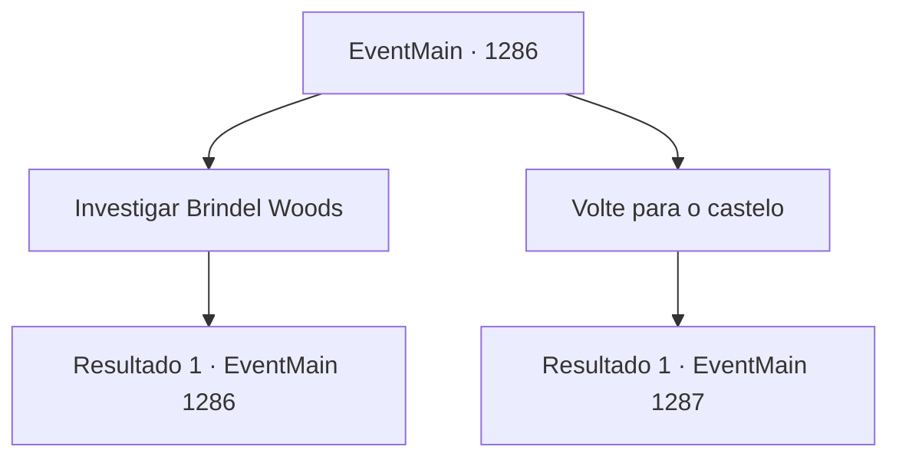

# Eventos principais · 1286

[Índice da tabela](index.md) · [Índice geral](../index.md)

ID: `pt:EventMain:1286` · Fonte: `EventMain4` · Versão: 1.2.47.

Mapeamento estático dos arquivos; a disponibilidade e a execução dependem do estado da run.

## Texto do evento

Sentindo o vento frio roçar em você, você segue até o moinho de água na margem do rio. Este lugar estava infestado de mortos-vivos até poucos dias atrás. Mas agora é apenas um simples moinho de água comum. 

 "Não sinto magia aqui. Se havia alguma, deve ter sido interrompida há algum tempo."

 "Então, a única possibilidade restante é..."

 Você ouve alguém falando vindo do moinho de água. Dentro do prédio, você encontra um pequeno grupo de aventureiros. Eles estão examinando o círculo mágico no chão. Então, percebem sua presença, viram-se e encontram você. 

 "Hm? Quem é você?"

 "Você é morador daqui? Ou um viajante?"

 Você diz a eles quem você é. Os aventureiros demonstram o devido respeito. 

 "Somos aventureiros contratados pelo administrador para investigar este lugar."

 Você recebe um breve relatório sobre a investigação deles. Mas nem mesmo eles descobriram por que os mortos-vivos desapareceram de repente. 

 "Também verificamos a Floresta de Brindel. Não é muito diferente daqui."


## Dados de entrada

```json
{
  "id": 1286,
  "grade": 1,
  "normalGoal": "",
  "required": "13_6_7|1_2_100"
}
```

## Mapa das escolhas



## Escolhas e resultados

### Escolha 1

Investigar Brindel Woods

Requisitos e outros campos da escolha:

```json
{
  "required": "5_954_0"
}
```

#### Resultado 1.1

Você se despede dos aventureiros e segue para Brindel Woods, localizado ao norte do Castelo Briovich. Este lugar não parece muito diferente do moinho d'água. O totem ainda está lá, mas já não emite aquela aura sinistra. Você explora a floresta, procurando por quaisquer sinais de necromancia. Mas em vão — nenhum morto-vivo à vista.

Continuação registrada: [Evento 1286](1286.md) na mesma tabela.

```json
{
  "required": "",
  "chance": "1",
  "nextEvent": 1286,
  "type": 2,
  "reward": "5_954_9"
}
```

### Escolha 2

Volte para o castelo

Requisitos e outros campos da escolha:

```json
{
  "required": ""
}
```

#### Resultado 2.1

Assim que você retorna ao Castelo Briovich, você se dirige ao escritório. Rennart, que devia estar organizando documentos, levanta-se da cadeira. Você lhe conta que os mortos-vivos foram banidos, e que os totens perderam sua magia. Rennart fica pensativo por um momento, então acena com a cabeça lentamente. 

 "Se os totens realmente pararam de funcionar, ao menos a ameaça iminente desapareceu. Mas não podemos ter muita certeza. Vou apertar um pouco as patrulhas e enviar alguns batedores pela região."

 Você acena com a cabeça e olha pela janela. Sua propriedade vai ficando gradualmente vermelha com o pôr do sol. Então, você ouve alguém bater na porta do seu escritório.

Continuação registrada: [Evento 1287](1287.md) na mesma tabela.

```json
{
  "required": "",
  "chance": "1",
  "nextEvent": 1287,
  "type": 2,
  "reward": ""
}
```

## Referências que chegam a este evento

- [Evento 1286 · escolha 1 · resultado 1](1286.md#escolha-1)
