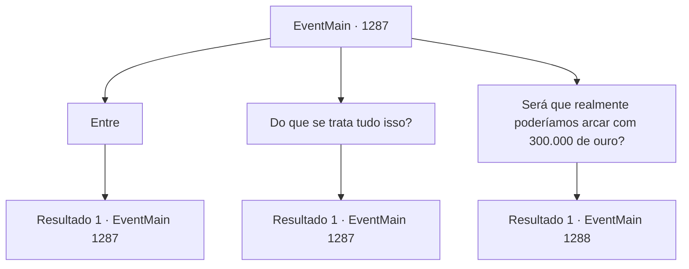

# Eventos principais · 1287

[Índice da tabela](index.md) · [Índice geral](../index.md)

ID: `pt:EventMain:1287` · Fonte: `EventMain4` · Versão: 1.2.47.

Mapeamento estático dos arquivos; a disponibilidade e a execução dependem do estado da run.

## Texto do evento

*Sem texto no arquivo.*

## Dados de entrada

```json
{
  "id": 1287,
  "grade": 1,
  "normalGoal": "",
  "required": ""
}
```

## Mapa das escolhas



## Escolhas e resultados

### Escolha 1

Entre

Requisitos e outros campos da escolha:

```json
{
  "required": "5_955_0"
}
```

#### Resultado 1.1

Logo, um jovem vestido com uma túnica longa entra. Você nota o brasão do grifo em sua couraça — brasão da Casa Greymoor. 

 "Minha Soberana, Condessa Greymoor, enviou uma mensagem."

 Você recebe um pedaço de pergaminho dele e o examina. 

 À Casa Briovich.
 Há poucos dias, uma horda de mortos-vivos foi avistada perto dos Bosques de Rugarden e causou danos sérios às propriedades vizinhas. Investigações revelaram que isso foi causado por ninguém menos que Kalman Briovich, o necromante. 

 Sir Ryon, um cavaleiro que serve nossa Casa, perdeu a vida combatendo os mortos-vivos. Nossos soldados também sofreram ferimentos graves. 

 Reunimos informações de que sua Casa ocultou Kalman e permitiu que ele pesquisasse e praticasse necromancia em suas terras. As quatro Casas — Greymoor, Bathory, Nadasdy e Raziviu — exigem oficialmente um pedido formal de desculpas do chefe da Casa Briovich e uma compensação financeira de trezentos mil de ouro. 

 O mensageiro parte, dizendo que deseja uma resposta rápida.

Continuação registrada: [Evento 1287](1287.md) na mesma tabela.

```json
{
  "required": "",
  "chance": "1",
  "nextEvent": 1287,
  "type": 2,
  "reward": "5_955_1"
}
```

### Escolha 2

Do que se trata tudo isso?

Requisitos e outros campos da escolha:

```json
{
  "required": "5_955_1"
}
```

#### Resultado 2.1

Você coloca o pergaminho na sua mesa e pergunta a Rennart do que se trata tudo isso e quem é Kalman. 

 "Kalman... Eu nunca pensei que ouviria esse nome novamente..."

 Rennart fica em silêncio por um tempo e então começa a falar lentamente. 

 "Os mortos-vivos que foram avistados em nossa propriedade - alguns deles devem ter se deslocado para outras propriedades vizinhas."

 A voz dele cai, como se ficasse entristecido ao falar. 

 "Kalman Briovich é... o irmão mais velho do seu pai e predecessor, o Conde Laszlo Briovich."

 Ele pronuncia esse nome na boca mais uma vez. É como se estivesse relembrando um nome que não usava há anos. 

 "Depois de perder o direito de sucessão para Laszlo Briovich, ele desapareceu."

 Sir Laszlo era um guerreiro nato. Kalman, por outro lado, era mais próximo de um estudioso. Ele adorava ler e tinha aptidão para magia. Costumava passar dias preso em seu gabinete."

 Você sente uma leve decepção na voz de Rennart. 

 "Mas ele começou a desejar conhecimentos proibidos. No fim, conseguiu desafiar a própria morte. Por isso foi exilado da linhagem Briovich."

 Rennart esfrega suas têmporas. 

 "Bem, eu não esperaria que você soubesse da sua existência de qualquer maneira. Sir Laszlo também não queria que você soubesse disso, meu Senhor. Os mortos-vivos que apareceram em nossa propriedade devem ter sido obra dele."


Continuação registrada: [Evento 1287](1287.md) na mesma tabela.

```json
{
  "required": "",
  "chance": "1",
  "nextEvent": 1287,
  "type": 2,
  "reward": "5_955_2"
}
```

### Escolha 3

Será que realmente poderíamos arcar com 300.000 de ouro?

Requisitos e outros campos da escolha:

```json
{
  "required": "5_955_2"
}
```

#### Resultado 3.1

Rennart responde balançando a cabeça. Então continua, calmamente. 

 "Trezentos mil de ouro... Mesmo a Casa mais influente teria dificuldade para reunir essa quantia de ouro. As quatro Casas — elas sabem disso muito bem, tenho certeza."

 Rennart fica olhando para um mapa por um tempo e então continua. 

 "Kalman pode ser apenas um casus belli aqui. Talvez o que eles realmente querem... seja a nossa propriedade."

 Você se lembra das três Casas que ficam próximas a Greymoor. Nadasdy, Bathory e Raziviu — essas Casas sempre estiveram muito próximas da Casa Greymoor. Rennart olha para você. 

 "Apesar disso... talvez possamos conseguir algo com uma negociação. Isso ao menos nos compraria algum tempo, mas quem sabe, talvez passemos por isto sem derramamento de sangue."


Continuação registrada: [Evento 1288](1288.md) na mesma tabela.

```json
{
  "required": "",
  "chance": "1",
  "nextEvent": 1288,
  "type": 2,
  "reward": ""
}
```

## Referências que chegam a este evento

- [Evento 1286 · escolha 2 · resultado 1](1286.md#escolha-2)
- [Evento 1287 · escolha 1 · resultado 1](1287.md#escolha-1)
- [Evento 1287 · escolha 2 · resultado 1](1287.md#escolha-2)
