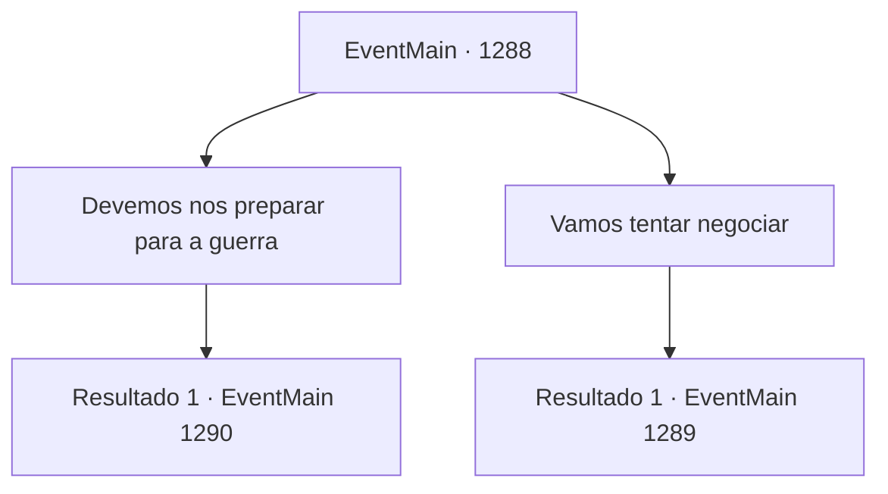

# Eventos principais · 1288

[Índice da tabela](index.md) · [Índice geral](../index.md)

ID: `pt:EventMain:1288` · Fonte: `EventMain4` · Versão: 1.2.47.

Mapeamento estático dos arquivos; a disponibilidade e a execução dependem do estado da run.

## Texto do evento

*Sem texto no arquivo.*

## Dados de entrada

```json
{
  "id": 1288,
  "grade": 1,
  "normalGoal": "",
  "required": ""
}
```

## Mapa das escolhas



## Escolhas e resultados

### Escolha 1

Devemos nos preparar para a guerra

Requisitos e outros campos da escolha:

```json
{
  "required": ""
}
```

#### Resultado 1.1

Você diz a Rennart para se preparar para a guerra. Rennart acena pesadamente. 

 "Sim, meu senhor. Entendido. Devemos preparar uma estratégia sólida. Nossos inimigos nos superam, tanto em número de homens, reforços quanto em suprimentos."

 Você verifica a localização da Propriedade Briovich e das outras Casas no mapa. Considerando a geografia da região, realmente não há muitas opções.

Continuação registrada: [Evento 1290](1290.md) na mesma tabela.

```json
{
  "required": "",
  "chance": "1",
  "nextEvent": 1290,
  "type": 2,
  "reward": ""
}
```

### Escolha 2

Vamos tentar negociar

Requisitos e outros campos da escolha:

```json
{
  "required": ""
}
```

#### Resultado 2.1

Você diz a Rennart para enviar um mensageiro para negociação. Rennart acena. 

 "Sim, meu senhor. Enviarei um agora mesmo."

 Enquanto espera, você se prepara para a guerra. Você intensifica o regime de treinamento dos soldados, faz estoque de suprimentos e envia batedores para patrulhar a área ao redor da propriedade. Alguns dias depois, seu mensageiro entra no escritório. 

 "Uma resposta da Casa Greymoor, meu senhor."

 Escrito na resposta está um convite, um pedido para que você visite o Castelo Greymoor. Você arruma suas coisas e parte para o Castelo Greymoor. Alguns dias depois, o castelo se revela à sua frente. Você nota um grupo de soldados patrulhando o topo das muralhas do castelo. A tensão entre as duas Casas deve ter se espalhado até aqui também. Quando você chega ao Castelo Greymoor, é escoltado até a câmara de audiência. Katrin está esperando por você ali, bebendo chá de sua xícara. Ela coloca a xícara e fala. 

 "...Faz muito tempo. Eu não esperava vê-lo novamente em circunstâncias como estas."

 Segue-se um breve silêncio. Katrin se vira para você e continua. 

 "Você deve ter visto nossa resposta já. Gostaria de uma explicação da Casa Briovich."

 Você nega todas as alegações feitas na primeira carta. Você diz a ela que nem sequer sabia da existência de Kalman, e que nunca tentou deliberadamente escondê-lo. Katrin encara você por um momento antes de falar. 

 "Acho isso difícil de acreditar."

 Após um breve silêncio, ela abre suas gavetas. 

 "Mas seja qual for a verdade, isso não desfaz magicamente os danos causados à Propriedade Greymoor."

 Ela coloca um pedaço de pergaminho à sua frente. 

 "Continuo convencida de que esta é sua responsabilidade. Por favor, assine este contrato."


Continuação registrada: [Evento 1289](1289.md) na mesma tabela.

```json
{
  "required": "",
  "chance": "1",
  "nextEvent": 1289,
  "type": 2,
  "reward": ""
}
```

## Referências que chegam a este evento

- [Evento 1287 · escolha 3 · resultado 1](1287.md#escolha-3)
