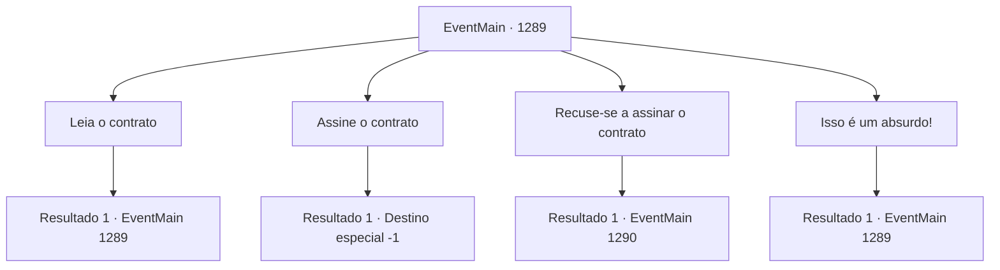

# Eventos principais · 1289

[Índice da tabela](index.md) · [Índice geral](../index.md)

ID: `pt:EventMain:1289` · Fonte: `EventMain4` · Versão: 1.2.47.

Mapeamento estático dos arquivos; a disponibilidade e a execução dependem do estado da run.

## Texto do evento

*Sem texto no arquivo.*

## Dados de entrada

```json
{
  "id": 1289,
  "grade": 1,
  "normalGoal": "",
  "required": ""
}
```

## Mapa das escolhas



## Escolhas e resultados

### Escolha 1

Leia o contrato

Requisitos e outros campos da escolha:

```json
{
  "required": "5_956_0"
}
```

#### Resultado 1.1

Lentamente, você examina os termos do contrato. 

 1. A Casa Briovich concederá direitos de comércio doméstico à Casa Greymoor, Nadasdy, Bathory e Raziviu (doravante referidas como a Aliança). 

 2. O direito de vender os produtos especiais da Fazenda Briovich é concedido à Casa Greymoor, como líder da Aliança. 

 3. A Casa Briovich pagará setenta por cento de seu lucro total da propriedade à Casa Greymoor. A Casa Greymoor será responsável por distribuir isso igualmente entre a Aliança. 

 4. Os termos acima serão mantidos até que a dívida de trezentos mil ouros seja paga integralmente. Além disso, para facilitar investigações adicionais sobre necromancia e proteger as dependências da propriedade, um exército da Aliança liderado pela Casa Greymoor permanecerá estacionado no Castelo Briovich, controlando entradas e saídas. 

 Assinar isto significaria que, embora você ainda detenha o título, os direitos práticos estarão nas mãos da Casa Greymoor. Você desvia o olhar do contrato e encara Katrin. Silenciosamente, ela responde ao seu olhar com outro dela.

Continuação registrada: [Evento 1289](1289.md) na mesma tabela.

```json
{
  "required": "",
  "chance": "1",
  "nextEvent": 1289,
  "type": 2,
  "reward": "5_956_1"
}
```

### Escolha 2

Assine o contrato

Requisitos e outros campos da escolha:

```json
{
  "required": "5_956_1"
}
```

#### Resultado 2.1

Você assina o contrato. Katrin derrama um pouco de cera de vela no pergaminho, pressionando o selo de Greymoor nele. Em seguida, ela aponta para o final do documento. 

 "Ali mesmo."

 Você a segue e carimba o selo de Briovich nele. Um contrato oficial foi assinado. Katrin pega o contrato e fala calmamente. 

 "Uma decisão sensata. Vou me certificar de convencer os outros."

 Ela se levanta da cadeira e o acompanha até a saída. 

 "Desejo-lhe um retorno seguro. Enviarei um administrador em alguns dias."

 Você deixa o Castelo Greymoor. O caminho de volta ao Sítio Briovich parece muito mais longo do que o habitual. Você conseguiu proteger seu título, mas isso foi tudo.

Continuação registrada: [Destino especial `-1`](../destinos-especiais.md).

```json
{
  "required": "",
  "chance": "1",
  "nextEvent": -1,
  "type": 2,
  "reward": "15_7_2"
}
```

### Escolha 3

Recuse-se a assinar o contrato

Requisitos e outros campos da escolha:

```json
{
  "required": "5_956_1"
}
```

#### Resultado 3.1

Você não assina o contrato e se levanta do seu assento. Katrin te encara friamente. Ela toma um gole da xícara e acrescenta. 

 "Isso é infeliz."

 Sem responder, você se vira e vai embora. Ao sair da sala de audiência, você segue para o portão do castelo. Soldados praticam incansavelmente movimentos de combate uns contra os outros, com fileiras de diligências entrando e saindo do castelo. Você sai pelo portão principal, sobe em um cavalo e retorna a Briovich. Alguns dias depois, você está de volta ao castelo. O castelo está muito mais calmo que o habitual. Você percebe nervosismo no rosto dos soldados. Você procura Rennart imediatamente. Você o informa da sua vontade, e ele acena em concordância. 

 "Sim, meu senhor. Entendido. Devemos preparar uma estratégia sólida. Nossos inimigos têm mais homens, equipamento melhor e mais mantimentos."

 Imediatamente, Rennart põe um mapa sobre a escrivaninha. Você verifica a localização da Propriedade Briovich e das outras Casas no mapa.

Continuação registrada: [Evento 1290](1290.md) na mesma tabela.

```json
{
  "required": "",
  "chance": "1",
  "nextEvent": 1290,
  "type": 2,
  "reward": ""
}
```

### Escolha 4

Isso é um absurdo!

Requisitos e outros campos da escolha:

```json
{
  "required": "5_957_0"
}
```

#### Resultado 4.1

Você responde que os termos deste contrato são ridículos. Mas Katrin simplesmente sorri levemente. 

 "Nosso reino não reconhece a necromancia como uma escola válida de magia. E ainda assim você o abrigou e até fez vista grossa aos seus experimentos. Isso é igualmente culpável."

 Ela toma um gole de sua taça e continua com voz calma. 

 "Ainda vou permitir que você use aquele nome e título da Casa. É o mínimo que eu poderia fazer."


Continuação registrada: [Evento 1289](1289.md) na mesma tabela.

```json
{
  "required": "",
  "chance": "1",
  "nextEvent": 1289,
  "type": 2,
  "reward": "5_957_9"
}
```

## Referências que chegam a este evento

- [Evento 1288 · escolha 2 · resultado 1](1288.md#escolha-2)
- [Evento 1289 · escolha 1 · resultado 1](1289.md#escolha-1)
- [Evento 1289 · escolha 4 · resultado 1](1289.md#escolha-4)
