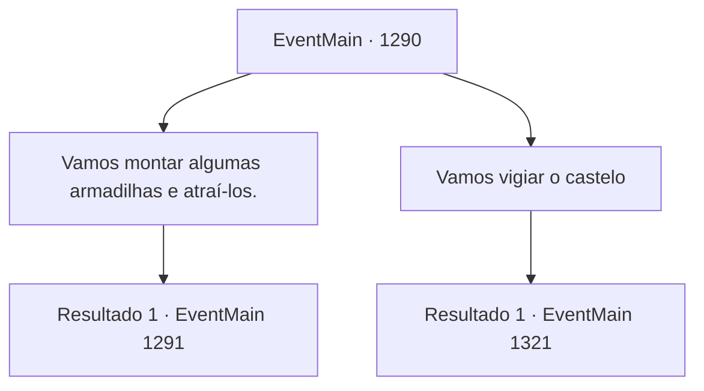

# Eventos principais · 1290

[Índice da tabela](index.md) · [Índice geral](../index.md)

ID: `pt:EventMain:1290` · Fonte: `EventMain4` · Versão: 1.2.47.

Mapeamento estático dos arquivos; a disponibilidade e a execução dependem do estado da run.

## Texto do evento

*Sem texto no arquivo.*

## Dados de entrada

```json
{
  "id": 1290,
  "grade": 1,
  "normalGoal": "",
  "required": ""
}
```

## Mapa das escolhas



## Escolhas e resultados

### Escolha 1

Vamos montar algumas armadilhas e atraí-los.

Requisitos e outros campos da escolha:

```json
{
  "required": ""
}
```

#### Resultado 1.1

Você sugere preparar armadilhas, atrair os inimigos para elas e eliminá-los de uma vez. Rennart considera isso por alguns segundos, então aponta para um ponto no mapa. É o Rio Kroben - um curso d'água largo entre o Castelo Briovich e o Castelo Greymoor. 

 "Que tal aqui?"

 Olhando o mapa, você pensa em um plano. Você decide construir barragens antecipadamente e destruí-las na hora certa, varrendo o inimigo. 

 "Vou enviar soldados para construir algumas barragens. Mas... se realmente quisermos que isso aconteça, precisaremos de um esquadrão de isca e um esquadrão de emboscada."

 Você acena concordando. Logo, seus soldados partem para o Rio Kroben e preparam algumas armadilhas. 

 Alguns dias depois, Rennart entra correndo no escritório e espalha a notícia. Ele diz que a Casa Greymoor e a Aliança declararam guerra à Casa Briovich. 

 "Logo após a declaração de guerra, as forças da Aliança já estão marchando rumo ao Castelo Briovich. Precisamos nos mover, tipo, agora mesmo, meu senhor."

 Você imediatamente prepara seu equipamento e vai até a praça principal. Lá, soldados armados estão em formação, aguardando suas ordens. Rennart se aproxima e reporta. 

 "Tanto nosso esquadrão de isca quanto nosso esquadrão de emboscada estão prontos."


Continuação registrada: [Evento 1291](1291.md) na mesma tabela.

```json
{
  "required": "",
  "chance": "1",
  "nextEvent": 1291,
  "type": 2,
  "reward": ""
}
```

### Escolha 2

Vamos vigiar o castelo

Requisitos e outros campos da escolha:

```json
{
  "required": ""
}
```

#### Resultado 2.1

Você sugere resistir dentro do castelo. Rennart considera por um momento antes de responder. 

 "Podemos usar as muralhas do castelo a nosso favor."

 Ele continua, encarando o mapa. 

 "Entretanto... Recentemente tivemos que passar por várias guerras e estamos com pouco efetivo. Mas a Casa Greymoor não teve uma grande guerra há algum tempo. Eles também terão o apoio de outras Casas a seu lado. Seremos amplamente superados em número."

 Rennart considera isso por um momento e assente, como se de repente tivesse tido uma boa ideia. 

 "Enquanto limpávamos o depósito depois de lutar contra os orcs, descobrimos esta velha balista."

 Se conseguirmos consertá-la, deveríamos ser capazes de destruir o equipamento de cerco deles. Sem um l

Continuação registrada: [Evento 1321](1321.md) na mesma tabela.

```json
{
  "required": "",
  "chance": "1",
  "nextEvent": 1321,
  "type": 2,
  "reward": ""
}
```

## Referências que chegam a este evento

- [Evento 1288 · escolha 1 · resultado 1](1288.md#escolha-1)
- [Evento 1289 · escolha 3 · resultado 1](1289.md#escolha-3)
