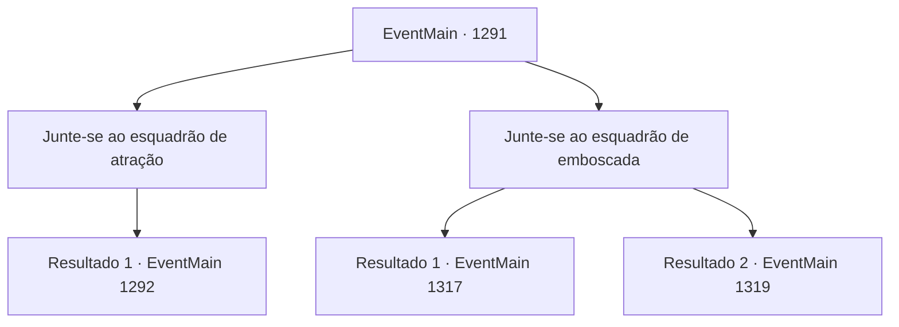

# Eventos principais · 1291

[Índice da tabela](index.md) · [Índice geral](../index.md)

ID: `pt:EventMain:1291` · Fonte: `EventMain4` · Versão: 1.2.47.

Mapeamento estático dos arquivos; a disponibilidade e a execução dependem do estado da run.

## Texto do evento

*Sem texto no arquivo.*

## Dados de entrada

```json
{
  "id": 1291,
  "grade": 1,
  "normalGoal": "",
  "required": ""
}
```

## Mapa das escolhas



## Escolhas e resultados

### Escolha 1

Junte-se ao esquadrão de atração

Requisitos e outros campos da escolha:

```json
{
  "required": ""
}
```

#### Resultado 1.1

Você decide liderar seus homens na esquadra de isca. Rennart acena com a cabeça. 

 "Então eu vou liderar a esquadra de emboscada e me preparar para o seu sinal. Assim que eu vir seu sinalizador, as comportas serão desmontadas. Cuidado lá fora, meu senhor."

 Você pega o pergaminho do sinalizador com você e começa a marchar com os soldados. 

 Dois dias se passaram desde que você iniciou sua marcha. Você chega às Planícies de Roskar. É um lugar seguro localizado bem entre a Propriedade Briovich e a Propriedade Greymoor. O rio Korben atravessa essa área. Você para a caminhada árdua e estima o número de inimigos com os olhos. Você vê não apenas a bandeira da Casa Greymoor, mas de outras Casas também. As forças da Aliança ocupam as planícies. Você reúne seus soldados e lidera a investida na linha de frente. As forças da Aliança começam a retaliar - segue-se uma batalha temível.

Continuação registrada: [Evento 1292](1292.md) na mesma tabela.

```json
{
  "required": "",
  "chance": "1",
  "nextEvent": 1292,
  "type": 2,
  "reward": "3_54_1|6_0_204",
  "place": 0
}
```

### Escolha 2

Junte-se ao esquadrão de emboscada

Requisitos e outros campos da escolha:

```json
{
  "required": ""
}
```

#### Resultado 2.1

Você decide liderar seus homens na equipe de emboscada. Rennart acena com a cabeça. 

 "Então eu vou atrair o inimigo para o rio. Quando eles começarem a atravessar o rio, eu vou lançar o sinalizador. Aí, vocês podem abrir as comportas e se juntar a nós."

 Ele puxa o capacete para baixo, reúne seus homens e parte. Você o observa ir embora antes de conduzir os engenheiros militares e alguns soldados até a margem do Rio Kroben. 

 Dois dias depois, você chega ao Rio Kroben e imediatamente prepara o ataque. Os soldados já estão formando as posições, com os engenheiros militares prontos para destruir as comportas. Mas, não importa quanto tempo você espere, o sinalizador não é lançado ao céu.

Continuação registrada: [Evento 1317](1317.md) na mesma tabela.

```json
{
  "required": "5_881_1",
  "chance": "1",
  "nextEvent": 1317,
  "type": 2,
  "reward": ""
}
```

#### Resultado 2.2

Você decide liderar seus homens na esquadra de emboscada. Rennart acena com a cabeça. 

 "Então eu vou atrair o inimigo para o rio. Quando começarem a atravessar o rio, eu vou disparar a sinalização. Então, vocês podem abrir as comportas e se juntar a nós."

 Ele puxa o capacete, pega seus homens e parte. Você o observa partir antes de conduzir os engenheiros militares, Tarrys e alguns soldados até a margem do rio Kroben. 

 Dois dias depois, você chega ao rio Kroben e imediatamente prepara o ataque. Os soldados já estão formando fileiras, com engenheiros militares prontos para destruir as comportas. Mas não importa quanto você espere, a sinalização não é disparada no céu. 

 "Tch. Algo não está certo. Vou investigar com alguns homens."

 Tarrys ajusta o cabo de sua lança e responde.

Continuação registrada: [Evento 1319](1319.md) na mesma tabela.

```json
{
  "required": "18_881_1",
  "chance": "1",
  "nextEvent": 1319,
  "type": 2,
  "reward": ""
}
```

## Referências que chegam a este evento

- [Evento 1290 · escolha 1 · resultado 1](1290.md#escolha-1)
