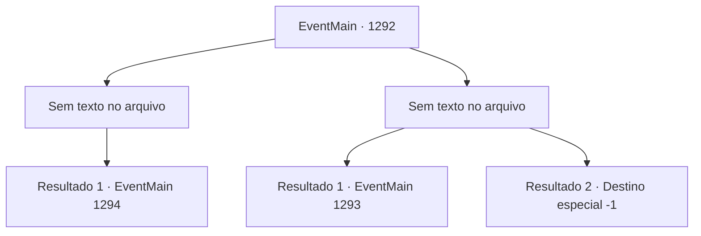

# Eventos principais · 1292

[Índice da tabela](index.md) · [Índice geral](../index.md)

ID: `pt:EventMain:1292` · Fonte: `EventMain4` · Versão: 1.2.47.

Mapeamento estático dos arquivos; a disponibilidade e a execução dependem do estado da run.

## Texto do evento

*Sem texto no arquivo.*

## Dados de entrada

```json
{
  "id": 1292,
  "grade": 1,
  "normalGoal": "",
  "required": ""
}
```

## Mapa das escolhas



## Escolhas e resultados

### Escolha 1

*Sem texto no arquivo; o papel dessa opção depende da interface do jogo.*

Requisitos e outros campos da escolha:

```json
{
  "required": ""
}
```

#### Resultado 1.1

Você verifica o campo de batalha e ordena que seus homens recuem. Seguindo sua ordem, eles fingem fugir. As forças da Aliança avançam cada vez mais. Então, um de seus homens grita, apontando para o outro lado. 

 "M- meu senhor! Reforços chegando!"

 Ainda mais soldados chegam. 

 "Eu, Cedric da Casa Bathory, estou aqui! Tomem minha lâmina!!"

 Uma cavalaria liderada por um cavaleiro da Aliança bloqueia seu caminho.

Continuação registrada: [Evento 1294](1294.md) na mesma tabela.

```json
{
  "required": "",
  "chance": "1",
  "nextEvent": 1294,
  "type": 2,
  "reward": ""
}
```

### Escolha 2

*Sem texto no arquivo; o papel dessa opção depende da interface do jogo.*

Requisitos e outros campos da escolha:

```json
{
  "required": ""
}
```

#### Resultado 2.1

Briovich soldados são lentamente empurrados para trás pelo ataque implacável das forças da Aliança. Eles permanecem em seus cavalos, pisoteando sua formação. Seus soldados estão ocupados defendendo, erguendo seus escudos. 

 "M-meu Senhor! É o sinalizador!"

 Então, uma bola vermelha de luz explode no céu a partir do topo da margem do rio. Isso significava que a equipe de emboscada estava sendo atacada. Infelizmente, você desiste de tentar atrair as forças da Aliança e recua para o Castelo. 

 Quando você finalmente retorna ao escritório, Rennart relata. Ele tem bandagens no peito e nos ombros. Seus olhos estão marcados pela exaustão. 

 "Sinto muito, meu Senhor... Fomos rastreados pelos malditos batedores..."

 Você balança a cabeça em silêncio e pergunta o que ele fará no futuro. 

 "As forças da Aliança estão marchando para o castelo. Devemos preparar a defesa em breve."

 Você se dirige ao centro da praça com Rennart. Lá, soldados sobreviventes tratam possíveis ferimentos uns dos outros.

Continuação registrada: [Evento 1293](1293.md) na mesma tabela.

```json
{
  "required": "1_0_2|1_1_2",
  "chance": "1",
  "nextEvent": 1293,
  "type": 2,
  "reward": "0_0_-1|0_1_-1"
}
```

#### Resultado 2.2

Soldados Briovich estão sendo lentamente empurrados para trás pelo ataque impiedoso das forças da Aliança.. Eles permanecem em seus cavalos, pisoteando sua formação. Seus soldados estão ocupados defendendo, erguendo seus escudos. 

 "...Meu Senhor! Sua retaguarda!"

 Em meio ao combate pesado, você nota alguém gritando lá atrás. Uma enorme maça voa em sua direção. Você tenta desviar, mas seus membros não obedecem. Ai de você, a maça o atinge em cheio, e você perde a consciência.

Continuação registrada: [Destino especial `-1`](../destinos-especiais.md).

```json
{
  "required": "-1|2_0_2|2_1_2",
  "chance": "1",
  "nextEvent": -1,
  "type": 2,
  "reward": "0_0_-1|0_1_-1|15_7_11|25_8_1"
}
```

## Referências que chegam a este evento

- [Evento 1291 · escolha 1 · resultado 1](1291.md#escolha-1)
