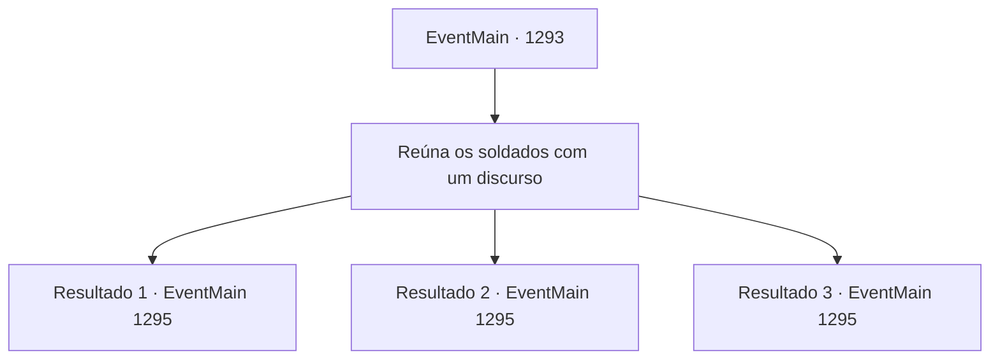

# Eventos principais · 1293

[Índice da tabela](index.md) · [Índice geral](../index.md)

ID: `pt:EventMain:1293` · Fonte: `EventMain4` · Versão: 1.2.47.

Mapeamento estático dos arquivos; a disponibilidade e a execução dependem do estado da run.

## Texto do evento

*Sem texto no arquivo.*

## Dados de entrada

```json
{
  "id": 1293,
  "grade": 1,
  "normalGoal": "",
  "required": ""
}
```

## Mapa das escolhas



## Escolhas e resultados

### Escolha 1

Reúna os soldados com um discurso

Requisitos e outros campos da escolha:

```json
{
  "required": ""
}
```

#### Resultado 1.1

Você reúne seus homens e faz um discurso, dizendo que as forças da Aliança logo estarão aqui. Começam a se espalhar murmúrios inseguros entre os soldados. Você ignora a reação deles e continua. Você passa a dizer que nada vem quando nada é feito, apontando que agora é a chance deles de realmente lutar por alguém que amam. Os soldados erguem suas armas em conjunto, soltando um poderoso brado de guerra. 

 'DING DING DING DING!!' 

 "Inimigo se aproximando! Inimigo se aproximando!"

 Naquela noite, as forças da Aliança forçam sua entrada no Castelo Briovich. Você e Rennart ouvem o guarda gritando. Vocês sobem as muralhas do castelo. Lá, vocês enfrentam os mortos-vivos, sem medo da morte.

Continuação registrada: [Evento 1295](1295.md) na mesma tabela.

```json
{
  "required": "5_881_1",
  "chance": "1|0_12_1",
  "nextEvent": 1295,
  "type": 0,
  "reward": "6_0_204",
  "place": 0
}
```

#### Resultado 1.2

Você reúne seus homens e faz um discurso, dizendo que as forças da Aliança logo estarão aqui. Mas nada muda entre seus soldados. Alguns dos soldados reagem finalmente, provavelmente para não deixá-lo desconfortável. 

 'DING DING DING DING!!' 

 "Inimigo se aproximando! Inimigo se aproximando!"

 Naquela noite, as forças da Aliança forçam a entrada no Castelo Briovich. Você e Rennart ouvem o guarda gritando. Vocês sobem pelas muralhas do castelo. Lá, vocês revidam contra os mortos-vivos, sem medo da morte.

Continuação registrada: [Evento 1295](1295.md) na mesma tabela.

```json
{
  "required": "5_881_1",
  "chance": "18",
  "nextEvent": 1295,
  "type": 1,
  "reward": "6_3_204",
  "place": 0
}
```

#### Resultado 1.3

Você reúne seus homens e faz um discurso, dizendo que as forças da Aliança logo estarão aqui. Começam a se espalhar murmúrios inseguros entre os soldados. Você ignora a reação deles e continua. Você passa a dizer que nada vem quando nada é feito, apontando que agora é a chance deles de realmente lutar por alguém que amam. Os soldados erguem suas armas em conjunto, soltando um poderoso brado de guerra. 

 DING DING DING DING!! 

 "Inimigo se aproximando! Inimigo se aproximando!"

 Naquela noite, as forças da Aliança forçam sua entrada no Castelo Briovich. Você e Rennart ouvem o guarda gritando. Vocês sobem as muralhas do castelo. Lá, vocês enfrentam os mortos-vivos, sem medo da morte.

Continuação registrada: [Evento 1295](1295.md) na mesma tabela.

```json
{
  "required": "18_881_1",
  "chance": "1",
  "nextEvent": 1295,
  "type": 2,
  "reward": "6_0_204",
  "place": 0
}
```

## Referências que chegam a este evento

- [Evento 1292 · escolha 2 · resultado 1](1292.md#escolha-2)
- [Evento 1320 · escolha 2 · resultado 1](1320.md#escolha-2)
