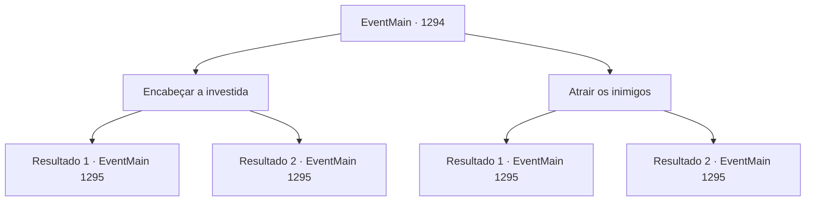

# Eventos principais · 1294

[Índice da tabela](index.md) · [Índice geral](../index.md)

ID: `pt:EventMain:1294` · Fonte: `EventMain4` · Versão: 1.2.47.

Mapeamento estático dos arquivos; a disponibilidade e a execução dependem do estado da run.

## Texto do evento

*Sem texto no arquivo.*

## Dados de entrada

```json
{
  "id": 1294,
  "grade": 1,
  "normalGoal": "",
  "required": ""
}
```

## Mapa das escolhas



## Escolhas e resultados

### Escolha 1

Encabeçar a investida

Requisitos e outros campos da escolha:

```json
{
  "required": ""
}
```

#### Resultado 1.1


 "LÁ!"

 "ATAQUEM! NÃO OS DEIXEM ESCAPAR!"

 Os cavaleiros da Aliança competem entre si para chegar até você assim que o avistam. Você diz aos seus soldados para se concentrarem e abrir um caminho por um ponto fraco. Você rompe as linhas inimigas e chega ao Rio Kroben. As barragens pré-construídas estão fazendo seu trabalho maravilhosamente. A corrente do rio enfraqueceu. 

 "Lá! Não os deixem escapar!"

 "Capturem Briovich!"

 Após confirmar que todos os seus soldados atravessaram o rio, você puxa seu pergaminho sinalizador. Você rasga o pergaminho ao meio, bem quando os inimigos estão no centro do rio. Uma esfera brilhante de luz azul surge no ar. 

 <link=shake>'GRRRRRRRNG!! *RUMBLE*</link> |drawing_washArmy| Logo depois, a água aprisionada varre o terreno. Os soldados da Aliança são completamente aniquilados. Mais da metade deles é levada pela água. 

 "S- SOCORRO!! ARGH!!"

 Arrastados pelo rio, os soldados da Aliança perdem a moral. Os que restaram estão correndo por suas vidas, enquanto você e seus homens os perseguem.

Continuação registrada: [Evento 1295](1295.md) na mesma tabela.

```json
{
  "required": "",
  "chance": "1|0_5_1",
  "nextEvent": 1295,
  "type": 0,
  "reward": "4_54_1|6_2_204",
  "place": 0
}
```

#### Resultado 1.2

Você manda seus soldados se concentrarem para encontrar uma abertura, mas não consegue. A Aliança também não fica parada. Eles intensificam o ataque, impedindo você de usar suas táticas. Cada vez que você tenta se mover, eles mudam de formação para não lhe dar espaço. 

 "Lá! Peguem-nos! AGORA!"

 Os cavaleiros da Aliança competem entre si para alcançá-lo assim que o avistam. Infelizmente, você encosta as costas nos seus outros soldados, entrando em uma situação de luta ou morte.

Continuação registrada: [Evento 1295](1295.md) na mesma tabela.

```json
{
  "required": "",
  "chance": "20",
  "nextEvent": 1295,
  "type": 1,
  "reward": "6_0_204",
  "place": 0
}
```

### Escolha 2

Atrair os inimigos

Requisitos e outros campos da escolha:

```json
{
  "required": ""
}
```

#### Resultado 2.1

Você grita com os cavaleiros da Aliança para distraí-los. 

 "AÍ! PEGUEM-OS! NÃO DEIXEM QUE ESCAPEM!"

 Os cavaleiros da Aliança correm uns contra os outros para chegar até você assim que o avistam. Você guia rapidamente seu cavalo, atraindo os inimigos e dando tempo aos seus companheiros para recuarem. Alguns momentos depois, o Rio Kroben surge à sua frente. As represas pré-construídas estão fazendo seu trabalho maravilhosamente. O fluxo do rio enfraqueceu. 

 "Aí! Não deixem que escapem!"

 "Capturem Briovich!"

 Você rasga o pergaminho ao meio, justamente quando os inimigos estão no centro do rio. Uma esfera brilhante de luz azul emerge no ar. 

 <link=shake>'GRRRRRRRNG!! *RUMBLE*</link> |drawing_washArmy| Logo depois, a água presa varre o terreno. Os soldados da Aliança são completamente aniquilados. Mais da metade deles é levada pela água. 

 "S- SOCORRO!! ARGH!!"

 Arrastados pelo rio, os soldados da Aliança perdem o ânimo. Os que restam estão ocupados correndo por suas vidas, enquanto você e seus homens os perseguem.

Continuação registrada: [Evento 1295](1295.md) na mesma tabela.

```json
{
  "required": "",
  "chance": "1|0_12_1",
  "nextEvent": 1295,
  "type": 0,
  "reward": "4_54_1|6_2_204",
  "place": 0
}
```

#### Resultado 2.2

Você grita com os cavaleiros da Aliança para distraí-los. Enquanto a Aliança vem atrás de você, seus companheiros deveriam ter tido tempo para recuar. Mas eles não ficam de braços cruzados. Eles intensificam o ataque, impedindo você de usar suas táticas. Cada vez que você tenta se movimentar, eles mudam de formação para não lhe dar espaço. 

 "Lá! Peguem-no! AGORA!"

 Os cavaleiros da Aliança competem entre si para alcançá-lo assim que o avistam. Infelizmente, você fica com as costas encostadas nos seus outros soldados, entrando numa situação de luta ou morte.

Continuação registrada: [Evento 1295](1295.md) na mesma tabela.

```json
{
  "required": "",
  "chance": "18",
  "nextEvent": 1295,
  "type": 1,
  "reward": "6_0_204",
  "place": 0
}
```

## Referências que chegam a este evento

- [Evento 1292 · escolha 1 · resultado 1](1292.md#escolha-1)
- [Evento 1320 · escolha 1 · resultado 1](1320.md#escolha-1)
