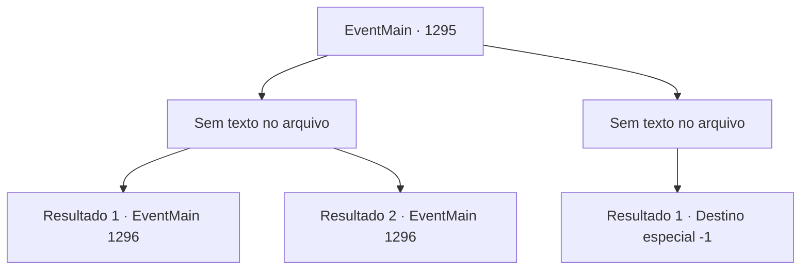

# Eventos principais · 1295

[Índice da tabela](index.md) · [Índice geral](../index.md)

ID: `pt:EventMain:1295` · Fonte: `EventMain4` · Versão: 1.2.47.

Mapeamento estático dos arquivos; a disponibilidade e a execução dependem do estado da run.

## Texto do evento

*Sem texto no arquivo.*

## Dados de entrada

```json
{
  "id": 1295,
  "grade": 1,
  "normalGoal": "",
  "required": ""
}
```

## Mapa das escolhas



## Escolhas e resultados

### Escolha 1

*Sem texto no arquivo; o papel dessa opção depende da interface do jogo.*

Requisitos e outros campos da escolha:

```json
{
  "required": ""
}
```

#### Resultado 1.1


 "Surrender! Nós nos rendemos!!"

 Quando um cavaleiro da Aliança larga sua arma e se rende, uma onda inteira começa. 

 "E- eu também!"

 Outro cavaleiro põe sua lança no chão. Alguns soldados largam os arcos. Alguns estão simplesmente fugindo sem sequer olhar para trás. Você respira fundo e se vira para olhar os soldados derrotados. Eles foram drasticamente reduzidos em número. Os prisioneiros são mantidos em um único local, armas guardadas. Os cavaleiros se curvam em derrota, enquanto os soldados olham para suas armas.

Continuação registrada: [Evento 1296](1296.md) na mesma tabela.

```json
{
  "required": "18_958_1",
  "chance": "1",
  "nextEvent": 1296,
  "type": 2,
  "reward": ""
}
```

#### Resultado 1.2


 "Surrender! We surrender!!"

 Enquanto um cavaleiro da Aliança larga sua arma e se rende, uma onda inteira começa. 

 "E- eu também!"

 Outro cavaleiro coloca sua lança no chão. Alguns soldados largam seus arcos. Alguns simplesmente correm sem jamais olhar para trás. Você sai vitorioso. Então, Rennart se aproxima de você, ofegante. 

 "Tudo graças a você por enviar Tarrys, meu senhor. Fomos contra-cercados depois de tentar romper o cerco. Tarrys encontrou uma abertura e fez o plano funcionar."

 Você se vira para olhar Tarrys. Ele simplesmente dá de ombros. Você volta seu olhar para as forças da Aliança destruídas. Os prisioneiros estão reunidos em um único lugar, suas armas guardadas. Os cavaleiros se curvam, derrotados, enquanto os soldados olham para o chão, exaustos.

Continuação registrada: [Evento 1296](1296.md) na mesma tabela.

```json
{
  "required": "5_958_1",
  "chance": "1",
  "nextEvent": 1296,
  "type": 2,
  "reward": ""
}
```

### Escolha 2

*Sem texto no arquivo; o papel dessa opção depende da interface do jogo.*

Requisitos e outros campos da escolha:

```json
{
  "required": ""
}
```

#### Resultado 2.1

Um cavaleiro da Aliança aponta sua espada para o seu pescoço. Você dá um passo para trás e desvia, mas então uma lança se enterra em seu abdômen. Você é empalado pela lança e lançado para trás. 

 "...MEU SENHOR!!"

 Rennart, que só entrou na batalha para descobrir sua morte, grita desesperadamente. Sua visão começa a turvar. Sua consciência se desvanece na escuridão.

Continuação registrada: [Destino especial `-1`](../destinos-especiais.md).

```json
{
  "required": "",
  "chance": "1",
  "nextEvent": -1,
  "type": 2,
  "reward": "0_0_-1|0_1_-1|15_7_11|25_8_1"
}
```

## Referências que chegam a este evento

- [Evento 1293 · escolha 1 · resultado 1](1293.md#escolha-1)
- [Evento 1293 · escolha 1 · resultado 2](1293.md#escolha-1)
- [Evento 1293 · escolha 1 · resultado 3](1293.md#escolha-1)
- [Evento 1294 · escolha 1 · resultado 1](1294.md#escolha-1)
- [Evento 1294 · escolha 1 · resultado 2](1294.md#escolha-1)
- [Evento 1294 · escolha 2 · resultado 1](1294.md#escolha-2)
- [Evento 1294 · escolha 2 · resultado 2](1294.md#escolha-2)
- [Evento 1318 · escolha 1 · resultado 1](1318.md#escolha-1)
- [Evento 1319 · escolha 1 · resultado 1](1319.md#escolha-1)
