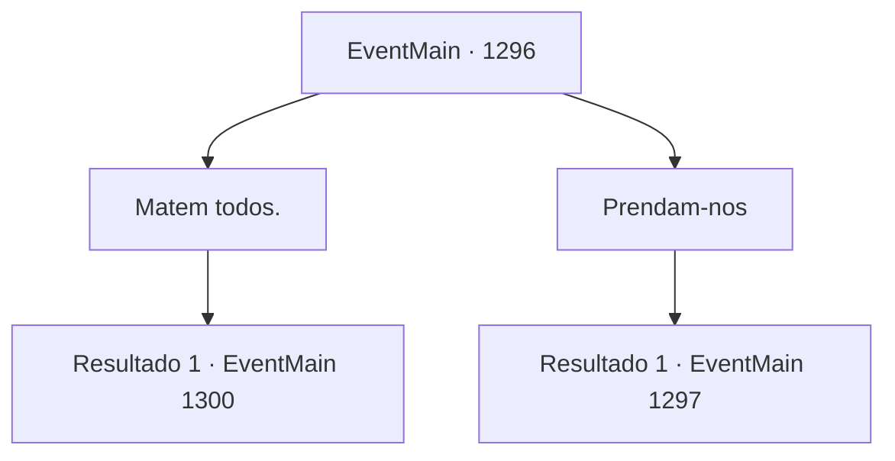

# Eventos principais · 1296

[Índice da tabela](index.md) · [Índice geral](../index.md)

ID: `pt:EventMain:1296` · Fonte: `EventMain4` · Versão: 1.2.47.

Mapeamento estático dos arquivos; a disponibilidade e a execução dependem do estado da run.

## Texto do evento

*Sem texto no arquivo.*

## Dados de entrada

```json
{
  "id": 1296,
  "grade": 1,
  "normalGoal": "",
  "required": ""
}
```

## Mapa das escolhas



## Escolhas e resultados

### Escolha 1

Matem todos.

Requisitos e outros campos da escolha:

```json
{
  "required": ""
}
```

#### Resultado 1.1

Você diz a Rennart para executar os prisioneiros, todos eles. Rennart hesita um pouco, mas logo concorda com a cabeça e prepara as execuções. 

 "M- MISERICÓRDIA! POR FAVOR!"

 Os cavaleiros são todos condenados à forca. Seus corpos são pendurados nas muralhas do castelo. Os soldados são enterrados vivos em uma vala. Alguns dias depois, as forças da Aliança estão invadindo o Castelo Briovich. 

 "Meu Senhor, a Aliança está vindo contra nós."|drawing_unionArmy| Você sobe nas muralhas do castelo com Rennart para estimar seu tamanho. Você consegue sentir sua raiva de longe. 

 "Sem vergonha, Briovich! Vocês vão pagar caro por abandonar a honra e executar seus prisioneiros!"

 Eles já estão batendo furiosamente no portão da frente. Você e seus homens começam a atacá‑los de cima.

Continuação registrada: [Evento 1300](1300.md) na mesma tabela.

```json
{
  "required": "",
  "chance": "1",
  "nextEvent": 1300,
  "type": 2,
  "reward": "0_3_-10|5_959_1|6_2_204",
  "place": 4
}
```

### Escolha 2

Prendam-nos

Requisitos e outros campos da escolha:

```json
{
  "required": ""
}
```

#### Resultado 2.1

Você ordena que Rennart tranque os prisioneiros na cadeia. Rennart concorda com a cabeça, então ordena que seus soldados levem os prisioneiros para a prisão. 

 "Algumas Casas nos enviaram cartas, pedindo o retorno seguro de seus cavaleiros. Algumas até ofereceram resgate, ou prometeram ficar neutras nessa guerra."

 Você responde que lidará com isso quando a guerra acabar. Você sai para se preparar para a próxima batalha. 

 "Conseguimos reduzir bastante os números deles, mas aparentemente eles ainda têm algumas reservas. ...Mas sendo reservas, eu não esperaria muito deles."

 Rennart coloca as mãos no mapa e continua. 

 "Nossa próxima batalha — muito importante. Como o inimigo acabou de sofrer uma grande perda, desta vez eles serão muito mais cautelosos em sua abordagem."

 Você fixa o olhar no mapa.

Continuação registrada: [Evento 1297](1297.md) na mesma tabela.

```json
{
  "required": "",
  "chance": "1",
  "nextEvent": 1297,
  "type": 2,
  "reward": ""
}
```

## Referências que chegam a este evento

- [Evento 1295 · escolha 1 · resultado 1](1295.md#escolha-1)
- [Evento 1295 · escolha 1 · resultado 2](1295.md#escolha-1)
- [Evento 1328 · escolha 1 · resultado 1](1328.md#escolha-1)
