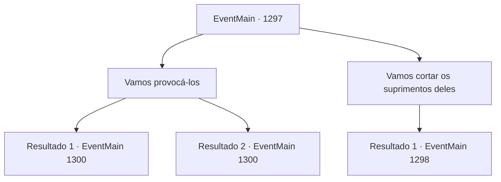

# Eventos principais · 1297

[Índice da tabela](index.md) · [Índice geral](../index.md)

ID: `pt:EventMain:1297` · Fonte: `EventMain4` · Versão: 1.2.47.

Mapeamento estático dos arquivos; a disponibilidade e a execução dependem do estado da run.

## Texto do evento

*Sem texto no arquivo.*

## Dados de entrada

```json
{
  "id": 1297,
  "grade": 1,
  "normalGoal": "",
  "required": ""
}
```

## Mapa das escolhas



## Escolhas e resultados

### Escolha 1

Vamos provocá-los

Requisitos e outros campos da escolha:

```json
{
  "required": ""
}
```

#### Resultado 1.1

Você diz a Rennart que vai pessoalmente sair e provocá-los. Ele ouve sua ousada sugestão e acena com cuidado. 

 "...Entendido. Mas tenha cuidado."

 Você monta seu cavalo e vai até o posto avançado da Aliança. Lembrando da grande perda da última batalha, nenhum deles o ataca primeiro, apesar de você estar bem perto das tendas deles agora. Você amarra seu cavalo à distância, então procede a provocar os soldados da Aliança. Você xinga Katrin, dizendo que ela é uma covarde desavergonhada e desonrosa que se esconde atrás de seus soldados. Você estende as críticas a outros nobres também. Você os chama de gente sem coluna vertebral, desperdiçando as preciosas vidas de seus soldados, só se importando com o que Katrin tem a dizer. Então, um punhado de cavaleiros vem galopando em sua direção — suas provocações parecem ter funcionado. 

 "Parem aí mesmo, escória de Briovich! Vou acabar com vocês em breve!"

 Rapidamente, você salta de volta no cavalo e retorna ao castelo. Os cavaleiros da Aliança não têm escolha senão recuar. 

 "Nunca esqueceremos este insulto!"

 Logo depois que os cavaleiros retornam, as forças da Aliança marcham em direção ao Castelo Briovich. 

 "Meu senhor, o inimigo está atacando."

 Você e Rennart sobem as muralhas do castelo e olham para baixo. |drawing_unionArmy| Soldados da Aliança marcharam às pressas, cegos de raiva. A formação deles está incorreta — eles simplesmente sobem em massa como abelhas. Você e seus homens começam a atacá-los de cima.

Continuação registrada: [Evento 1300](1300.md) na mesma tabela.

```json
{
  "required": "",
  "chance": "1|0_12_1",
  "nextEvent": 1300,
  "type": 0,
  "reward": "6_2_204",
  "place": 4
}
```

#### Resultado 1.2

Você diz a Rennart que vai pessoalmente sair e provocá-los. Ele ouve sua audaciosa sugestão e acena cuidadosamente. 

 "...Entendido. Mas tenha cuidado."

 Você monta em seu cavalo e vai até o posto avançado da Aliança. Lembrando da grande perda da última batalha, nenhum deles o ataca primeiro, apesar de você estar bem perto das tendas deles agora. Você prende seu cavalo a uma certa distância, então procede a provocar os soldados da Aliança. Mas mesmo horas de xingamentos e de chamar Katrin de nomes não são suficientes para fazê-los agir. Lamentavelmente, você não tem outra escolha senão voltar ao castelo. 

 Alguns dias depois, as forças da Aliança marcham novamente até o Castelo Briovich. 

 "Meu Senhor, o inimigo está atacando."

 Você e Rennart sobem às muralhas do castelo e olham para baixo. |drawing_unionArmy| Eles parecem ter trazido soldados adicionais - você nota imediatamente que está em desvantagem numérica. Eles iniciam um cerco de fato, mantendo formação eficaz e minando as muralhas do castelo. Você e seus homens começam a atacá-los de cima.

Continuação registrada: [Evento 1300](1300.md) na mesma tabela.

```json
{
  "required": "",
  "chance": "15",
  "nextEvent": 1300,
  "type": 1,
  "reward": "6_0_204",
  "place": 4
}
```

### Escolha 2

Vamos cortar os suprimentos deles

Requisitos e outros campos da escolha:

```json
{
  "required": ""
}
```

#### Resultado 2.1

Você sugere cortar a cadeia de suprimentos deles. Rennart ajusta os óculos e responde. 

 "Boa ideia. Primeiro vamos verificar de onde eles estão recebendo os suprimentos."

 Você e Rennart abrem um mapa para estimar aproximadamente a localização das linhas de suprimento deles. Então, você envia alguns batedores para que verifiquem a área. 

 Dois dias se passam desde que os batedores foram despachados.
 Rennart recebe um relatório dos batedores, resume os resultados e entrega a você. 

 "Parece que a Aliança está usando o Posto Comercial Jarval como seu depósito principal de suprimentos. De lá, eles distribuíam recursos pela Floresta de Almorn."

 Rennart encontra o posto comercial no mapa e continua. 

 "Há certa distância entre nosso castelo e o posto comercial. Se fôssemos atacar, eu sugeriria ir atrás da Floresta de Almorn."

 Você imediatamente reúne alguns de seus soldados e monta seu cavalo rumo à Floresta de Almorn. 

 A floresta já está envolta em trevas. Você se esgueira pelos cenários familiares da floresta e encontra um grupo de soldados da Aliança transportando suprimentos. Eles estão alheios à sua presença, arrastando rodas de carroça pelo caminho da floresta.

Continuação registrada: [Evento 1298](1298.md) na mesma tabela.

```json
{
  "required": "",
  "chance": "1",
  "nextEvent": 1298,
  "type": 2,
  "reward": ""
}
```

## Referências que chegam a este evento

- [Evento 1296 · escolha 2 · resultado 1](1296.md#escolha-2)
