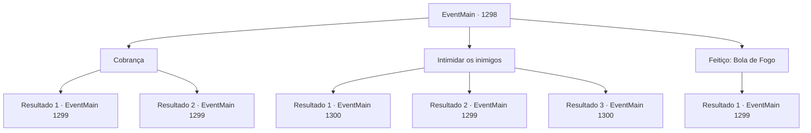

# Eventos principais · 1298

[Índice da tabela](index.md) · [Índice geral](../index.md)

ID: `pt:EventMain:1298` · Fonte: `EventMain4` · Versão: 1.2.47.

Mapeamento estático dos arquivos; a disponibilidade e a execução dependem do estado da run.

## Texto do evento

*Sem texto no arquivo.*

## Dados de entrada

```json
{
  "id": 1298,
  "grade": 1,
  "normalGoal": "",
  "required": ""
}
```

## Mapa das escolhas



## Escolhas e resultados

### Escolha 1

Cobrança

Requisitos e outros campos da escolha:

```json
{
  "required": ""
}
```

#### Resultado 1.1

Você lidera seus soldados e embosca os fornecedores da Aliança. Pego de surpresa pelo ataque repentino, eles começam a entrar em pânico. 

 "Não os perca!!"

 "Avante! Avante!"

 Com um brado de guerra, você arrasa os fornecedores.

Continuação registrada: [Evento 1299](1299.md) na mesma tabela.

```json
{
  "required": "",
  "chance": "1|0_5_1",
  "nextEvent": 1299,
  "type": 0,
  "reward": "6_2_135",
  "place": 1
}
```

#### Resultado 1.2

Você lidera seus soldados e embosca os fornecedores da Aliança. Mas os fornecedores reagem com calma e de forma estratégica. Eles erguem seus escudos, formando uma formação defensiva, reagindo de maneira adequada. 

 "Emboscada inimiga! Todos, protejam os vagões!"

 "Não são tantos! Revidem!"

 Com um brado de guerra, você avança contra os fornecedores.

Continuação registrada: [Evento 1299](1299.md) na mesma tabela.

```json
{
  "required": "",
  "chance": "16",
  "nextEvent": 1299,
  "type": 1,
  "reward": "6_0_135",
  "place": 1
}
```

### Escolha 2

Intimidar os inimigos

Requisitos e outros campos da escolha:

```json
{
  "required": ""
}
```

#### Resultado 2.1

Você lidera seus soldados e se aproxima confiante dos fornecedores da Aliança. Você grita que, se eles deixarem a carroça e partirem, nenhum deles precisa se ferir. O mais velho dos fornecedores olha ao redor, começa a suar e acena com a cabeça. 

 "W- gostaríamos de nos retirar."

 Eles deixam suas carroças e suprimentos no chão e fogem. Você ordena que seus homens os empacotem, então retorna ao castelo. 

 Alguns dias depois, as forças da Aliança marcham até o Castelo Briovich mais uma vez. Você e Rennart sobem às muralhas do castelo e olham para baixo. |drawing_unionArmy| Eles avançam furiosamente em direção ao castelo, mas você percebe que estão visivelmente exaustos. 

 "Parece que roubar os suprimentos deles valeu a pena."

 Você concorda com um aceno e se junta aos seus soldados nas muralhas do castelo.

Continuação registrada: [Evento 1300](1300.md) na mesma tabela.

```json
{
  "required": "21_1_3",
  "chance": "1|0_12_1",
  "nextEvent": 1300,
  "type": 0,
  "reward": "6_2_204",
  "place": 4
}
```

#### Resultado 2.2

Você lidera seus soldados e se aproxima confiante dos fornecedores da Aliança. Você grita que, se eles largarem a roda de carroça e saírem, nenhum deles precisa se machucar. 

 "Inimigos se aproximando! Todos, protejam as carroças!"

 Mas eles são mais corajosos do que você pensava. Eles erguem seus escudos, formando uma formação defensiva, reagindo apropriadamente. Com um alto grito de guerra, você investe contra os fornecedores.

Continuação registrada: [Evento 1299](1299.md) na mesma tabela.

```json
{
  "required": "21_1_3",
  "chance": "12",
  "nextEvent": 1299,
  "type": 1,
  "reward": "6_0_135",
  "place": 1
}
```

#### Resultado 2.3

Você lidera seus soldados e se aproxima confiante dos fornecedores da Aliança. Você grita que, se eles deixarem a carroça e partirem, nenhum deles precisa se ferir. O mais velho dos fornecedores olha ao redor, começa a suar e acena com a cabeça. 

 "W- gostaríamos de nos retirar."

 Eles deixam suas carroças e suprimentos no chão e fogem. Você ordena que seus homens os empacotem, então retorna ao castelo. 

 Alguns dias depois, as forças da Aliança marcham até o Castelo Briovich mais uma vez. Você e Rennart sobem às muralhas do castelo e olham para baixo. |drawing_unionArmy| Eles avançam furiosamente em direção ao castelo, mas você percebe que estão visivelmente exaustos. 

 "Parece que roubar os suprimentos deles valeu a pena."

 Você concorda com um aceno e se junta aos seus soldados nas muralhas do castelo.

Continuação registrada: [Evento 1300](1300.md) na mesma tabela.

```json
{
  "required": "20_1_3",
  "chance": "1",
  "nextEvent": 1300,
  "type": 2,
  "reward": "6_2_204",
  "place": 4
}
```

### Escolha 3

Feitiço: Bola de Fogo

Requisitos e outros campos da escolha:

```json
{
  "required": "20_0_2|1_1_2"
}
```

#### Resultado 3.1

Você conjura e lança uma bola de fogo nos fornecedores. Pego de surpresa pela emboscada, eles são engolidos pelas chamas, sem conseguir oferecer muita resistência. 

 "AAAAARGH!! F- FOGO! FOGO!"

 "Emboscada inimiga! Todo mundo, recu- ARGH!!"

 Você aproveita a oportunidade e investe contra os fornecedores com seus homens.

Continuação registrada: [Evento 1299](1299.md) na mesma tabela.

```json
{
  "required": "",
  "chance": "1",
  "nextEvent": 1299,
  "type": 2,
  "reward": "0_1_-1|6_2_135",
  "place": 1
}
```

## Referências que chegam a este evento

- [Evento 1297 · escolha 2 · resultado 1](1297.md#escolha-2)
