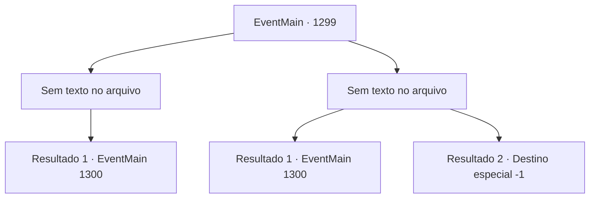

# Eventos principais · 1299

[Índice da tabela](index.md) · [Índice geral](../index.md)

ID: `pt:EventMain:1299` · Fonte: `EventMain4` · Versão: 1.2.47.

Mapeamento estático dos arquivos; a disponibilidade e a execução dependem do estado da run.

## Texto do evento

*Sem texto no arquivo.*

## Dados de entrada

```json
{
  "id": 1299,
  "grade": 1,
  "normalGoal": "",
  "required": ""
}
```

## Mapa das escolhas



## Escolhas e resultados

### Escolha 1

*Sem texto no arquivo; o papel dessa opção depende da interface do jogo.*

Requisitos e outros campos da escolha:

```json
{
  "required": ""
}
```

#### Resultado 1.1

Você lida com os fornecedores da Aliança. Os poucos soldados sobreviventes tentam fugir, deixando os suprimentos para trás. Você ordena que seus homens os embalem e então retorna ao castelo. 

 Alguns dias depois, as forças da Aliança marcham novamente em direção ao Castelo Briovich. Você e Rennart sobem às muralhas do castelo e olham para baixo. Eles estão investindo furiosamente contra o castelo, mas você nota que estão visivelmente exaustos. 

 "Parece que roubar os suprimentos deles valeu a pena."

 Você concorda com um aceno e se junta aos seus soldados nas muralhas do castelo.

Continuação registrada: [Evento 1300](1300.md) na mesma tabela.

```json
{
  "required": "",
  "chance": "1",
  "nextEvent": 1300,
  "type": 2,
  "reward": "6_2_204",
  "place": 4
}
```

### Escolha 2

*Sem texto no arquivo; o papel dessa opção depende da interface do jogo.*

Requisitos e outros campos da escolha:

```json
{
  "required": ""
}
```

#### Resultado 2.1

Os fornecedores ofereceram forte resistência. Infelizmente, você desiste de roubar seus suprimentos e retorna ao castelo com os soldados que restaram. 

 Alguns dias depois, as forças da Aliança marcham novamente até o Castelo Briovich. Você e Rennart sobem as muralhas do castelo e olham para baixo. Eles têm menos soldados do que da última vez, mas suas formações estavam impecáveis e seus ataques implacáveis. 

 "Parece que fizeram uma preparação e tanto."

 Você acena em concordância e se junta aos seus soldados nas muralhas do castelo.

Continuação registrada: [Evento 1300](1300.md) na mesma tabela.

```json
{
  "required": "1_0_2|1_1_2",
  "chance": "1",
  "nextEvent": 1300,
  "type": 2,
  "reward": "6_0_204|0_0_-1|0_1_-1",
  "place": 4
}
```

#### Resultado 2.2

Os fornecedores oferecem forte resistência. O soldado que parece ser o mais velho dos fornecedores continua lutando depois de ser atingido no ombro. 

 "WRAAAAAH!!"

 Com um grito de guerra estrondoso, ele se joga em cima de você. O próprio ataque não é letal — apenas te desequilibra. No entanto, você cai em cima de uma rocha afiada que sobressai. Infelizmente, você bate a cabeça nela e perde a consciência.

Continuação registrada: [Destino especial `-1`](../destinos-especiais.md).

```json
{
  "required": "-1|2_0_2|2_1_2",
  "chance": "1",
  "nextEvent": -1,
  "type": 2,
  "reward": "15_7_11|0_0_-1|0_1_-1|25_8_1"
}
```

## Referências que chegam a este evento

- [Evento 1298 · escolha 1 · resultado 1](1298.md#escolha-1)
- [Evento 1298 · escolha 1 · resultado 2](1298.md#escolha-1)
- [Evento 1298 · escolha 2 · resultado 2](1298.md#escolha-2)
- [Evento 1298 · escolha 3 · resultado 1](1298.md#escolha-3)
