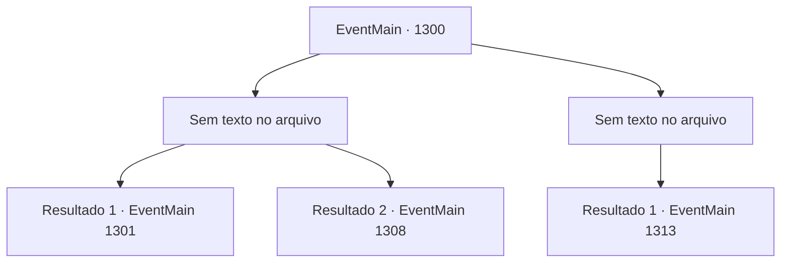

# Eventos principais · 1300

[Índice da tabela](index.md) · [Índice geral](../index.md)

ID: `pt:EventMain:1300` · Fonte: `EventMain4` · Versão: 1.2.47.

Mapeamento estático dos arquivos; a disponibilidade e a execução dependem do estado da run.

## Texto do evento

*Sem texto no arquivo.*

## Dados de entrada

```json
{
  "id": 1300,
  "grade": 1,
  "normalGoal": "",
  "required": ""
}
```

## Mapa das escolhas



## Escolhas e resultados

### Escolha 1

*Sem texto no arquivo; o papel dessa opção depende da interface do jogo.*

Requisitos e outros campos da escolha:

```json
{
  "required": ""
}
```

#### Resultado 1.1

Castelo de Briovich repeliu com sucesso o ataque inimigo. O campo de batalha está repleto de cavaleiros mortos, corpos de soldados, máquinas de cerco destruídas, escudos estilhaçados e muito mais. Aqueles que conseguiram sobreviver são amarrados com corda e levados ao pátio. 

 "M- MISERICÓRDIA! Poupe minha vida e eu... AAARGH!!"

 Você atinge o cavaleiro antes que ele possa implorar por sua vida novamente, e olha ao redor. Um forte cheiro de sangue se espalha pelo ar. 

 "Meu Senhor! Eles estão recuando."

 Você acena com a cabeça e ordena que seus soldados limpem o campo de batalha. 

 No começo da manhã do segundo dia, um homem chega ao Castelo Briovich. Você nota um pequeno brasão de serpente prateada em sua capa. É um mensageiro enviado pelo Conde Nadasdy, uma das Casas que compõem a Aliança. Ele se curva respeitosamente e começa a falar. 

 "Meu Senhor, o Conde Nadasdy deseja que saiba que ele não tem intenção de lutar contra a Casa Briovich por mais tempo."

 Ele engole em seco, então continua. 

 "...E ele gostaria de lhe propor uma maneira de pôr fim a esta guerra."


Continuação registrada: [Evento 1301](1301.md) na mesma tabela.

```json
{
  "required": "5_959_1",
  "chance": "1",
  "nextEvent": 1301,
  "type": 2,
  "reward": ""
}
```

#### Resultado 1.2

Castelo de Briovich repeliu com sucesso o ataque inimigo. Você respira fundo e olha ao redor. O campo de batalha está coberto pelos cadáveres de cavaleiros e soldados aliados, máquinas de cerco destruídas e escudos quebrados jaze espalhados. Os prisioneiros estão reunidos no pátio, amarrados com cordas. Um cheiro horrível de sangue vem no vento. 

 "Meu senhor, o inimigo está recuando."

 Você acena com a cabeça e ordena que o campo de batalha seja assegurado. 

 Dias depois, um mensageiro do exército aliado chega e propõe negociações. O mensageiro não é outro senão Katrin. Você lhe pergunta a que veio. Ela respira por um momento e fala com voz calma. 

 "Acho que o rumo desta guerra já ficou suficientemente claro. Se continuarmos lutando, só causará baixas desnecessárias em ambos os lados."

 Ela faz uma pausa e olha para você. 

 "Desejamos negociar o fim da guerra. Também estamos preparados para aceitar o maior número possível das exigências do conde."

 Você se senta em sua cadeira e a observa em silêncio. Katrin também mantém o olhar e espera quieta pela sua resposta.

Continuação registrada: [Evento 1308](1308.md) na mesma tabela.

```json
{
  "required": "18_959_1",
  "chance": "1",
  "nextEvent": 1308,
  "type": 2,
  "reward": ""
}
```

### Escolha 2

*Sem texto no arquivo; o papel dessa opção depende da interface do jogo.*

Requisitos e outros campos da escolha:

```json
{
  "required": ""
}
```

#### Resultado 2.1

O aríete da Aliança arromba os portões do castelo. Então, Rennart se aproxima de você, brandindo a espada, e grita. 

 "Meu senhor, você deve recuar para a torre de menagem!"

 Você e Rennart recuam para a torre de menagem e se preparam para resistir ali. Você tranca todas as portas e janelas que encontra, depois monta uma barricada improvisada com móveis. Você posiciona seus soldados em todas as entradas. 

 "E- eles estão vindo!"

 Os soldados exclamam, e logo ouve-se uma forte pancada. Eles estão tentando arrombar a porta do lado de fora da torre de menagem.

Continuação registrada: [Evento 1313](1313.md) na mesma tabela.

```json
{
  "required": "",
  "chance": "1",
  "nextEvent": 1313,
  "type": 2,
  "reward": ""
}
```

## Referências que chegam a este evento

- [Evento 1296 · escolha 1 · resultado 1](1296.md#escolha-1)
- [Evento 1297 · escolha 1 · resultado 1](1297.md#escolha-1)
- [Evento 1297 · escolha 1 · resultado 2](1297.md#escolha-1)
- [Evento 1298 · escolha 2 · resultado 1](1298.md#escolha-2)
- [Evento 1298 · escolha 2 · resultado 3](1298.md#escolha-2)
- [Evento 1299 · escolha 1 · resultado 1](1299.md#escolha-1)
- [Evento 1299 · escolha 2 · resultado 1](1299.md#escolha-2)
