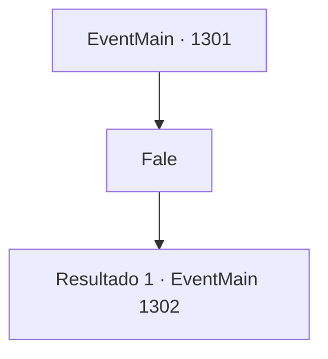

# Eventos principais · 1301

[Índice da tabela](index.md) · [Índice geral](../index.md)

ID: `pt:EventMain:1301` · Fonte: `EventMain4` · Versão: 1.2.47.

Mapeamento estático dos arquivos; a disponibilidade e a execução dependem do estado da run.

## Texto do evento

*Sem texto no arquivo.*

## Dados de entrada

```json
{
  "id": 1301,
  "grade": 1,
  "normalGoal": "",
  "required": ""
}
```

## Mapa das escolhas



## Escolhas e resultados

### Escolha 1

Fale

Requisitos e outros campos da escolha:

```json
{
  "required": ""
}
```

#### Resultado 1.1

Você levanta o queixo para deixá-lo falar. O mensageiro olha ao redor cuidadosamente antes de continuar. 

 "...Se você liderar seu exército e atacar o posto avançado, nós atearemos fogo em nossas tendas e recuaremos imediatamente."

 Isso significa que a Casa Nadasdy trairá a Aliança. Você pergunta ao mensageiro o que eles querem em troca. 

 "Tudo o que o Conde Nadasdy deseja é que esta guerra sem sentido termine."

 Ele tira um documento selado com o sigilo dos Nadasdy e entrega a você.

Continuação registrada: [Evento 1302](1302.md) na mesma tabela.

```json
{
  "required": "",
  "chance": "1",
  "nextEvent": 1302,
  "type": 2,
  "reward": "3_389_1"
}
```

## Referências que chegam a este evento

- [Evento 1300 · escolha 1 · resultado 1](1300.md#escolha-1)
