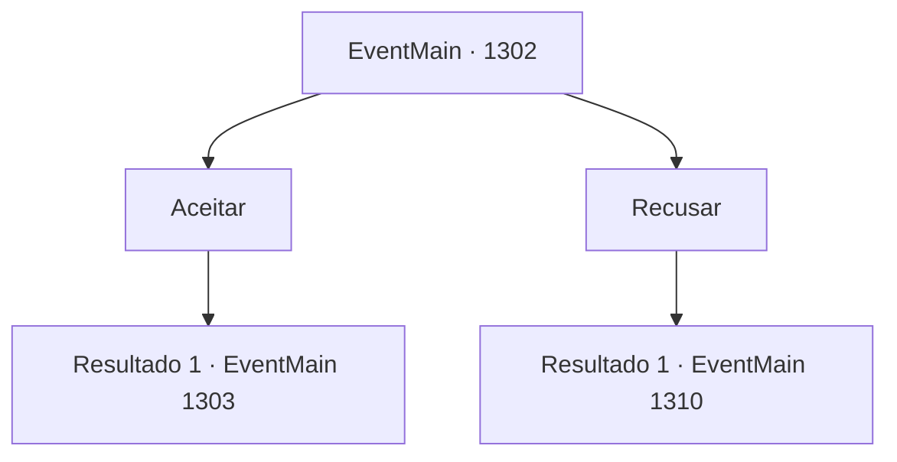

# Eventos principais · 1302

[Índice da tabela](index.md) · [Índice geral](../index.md)

ID: `pt:EventMain:1302` · Fonte: `EventMain4` · Versão: 1.2.47.

Mapeamento estático dos arquivos; a disponibilidade e a execução dependem do estado da run.

## Texto do evento

*Sem texto no arquivo.*

## Dados de entrada

```json
{
  "id": 1302,
  "grade": 1,
  "normalGoal": "",
  "required": ""
}
```

## Mapa das escolhas



## Escolhas e resultados

### Escolha 1

Aceitar

Requisitos e outros campos da escolha:

```json
{
  "required": ""
}
```

#### Resultado 1.1

Você aceita a oferta do Conde Nadasdy. Em seguida, você informa o mensageiro sobre o horário do seu ataque - três dias depois, à meia-noite. 

 "Agradecemos por sua misericórdia."

 O mensageiro pega o documento de você e deixa o castelo. 

 Passam-se alguns dias, e o dia prometido chega. O posto avançado no morro brilha tenuemente sob o luar. Você lidera seus homens e conduz a investida contra os portões frontais. Nesse momento, chamas começam a surgir além dos portões do posto avançado. Fumaça e fogo se erguem, e você nota soldados da Casa Nadasdy recuando lentamente. 

 "INIMIGO À VISTA!"

 O resto da Aliança prepara apressadamente suas armas, correndo para o portão frontal para repelir seu ataque.

Continuação registrada: [Evento 1303](1303.md) na mesma tabela.

```json
{
  "required": "",
  "chance": "1",
  "nextEvent": 1303,
  "type": 2,
  "reward": "6_2_204",
  "place": 13
}
```

### Escolha 2

Recusar

Requisitos e outros campos da escolha:

```json
{
  "required": ""
}
```

#### Resultado 2.1

Você recusa a oferta do Conde Nadasdy. O mensageiro tenta convencê-lo mais algumas vezes antes de desistir e voltar ao posto avançado. 

 Dias se passam, e ainda assim a Aliança não dá sinais de movimento ou ação. Não importa quantos batedores e emboscadas você envie, tudo o que fazem é defender e proteger. Você até começa a ouvir rumores sobre a Aliança estar indo embora. 

 "Eles sofreram duas derrotas seguidas. Eu não ficaria surpreso se estiverem com medo de fazer o primeiro movimento."

 Rennart examina os relatórios dos batedores e acrescenta. 

 "Se eles abandonarem o atual ponto de contestação, essa guerra pode levar a um longo cerco. Algo que testará a paciência de ambos os lados. Teríamos que pensar em uma opção caso isso venha a acontecer."

 Você termina sua conversa com Rennart e vai para seu quarto descansar. Ao deitar na cama confortável, a fadiga começa a tomar conta lentamente. 

 *coçar*... *rangido*... 

 A brisa fria da noite passa por você. Mas então, você lembra que nunca abriu as janelas. Imediatamente, sente algo no escuro olhando para você.

Continuação registrada: [Evento 1310](1310.md) na mesma tabela.

```json
{
  "required": "",
  "chance": "1",
  "nextEvent": 1310,
  "type": 2,
  "reward": ""
}
```

## Referências que chegam a este evento

- [Evento 1301 · escolha 1 · resultado 1](1301.md#escolha-1)
