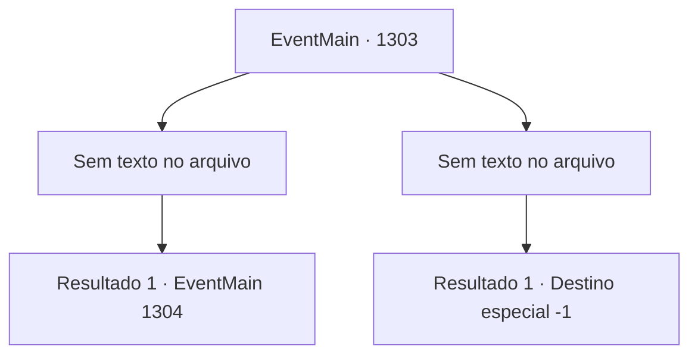

# Eventos principais · 1303

[Índice da tabela](index.md) · [Índice geral](../index.md)

ID: `pt:EventMain:1303` · Fonte: `EventMain4` · Versão: 1.2.47.

Mapeamento estático dos arquivos; a disponibilidade e a execução dependem do estado da run.

## Texto do evento

*Sem texto no arquivo.*

## Dados de entrada

```json
{
  "id": 1303,
  "grade": 1,
  "normalGoal": "",
  "required": ""
}
```

## Mapa das escolhas



## Escolhas e resultados

### Escolha 1

*Sem texto no arquivo; o papel dessa opção depende da interface do jogo.*

Requisitos e outros campos da escolha:

```json
{
  "required": ""
}
```

#### Resultado 1.1

Você limpa o sangue na sua bochecha com o dorso da mão e olha ao redor lentamente. O resultado de uma emboscada à meia-noite e de uma traição interna equivale a um posto avançado a menos. À exceção do soldado da Casa Nadasdy, a maioria está no chão, morta. Os poucos cavaleiros sobreviventes são reunidos e executados também. Você observa o posto avançado destruído, ouvindo um relatório de Rennart. 

 "Terminamos de executar os prisioneiros, e nossos soldados estão saqueando suprimentos e armas."

 Você dá aos seus soldados uma breve pausa, então segue direto para o Castelo Greymoor. Você sabe que enquanto o líder da Aliança, a Casa Greymoor, permanecer intacto, a guerra nunca terminará. Alguns dias depois, você chega ao Castelo Greymoor, apenas para encontrar seus portões frontais fechados em silêncio. Os portões estão trancados firmemente, e os soldados no alto das muralhas do castelo olham para você nervosos.

Continuação registrada: [Evento 1304](1304.md) na mesma tabela.

```json
{
  "required": "",
  "chance": "1",
  "nextEvent": 1304,
  "type": 2,
  "reward": ""
}
```

### Escolha 2

*Sem texto no arquivo; o papel dessa opção depende da interface do jogo.*

Requisitos e outros campos da escolha:

```json
{
  "required": ""
}
```

#### Resultado 2.1

No meio do pânico da batalha, você sente uma dor queimação no torso. Uma lança entrou na sua carne. 

 "D- MORRA!!"

 Você quebra a ponta da lança e acerta a mandíbula do soldado. Então, você se ajoelha, segurando sua ferida. 

 "...Meu Senhor! Você está bem?"

 Rennart corre em seu auxílio, mas sua consciência já está se apagando rapidamente. Por fim, você dá seu último suspiro no campo de batalha.

Continuação registrada: [Destino especial `-1`](../destinos-especiais.md).

```json
{
  "required": "",
  "chance": "1",
  "nextEvent": -1,
  "type": 2,
  "reward": "15_7_26|0_0_-1|0_1_-1|25_8_1"
}
```

## Referências que chegam a este evento

- [Evento 1302 · escolha 1 · resultado 1](1302.md#escolha-1)
