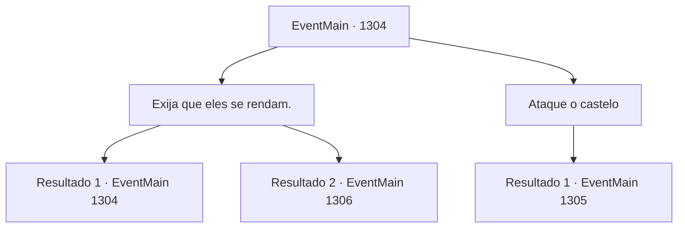

# Eventos principais · 1304

[Índice da tabela](index.md) · [Índice geral](../index.md)

ID: `pt:EventMain:1304` · Fonte: `EventMain4` · Versão: 1.2.47.

Mapeamento estático dos arquivos; a disponibilidade e a execução dependem do estado da run.

## Texto do evento

*Sem texto no arquivo.*

## Dados de entrada

```json
{
  "id": 1304,
  "grade": 1,
  "normalGoal": "",
  "required": ""
}
```

## Mapa das escolhas



## Escolhas e resultados

### Escolha 1

Exija que eles se rendam.

Requisitos e outros campos da escolha:

```json
{
  "required": "5_967_0"
}
```

#### Resultado 1.1

Você avança até a linha de frente e exige que se rendam. Mas mesmo após um longo período de tempo, o portão não se abre. Tudo o que resta é um impasse silencioso, porém intenso, entre os dois exércitos.

Continuação registrada: [Evento 1304](1304.md) na mesma tabela.

```json
{
  "required": "18_968_1",
  "chance": "1",
  "nextEvent": 1304,
  "type": 1,
  "reward": "5_967_1"
}
```

#### Resultado 1.2

Você avança para a linha de frente e exige que eles se rendam. Segue-se um breve silêncio. Logo, o portão principal do Castelo Greymoor se abre lentamente. Você conduz seus soldados e entra orgulhosamente no Castelo Greymoor. Os soldados inimigos baixaram suas armas, permanecendo ali abatidos. Você vai direto para a torre do castelo. A Torre de Greymoor, onde reside o castelão do castelo, está totalmente aberta. 

 "...Briovich."

 Katrin aparece pela porta aberta. Ao lado dela está o Conde Bathory, acompanhado também pelo Conde Raziviu. Juntos, vocês entram no escritório. Então, você senta-se onde Katrin costumava sentar. Ela faz o possível para manter a compostura, mas você percebe que suas sobrancelhas estão tremendo.

Continuação registrada: [Evento 1306](1306.md) na mesma tabela.

```json
{
  "required": "5_968_1",
  "chance": "1",
  "nextEvent": 1306,
  "type": 2,
  "reward": ""
}
```

### Escolha 2

Ataque o castelo

Requisitos e outros campos da escolha:

```json
{
  "required": "5_967_1"
}
```

#### Resultado 2.1

Você ordena que seus soldados ataquem, liderando a investida para o Castelo Greymoor. Uma chuva de flechas cai das muralhas. Gritos e clamores enchem o ar. Você derrota seus inimigos um a um, ascendendo pelas paredes do castelo. É caos também no topo das muralhas. Alguns soldados estão derramando óleo em chamas e areia para impedir os atacantes. Outros lutam contra os soldados que já terminaram de subir, pedindo reforços. Então, um cavaleiro de meia-idade aparece diante de você. Você nota o brasão da Casa Greymoor nessa armadura ensanguentada. Você sabe seu nome. Sir Wojciech. Um cavaleiro leal a Katrin, que serviu à Casa Greymoor desde o governo do seu pai. 

 "Receio que seja até aqui que você irá, Briovich."

 Você não responde, apenas recupera o fôlego para se preparar para a luta. Então, você dá um passo poderoso à frente, arremetendo contra ele.

Continuação registrada: [Evento 1305](1305.md) na mesma tabela.

```json
{
  "required": "",
  "chance": "1",
  "nextEvent": 1305,
  "type": 2,
  "reward": "6_0_205",
  "place": 4
}
```

## Referências que chegam a este evento

- [Evento 1303 · escolha 1 · resultado 1](1303.md#escolha-1)
- [Evento 1304 · escolha 1 · resultado 1](1304.md#escolha-1)
- [Evento 1332 · escolha 1 · resultado 1](1332.md#escolha-1)
- [Evento 1337 · escolha 1 · resultado 1](1337.md#escolha-1)
- [Evento 1338 · escolha 1 · resultado 1](1338.md#escolha-1)
