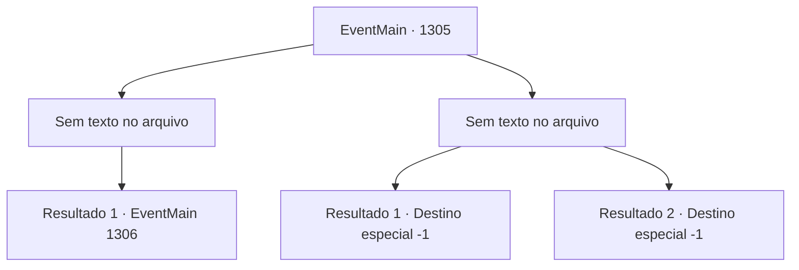

# Eventos principais · 1305

[Índice da tabela](index.md) · [Índice geral](../index.md)

ID: `pt:EventMain:1305` · Fonte: `EventMain4` · Versão: 1.2.47.

Mapeamento estático dos arquivos; a disponibilidade e a execução dependem do estado da run.

## Texto do evento

*Sem texto no arquivo.*

## Dados de entrada

```json
{
  "id": 1305,
  "grade": 1,
  "normalGoal": "",
  "required": ""
}
```

## Mapa das escolhas



## Escolhas e resultados

### Escolha 1

*Sem texto no arquivo; o papel dessa opção depende da interface do jogo.*

Requisitos e outros campos da escolha:

```json
{
  "required": ""
}
```

#### Resultado 1.1


 "*tosse*... Argh..."

 O temível duelo termina com Wojciech derramando sangue primeiro. Você limpa o sangue da sua arma e olha ao redor. A batalha no topo das muralhas do castelo está chegando ao fim. 

 "Meu senhor, assegurei um caminho para o castelo interior."

 Você conduz Rennart e seus soldados para o castelo interior. O castelo interior não dura mais do que algumas horas, com a maior parte do seu efetivo desaparecida. Você resolve a última linha de resistência e segue para a torre de menagem. Torre de Greymoor, onde reside o castelão do castelo, está totalmente aberta. 

 "...Briovich."

 Katrin aparece pela porta aberta. Ao lado dela está o Conde Bathory, acompanhado também pelo Conde Raziviu. Juntos, vocês entram no escritório. Então, você se senta onde Katrin costumava se sentar. Ela faz o possível para manter a compostura, mas você nota que suas sobrancelhas tremem.

Continuação registrada: [Evento 1306](1306.md) na mesma tabela.

```json
{
  "required": "",
  "chance": "1",
  "nextEvent": 1306,
  "type": 2,
  "reward": ""
}
```

### Escolha 2

*Sem texto no arquivo; o papel dessa opção depende da interface do jogo.*

Requisitos e outros campos da escolha:

```json
{
  "required": ""
}
```

#### Resultado 2.1

A espada longa de Sir Wojciech dobra-se em um ângulo estranho. Então, você perde o equilíbrio e é derrubado de joelhos. Você olha para cima. Wojciech balança sua arma contra você sem piedade. Você tenta desviar da arma reluzente, mas seus membros não obedecem. 

 "...Meu Senhor!!"

 Você ouve a voz de Rennart ao longe. No momento seguinte, a espada de Wojciech perfura o seu coração.

Continuação registrada: [Destino especial `-1`](../destinos-especiais.md).

```json
{
  "required": "5_959_1",
  "chance": "1",
  "nextEvent": -1,
  "type": 2,
  "reward": "15_7_26|0_0_-1|0_1_-1|25_8_1"
}
```

#### Resultado 2.2

A espada longa de Sir Wojciech dobra-se em um ângulo estranho. Então, você perde o equilíbrio e é derrubado de joelhos. Você olha para cima. Wojciech balança sua arma contra você sem piedade. Você tenta desviar da arma reluzente, mas seus membros não obedecem. 

 "...Meu Senhor!!"

 Você ouve a voz de Rennart ao longe. No momento seguinte, a espada de Wojciech perfura o seu coração.

Continuação registrada: [Destino especial `-1`](../destinos-especiais.md).

```json
{
  "required": "18_959_1",
  "chance": "1",
  "nextEvent": -1,
  "type": 2,
  "reward": "15_7_11|0_0_-1|0_1_-1|25_8_1"
}
```

## Referências que chegam a este evento

- [Evento 1304 · escolha 2 · resultado 1](1304.md#escolha-2)
