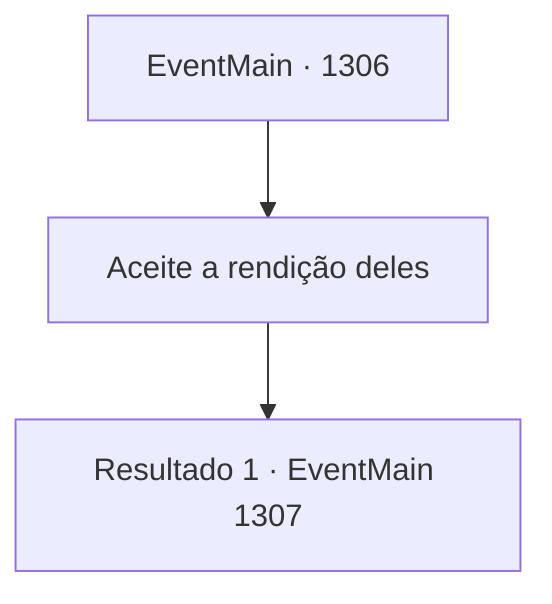

# Eventos principais · 1306

[Índice da tabela](index.md) · [Índice geral](../index.md)

ID: `pt:EventMain:1306` · Fonte: `EventMain4` · Versão: 1.2.47.

Mapeamento estático dos arquivos; a disponibilidade e a execução dependem do estado da run.

## Texto do evento

*Sem texto no arquivo.*

## Dados de entrada

```json
{
  "id": 1306,
  "grade": 1,
  "normalGoal": "",
  "required": ""
}
```

## Mapa das escolhas



## Escolhas e resultados

### Escolha 1

Aceite a rendição deles

Requisitos e outros campos da escolha:

```json
{
  "required": ""
}
```

#### Resultado 1.1

Você exige que os nobres se rendam. Katrin e os demais se ajoelham diante de você e se curvam. 

 "...Você vence. Admitimos nossa derrota."

 Você ordena a Rennart que redija um contrato. Rennart coloca um pedaço de papel sobre a escrivaninha e começa a escrever com sua pena. Escrito no documento estão os termos do contrato, exigindo que a Aliança faça uma compensação financeira à Casa Briovich por todos os danos causados, e um juramento de pacificação — as Casas jamais, sob quaisquer circunstâncias, deverão praticar qualquer ato hostil contra a Casa Briovich no futuro. Rennart finaliza o contrato e o empurra em direção a Katrin. Ela pega sua pena, com as mãos trêmulas. Em seguida, ela assina seu nome no rodapé do documento. O Conde Bathory e o Conde Raziviu fazem o mesmo. Cera vermelha é derramada sobre o documento, e os sigilos das Casas nobres são carimbados nele.

Continuação registrada: [Evento 1307](1307.md) na mesma tabela.

```json
{
  "required": "",
  "chance": "1",
  "nextEvent": 1307,
  "type": 2,
  "reward": ""
}
```

## Referências que chegam a este evento

- [Evento 1304 · escolha 1 · resultado 2](1304.md#escolha-1)
- [Evento 1305 · escolha 1 · resultado 1](1305.md#escolha-1)
