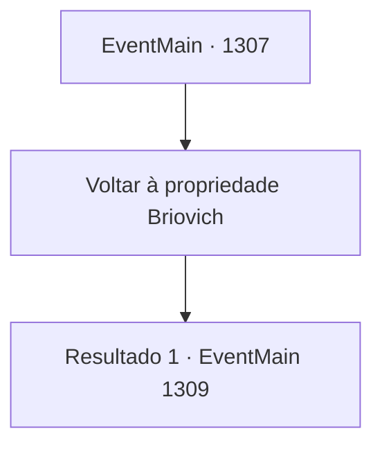

# Eventos principais · 1307

[Índice da tabela](index.md) · [Índice geral](../index.md)

ID: `pt:EventMain:1307` · Fonte: `EventMain4` · Versão: 1.2.47.

Mapeamento estático dos arquivos; a disponibilidade e a execução dependem do estado da run.

## Texto do evento

*Sem texto no arquivo.*

## Dados de entrada

```json
{
  "id": 1307,
  "grade": 1,
  "normalGoal": "",
  "required": ""
}
```

## Mapa das escolhas



## Escolhas e resultados

### Escolha 1

Voltar à propriedade Briovich

Requisitos e outros campos da escolha:

```json
{
  "required": ""
}
```

#### Resultado 1.1

Você pega o documento de rendição e deixa o Castelo Greymoor. 

 Quando finalmente chega ao Castelo Briovich, encontra os portões escancarados. Os moradores da propriedade estão alinhados ao longo da estrada, celebrando seu retorno vitorioso. Você os observa de dentro da carroça, passando lentamente pelo portão do castelo. |drawing_royal| Atrás de você, ouve os passos de seus soldados e os cumprimentos dos moradores se misturando em um grande brado. À noite, um banquete é realizado para celebrar sua vitória. Você se lembra de que faz tempo desde que vinho e carne preencheram o salão de banquetes. Pedaços de carne, cozidos à perfeição em fornos, preenchem os pratos. Barris de vinho são abertos um por um. Os soldados trocam taças, rindo. Um deles começa a cantar, e os outros se juntam batendo as mesas em ritmo. Você se senta no centro, assistindo a cena se desenrolar. Rennart senta ao seu lado, bebendo vinho de sua taça. Mas você percebe que o olhar dele está em outro lugar. Ele sorri de forma desconfortável, como se tivesse sentido seu olhar sobre ele. 

 "Ah, peço desculpas."

 Ele começa a bater levemente a mesa com os dedos. 

 "Estava pensando no que fazer com o ouro compensatório das Casas nobres."

 Os dedos dele se desenrolam, um a um. 

 "Precisamos de um novo alistamento para recompor o efetivo, precisamos também de novos vassalos e cavaleiros. Também temos que comprar mais cavalos, equipamentos melhores... Ah, sem falar nas reparações das muralhas do castelo."


Continuação registrada: [Evento 1309](1309.md) na mesma tabela.

```json
{
  "required": "",
  "chance": "1",
  "nextEvent": 1309,
  "type": 2,
  "reward": "5_961_1"
}
```

## Referências que chegam a este evento

- [Evento 1306 · escolha 1 · resultado 1](1306.md#escolha-1)
