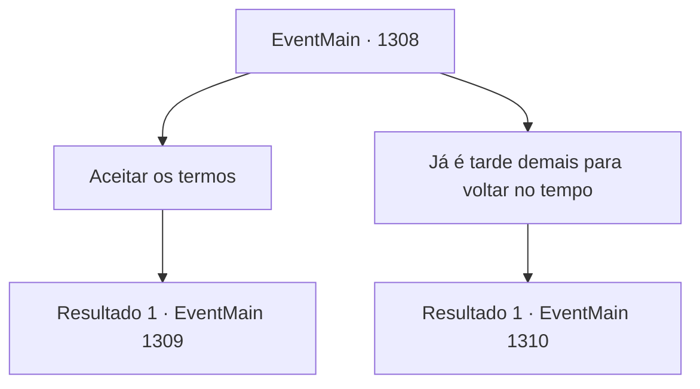

# Eventos principais · 1308

[Índice da tabela](index.md) · [Índice geral](../index.md)

ID: `pt:EventMain:1308` · Fonte: `EventMain4` · Versão: 1.2.47.

Mapeamento estático dos arquivos; a disponibilidade e a execução dependem do estado da run.

## Texto do evento

*Sem texto no arquivo.*

## Dados de entrada

```json
{
  "id": 1308,
  "grade": 1,
  "normalGoal": "",
  "required": ""
}
```

## Mapa das escolhas



## Escolhas e resultados

### Escolha 1

Aceitar os termos

Requisitos e outros campos da escolha:

```json
{
  "required": ""
}
```

#### Resultado 1.1

Você aceita a oferta deles e concorda com uma negociação. Quatro dias depois, a negociação é realizada nas Planícies de Roskar - corre suavemente, sem nenhum contratempo. A Aliança concorda com uma compensação financeira. As Casas também assinam um tratado de paz mútuo, finalmente pondo fim à guerra. Com as negociações terminadas, você primeiro envia um mensageiro para a Propriedade Briovich. Então, você reúne seus homens e retorna a Briovich. 

 Quando você finalmente chega ao Castelo Briovich, encontra os portões escancarados. Os moradores da propriedade estão alinhados ao lado da estrada, celebrando seu retorno vitorioso. Você os observa de dentro da carroça, passando lentamente pelo portão do castelo. |drawing_royal| Atrás de você, ouve-se os passos dos seus soldados e os cumprimentos dos moradores se misturando em um grande brado. À noite, é realizado um banquete para celebrar sua vitória. Você se lembra de que fazia tempo que vinho e carne não enchiam o salão principal. Pedaços de carne, cozidos à perfeição em fornos, preenchem os pratos. Barris de vinho são abertos um a um. Os soldados trocam taças, rindo. Um deles começa a cantar, e os outros se juntam batendo nas mesas em ritmo. Você se senta no centro, observando a cena se desenrolar. Rennart senta-se ao seu lado, bebendo vinho de sua taça. Mas seu olhar está em outro lugar, você percebe. Ele sorri sem jeito, como se tivesse sentido seu olhar sobre ele. 

 "Ah, peço desculpas."

 Ele começa a bater levemente na mesa com os dedos. 

 "Estava pensando no que fazer com o ouro de compensação das Casas nobres."

 Seus dedos se estendem, um a um. 

 "Precisamos de uma nova conscrição para reabastecer a força de homens, precisamos também de novos vassalos e cavaleiros. Também temos que comprar mais cavalos, equipamentos melhores... Ah, sem falar nas reparações das muralhas do castelo."


Continuação registrada: [Evento 1309](1309.md) na mesma tabela.

```json
{
  "required": "",
  "chance": "1",
  "nextEvent": 1309,
  "type": 2,
  "reward": "5_960_1"
}
```

### Escolha 2

Já é tarde demais para voltar no tempo

Requisitos e outros campos da escolha:

```json
{
  "required": ""
}
```

#### Resultado 2.1

Você recusa a oferta, dizendo que é tarde demais para negociações. Katrin o encara sem dizer uma palavra, e logo parte em sua carruagem. 

 Dias se passam, e ainda assim a Aliança não dá sinais de movimento ou ação. Por mais batedores e emboscadas que você envie em direção a eles, tudo o que fazem é se defender e proteger. Você até começa a ouvir rumores de que a Aliança está se retirando. 

 "Eles sofreram duas derrotas seguidas. Eu não ficaria surpreso se tiverem medo de fazer o primeiro movimento."

 Rennart examina os relatórios dos batedores e acrescenta. 

 "Se eles abandonarem o ponto de contestação atual, esta guerra pode se transformar em um longo cerco. Algo que testará a paciência de ambos os lados. Teríamos que pensar em uma opção caso isso venha a acontecer."

 Você termina a discussão com Rennart e vai para seu quarto descansar. Ao deitar na cama confortável, o cansaço começa a tomar conta lentamente. 

 *raspar*... *rangido*... 

 A brisa fria da noite passa por você. Mas então, você se lembra de que não abriu as janelas. Imediatamente, você sente algo no escuro olhando para você.

Continuação registrada: [Evento 1310](1310.md) na mesma tabela.

```json
{
  "required": "",
  "chance": "1",
  "nextEvent": 1310,
  "type": 2,
  "reward": ""
}
```

## Referências que chegam a este evento

- [Evento 1300 · escolha 1 · resultado 2](1300.md#escolha-1)
