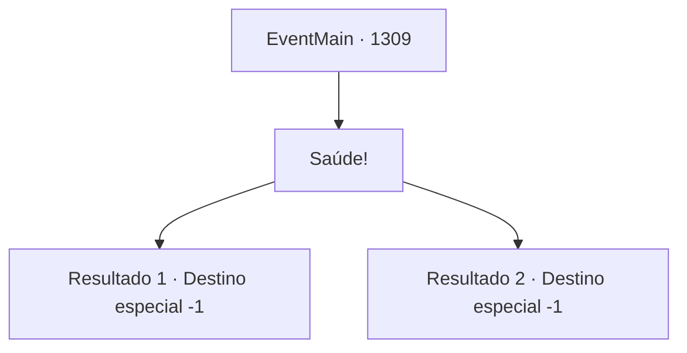

# Eventos principais · 1309

[Índice da tabela](index.md) · [Índice geral](../index.md)

ID: `pt:EventMain:1309` · Fonte: `EventMain4` · Versão: 1.2.47.

Mapeamento estático dos arquivos; a disponibilidade e a execução dependem do estado da run.

## Texto do evento

*Sem texto no arquivo.*

## Dados de entrada

```json
{
  "id": 1309,
  "grade": 1,
  "normalGoal": "",
  "required": ""
}
```

## Mapa das escolhas



## Escolhas e resultados

### Escolha 1

Saúde!

Requisitos e outros campos da escolha:

```json
{
  "required": ""
}
```

#### Resultado 1.1

Você enche novamente o copo dele com vinho, dizendo para ele aproveitar a noite. Em seguida, você ergue seu copo. 

 "Você tem razão. Talvez eu deva fazer isso."

 Rennart sorri e aproxima o copo dele do seu. Um tinido claro ecoa pelo refeitório. Você toma um gole do seu vinho. Um gosto amargo permanece na sua boca.

Continuação registrada: [Destino especial `-1`](../destinos-especiais.md).

```json
{
  "required": "5_960_1",
  "chance": "1",
  "nextEvent": -1,
  "type": 2,
  "reward": "15_7_12"
}
```

#### Resultado 1.2

Você enche novamente o copo dele com vinho, dizendo para ele aproveitar a noite. Então, você levanta seu copo. 

 "Você está certo. Talvez eu deva fazer isso."

 Rennart sorri e encosta o copo dele no seu. Um tilintar claro ecoa pelo refeitório. Você dá um gole do seu vinho. O gosto amargo que persistia desaparece, e um sabor doce permanece na sua boca.

Continuação registrada: [Destino especial `-1`](../destinos-especiais.md).

```json
{
  "required": "5_961_1",
  "chance": "1",
  "nextEvent": -1,
  "type": 2,
  "reward": "15_7_20"
}
```

## Referências que chegam a este evento

- [Evento 1307 · escolha 1 · resultado 1](1307.md#escolha-1)
- [Evento 1308 · escolha 1 · resultado 1](1308.md#escolha-1)
